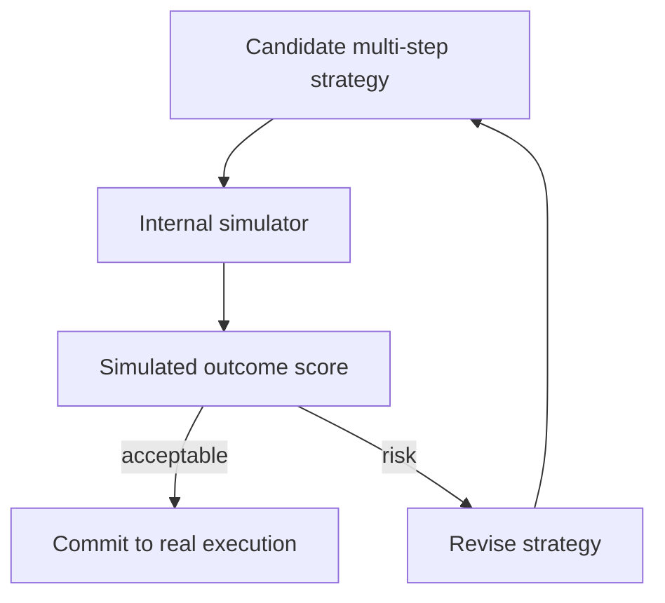

# Mental-Model-In-The-Loop Simulator

**Also known as:** Internal Simulator, Strategy-Test-In-Mental-Model

**Category:** Planning & Control Flow  
**Status in practice:** experimental

## Intent

Run candidate multi-step strategies inside an internal simulator of the environment before committing in the real world — broader than simulate-before-actuate (single action) by simulating multi-step strategies.

## Context

A team has an agent that must commit to multi-step strategies with real-world consequences (trading, infrastructure changes, treatment plans). simulate-before-actuate covers per-action preview; this pattern covers per-strategy preview where multiple steps interact.

## Problem

Per-action preview misses strategy-level interactions: step 2's safety depends on step 1's outcome, which the per-action check cannot see. A strategy that looks fine action-by-action can be disastrous in aggregate. Without a strategy simulator, the agent commits to multi-step strategies blind to their joint effect.

## Forces

- Simulators must model the environment accurately enough to be useful.
- Simulation latency adds to per-strategy decision time.
- Some real-world effects cannot be simulated (external systems, human behavior).

## Therefore

Therefore: maintain an internal simulator (mental model) that the agent runs candidate multi-step strategies against, scoring strategies on simulated aggregate outcome before committing any real action.

## Solution

Maintain a simulator of the relevant environment slice — could be a learned world model, a deterministic state machine, a what-if engine. Before committing to a strategy, run it in the simulator and score the simulated outcome. Reject strategies that simulate to bad outcomes. Pair with simulate-before-actuate (single-action), dry-run-harness (whole-plan preview), world-model-as-tool, world-model-graph-memory.

## Structure

```
Candidate multi-step strategy --> Strategy runner in internal simulator (world model / state machine / what-if engine) --> Outcome scorer --acceptable--> commit to real execution. Outcome scorer --risk--> revise strategy --> simulate again
```

## Diagram



## Example scenario

A trading agent considers a 5-step strategy: [sell A, buy B, hedge C, wait T, rebalance]. Simulator runs the strategy against a market state model. Simulated outcome: 90% of paths see acceptable P&L, but 10% trigger margin call at step 4. Strategy revised before any real trade fires. simulate-before-actuate would have approved each individual trade.

## Consequences

**Benefits**

- Catches multi-step interaction failures simulate-before-actuate misses.
- Strategy can be revised before any real commit.
- Simulation outcomes are auditable evidence of pre-commit reasoning.

**Liabilities**

- Simulator fidelity dominates — bad simulators give bad signals.
- Simulation latency adds to per-strategy decision time.
- Some real-world effects (external state, humans) are not simulatable.

## Failure modes

- Low-fidelity simulator — the simulator models the environment badly, and a strategy that scores well fails in the real world.
- Out-of-scope effects — the strategy depends on humans or external state the simulator cannot model, and the score ignores them.
- Simulation delay — each candidate strategy waits on a slow simulation, and the decision arrives too late to matter.
- Overclaimed scope — the simulator is treated as covering more of the environment than declared, and its pass is read as full safety.

## What this pattern constrains

No multi-step strategy commits without simulator scoring; simulator scope is declared and limited (does not claim to simulate what it cannot).

## Applicability

**Use when**

- Multi-step strategies with material consequences.
- Simulator of sufficient fidelity is available.
- Latency budget allows simulation pass per strategy.

**Do not use when**

- Single-action decisions (use simulate-before-actuate).
- Environment cannot be simulated meaningfully.
- Per-strategy latency cannot absorb simulation pass.

## Components

- Simulator — model of environment relevant slice
- Strategy runner — applies candidate strategy in simulation
- Outcome scorer — judges simulated aggregate result
- Revise loop — modifies strategy on bad simulation

## Tools

- Environment simulator
- Strategy runner
- Outcome scorer

## Evaluation metrics

- Pre-commit reject rate (strategies rejected after sim)
- Simulator vs real outcome divergence
- Strategy-revision count per commit

## Known uses

- **[Joakim Vivas: 17 Patrones de Arquitecturas Agénticas de IA (Simulator / Mental-Model-in-the-Loop)](https://www.joakimvivas.com/tech/17-patrones-arquitecturas-agenticas-ia/)** _available_

## Related patterns

- _specialises_ **Simulate Before Actuate**
- _complements_ **Dry-Run Harness**
- _complements_ **World Model as Tool**
- _complements_ **World-Model Graph Memory**
- _complements_ **Planner-Executor-Verifier (PEV)**
- _alternative-to_ **Affordance Grounding Before Action** — The simulator scores multi-step strategy outcomes; the affordance gate scores whether a single candidate action is physically possible right now.
- _complements_ **Physical Hallucination** — Running candidate strategies in an internal simulator before committing is one way to reject the infeasible commands this anti-pattern produces.
- _complements_ **Mirrored Tool Environment** — That simulator scores a candidate strategy the agent is about to execute for real; this one replaces the environment the agent is being trained or measured in.

## References

- [17 Patrones de Arquitecturas Agénticas de IA](https://www.joakimvivas.com/tech/17-patrones-arquitecturas-agenticas-ia/) — 2026
