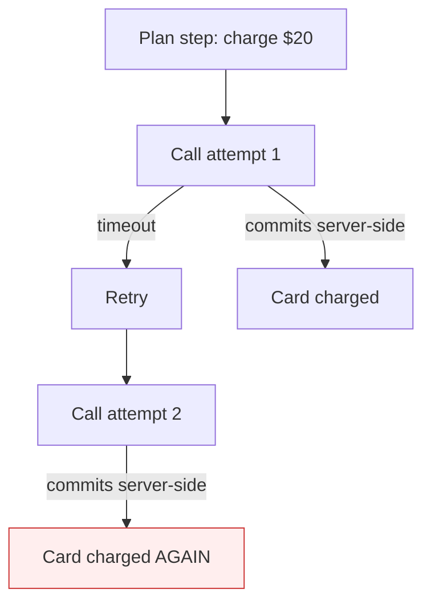

# Missing Idempotency on Agent Calls

**Also known as:** Non-Idempotent Tool Calls, Duplicate Side-Effect Anti-Pattern

**Category:** Anti-Patterns  
**Status in practice:** deprecated

## Intent

Anti-pattern: retry state-mutating agent tool calls without idempotency keys, so retries multiply real-world side effects.

## Context

An agent calls external tools that have side effects (charge card, send email, create ticket, post message). The orchestrator retries on timeout or transient error. The tool wrapper does not enforce idempotency keys and the backing service treats each call as distinct.

## Problem

A timeout that retried succeeds twice on the backend even though the client saw one logical operation. Cards get charged twice, emails get sent twice, duplicate tickets appear. The agent has no way to know which calls already committed. Worse: the retried calls often come from a different attempt loop and use different parameters (a regenerated email body), so deduplication after the fact requires fuzzy matching of natural language.

## Forces

- Network and tool flakiness make retries unavoidable.
- LLMs regenerate the call arguments on retry — the same logical action looks different at the call site.
- Idempotency requires cooperation from the backing service; not all providers support keys.

## Therefore

Therefore: every state-mutating tool call must carry a stable client-generated idempotency key derived from the *logical step* in the agent plan, not from the call attempt.

## Solution

Generate idempotency keys at the planning layer (hash of plan-step id + arguments) and pass them through the tool wrapper. For backings without native idempotency, maintain a client-side dedupe table keyed by (run id, step id). Treat idempotency as a property of the *plan step* not the call, so regenerated arguments still collapse to the same key.

## Structure

```
Anti-pattern: Plan step -> tool call -> timeout -> retry with new arguments -> duplicate side effect. Corrected: Plan step -> idempotency key (hash of step id + arguments) -> tool wrapper / dedupe table (run id, step id) -> one side effect per step.
```

## Diagram



## Example scenario

A billing agent calls `charge_card(amount, customer)` and the call times out. The orchestrator retries. The backend had actually committed the first charge; the retry commits a second. The customer sees two charges. Postmortem finds no idempotency key on the tool wrapper. Fix: derive `idempotency_key = sha(run_id + step_id + amount + customer)` at the planning layer.

## Consequences

**Benefits**

- Short-term: retrying without keys needs no changes to tools or backends and seems to fix flaky calls.
- Naming it lets a team require a stable idempotency key on every state-changing tool call.

**Liabilities**

- Retries produce duplicate side effects: double charges, double messages, duplicate records.
- Reconciliation requires fuzzy matching of regenerated argument shapes.
- Customer trust damage is disproportionate to the engineering effort the fix needs.

## Failure modes

- Double charge — a payment call times out, the agent retries, and the card is charged twice.
- Duplicate messages — a retried send produces two emails, each with a slightly different regenerated body.
- Unknown commit state — the agent cannot tell which earlier calls already took effect, so it repeats them.
- Fuzzy cleanup — duplicates carry different natural-language arguments, so finding them later needs fuzzy matching.

## What this pattern constrains

No useful constraint; the missing constraint is that every state-mutating call carry a stable idempotency key tied to the logical plan step.

## Applicability

**Use when**

- Never. Cite when reviewing tool wrappers for state-mutating APIs.
- Add stable idempotency keys derived from plan-step id, not retry attempt.
- Maintain client-side dedupe table when backing service lacks native idempotency.

**Do not use when**

- Any agent whose state-mutating tool calls lack idempotency keys.
- Any agent whose retry loop generates fresh arguments per attempt.
- Any agent where retries could commit user-visible duplicate operations.

## Components

- Plan step — the logical unit that should commit at most once
- Tool wrapper — currently passes attempt-scoped arguments without idempotency key
- Backing service — treats each request as distinct
- Missing idempotency-key generator — would derive a stable key from the plan step

## Tools

- Detection signal — monitors or audits that surface this anti-pattern in the wild
- Mitigation pattern infrastructure — the positive pattern that resolves this anti-pattern
- Incident-response playbook — what to do when the anti-pattern fires

## Evaluation metrics

- Incident rate — occurrences per period
- Mean time to detection — how long the anti-pattern runs unobserved
- Cost / damage per incident — measurable impact of each occurrence

## Known uses

- **[Production agentic workflow 2026 failure taxonomy (digitalapplied.com)](https://www.digitalapplied.com/blog/agentic-workflow-anti-patterns-orchestration-mistakes-2026)** _available_
- **[Qiita: AIエージェント開発と見過ごされるリソース](https://qiita.com/cvusk/items/8d86fc25f7220759ee66)** _available_

## Related patterns

- _complements_ **Naive Retry Without Backoff**
- _alternative-to_ **Circuit Breaker**
- _complements_ **Compensating Action**
- _complements_ **Durable Workflow Snapshot**
- _complements_ **Exception Handling and Recovery**
- _complements_ **Race Conditions on Shared Tool Resources**
- _complements_ **Hidden State Coupling**
- _complements_ **Scatter-Gather Plus Saga**
- _complements_ **Phantom Action Completion** — Sibling tool-call-reliability anti-pattern at the same boundary: missing-idempotency multiplies real effects on retry, phantom action claims an effect that never happened.

## References

- [Agentic Workflow Anti-Patterns: Orchestration Mistakes (2026)](https://www.digitalapplied.com/blog/agentic-workflow-anti-patterns-orchestration-mistakes-2026) — 2026
- [AIエージェント開発と見過ごされるリソース](https://qiita.com/cvusk/items/8d86fc25f7220759ee66) — 2026
