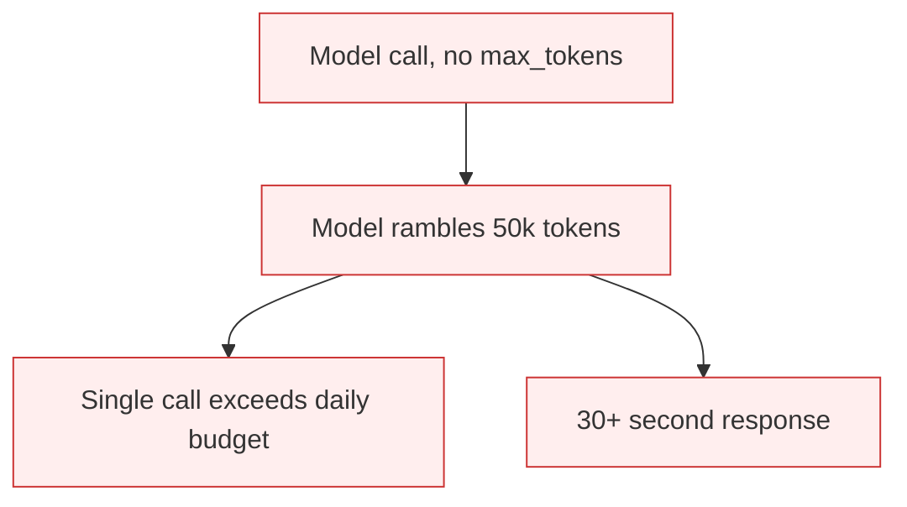

# Missing max_tokens Cap

**Also known as:** Unbounded Output Cap, No Output Budget

**Category:** Anti-Patterns  
**Status in practice:** deprecated

## Intent

Anti-pattern: call the model without an explicit max_tokens (or equivalent) so a single call can drain the run's budget on a runaway generation.

## Context

An agent calls a model that supports a max_tokens parameter (or the SDK exposes one). The call site omits the parameter or sets it to the model's max, on the reasoning that 'the agent wants full answers'.

## Problem

A single hallucinated loop in the output (the model rambling, repeating, or generating filler) consumes the full context budget on one call. This dominates the run cost. Worse, a slow generation locks up the agent thread for tens of seconds. Distinct from step-budget (which caps total agent steps) and cost-gating (which caps total spend) — this is the per-call output cap.

## Forces

- max_tokens defaults vary per SDK; some require explicit setting.
- Engineers underestimate how much a single call can over-produce when the prompt is even slightly off.
- Capping output too aggressively truncates legitimate answers.

## Therefore

Therefore: every model call site sets an explicit max_tokens cap matched to the expected output shape (e.g. 200 for a classification, 2000 for a summary, 8000 for code), and any output that hits the cap triggers an alert, not a silent truncation.

## Solution

Set max_tokens per call site based on output schema. For structured-output schemas, derive the cap from the schema. For prose, use task-class defaults. Alert on cap-hit rate as a quality signal (it indicates undersized cap OR runaway generation). Pair with structured-output and step-budget.

## Structure

```
Anti-pattern: Call site -> model call with no max_tokens -> runaway output -> budget and latency drained. Corrected: Call site -> max_tokens from output schema or task class -> model call -> alert on cap-hit rate.
```

## Diagram



## Example scenario

A summarization agent calls the model without max_tokens. A malformed prompt makes the model produce a 50,000-token rambling answer. One request costs more than the previous day's traffic. Discovered when the model gateway flags the call as anomalous.

## Consequences

**Benefits**

- Short-term: leaving out max_tokens avoids truncated outputs and the work of choosing a value per call site.
- Naming it lets a team separate the per-call output cap from step budgets and total spend caps.

**Liabilities**

- Single runaway call can drain the per-run budget unaided.
- Latency spikes on slow generations block the agent thread.
- Cost-tail attribution is harder because per-call overspend is invisible without tracking.

## Failure modes

- Runaway generation — the model repeats or rambles in one call and uses up the run's budget.
- Thread lock-up — a long, slow generation holds the agent thread for tens of seconds.
- Hidden tail cost — overspend on single calls is not tracked, so the source of the cost tail stays unclear.
- No signal — without a cap, there is no cap-hit rate to show when outputs run away.

## What this pattern constrains

No useful constraint; the missing constraint is per-call output cap matched to expected output shape.

## Applicability

**Use when**

- Never. Cite when reviewing model call sites.
- Set explicit max_tokens per call matched to expected output.
- Alert on cap-hit rate as a quality signal.

**Do not use when**

- Any model call site without explicit max_tokens.
- Any call where a single response could exceed the per-run budget.
- Any structured-output call without max derived from schema.

## Components

- Model call site — omits max_tokens
- Model — generates until natural stop or hard limit
- Missing per-call cap — would bound generation
- Missing cap-hit alerting — would surface undersized or runaway calls

## Tools

- Detection signal — monitors or audits that surface this anti-pattern in the wild
- Mitigation pattern infrastructure — the positive pattern that resolves this anti-pattern
- Incident-response playbook — what to do when the anti-pattern fires

## Evaluation metrics

- Incident rate — occurrences per period
- Mean time to detection — how long the anti-pattern runs unobserved
- Cost / damage per incident — measurable impact of each occurrence

## Known uses

- **[Zenn: 7つのLLM APIコスト削減アンチパターン](https://zenn.dev/kei_concierge/articles/llm-api-cost-antipatterns-2026)** _available_

## Related patterns

- _complements_ **Step Budget**
- _complements_ **Cost Gating**
- _complements_ **Structured Output**
- _complements_ **Token-Economy Blindness**
- _complements_ **Unbounded Loop**

## References

- [LLM APIコスト削減の落とし穴](https://zenn.dev/kei_concierge/articles/llm-api-cost-antipatterns-2026) — 2026
