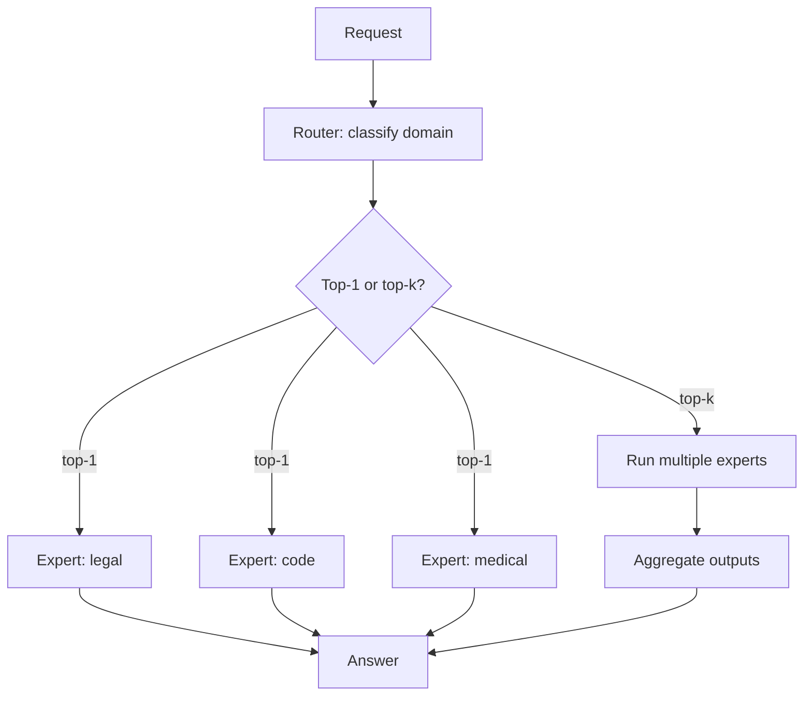

# Mixture of Experts Routing

**Also known as:** MoE Routing (Agent-Level), Expert Selection

**Category:** Routing & Composition  
**Status in practice:** emerging

## Intent

Route each request to one or more domain-expert agents, where each expert holds deep capability in a narrow area.

## Context

A team is building one agent that serves users across several substantially different professional domains — for example legal questions, medical questions, financial planning, and technical support. Each of these domains has its own vocabulary, its own authoritative sources, and its own conventions for what a good answer looks like. A single shared prompt cannot credibly carry deep expertise in all of them at once because the prompt budget and the model's attention are finite.

## Problem

A generalist agent ends up shallow in every domain: it knows enough legal language to sound competent but misses important distinctions a tax specialist would catch, and the same is true on the medical side. Users in specialist domains feel under-served and the team cannot improve any one domain without bloating the shared prompt with material that hurts the others. Adding more general examples does not fix the depth problem because the model is forced to flatten its expertise across the whole surface.

## Forces

- Expert maintenance scales with domain count.
- Routing classification must match expert coverage.
- Cross-domain queries challenge single-expert routing.

## Therefore

Therefore: dispatch each query to one or more deeply specialised expert agents chosen by a domain classifier, so that depth per domain is not flattened into generalist shallowness.

## Solution

Define experts (specialised system prompts, tool palettes, possibly fine-tuned models). A router classifies queries by domain. Route to one expert (top-1) or to multiple experts whose outputs are aggregated. Distinct from standard routing by emphasising deep specialisation per expert.

## Structure

```
Request --> Domain router --top-1--> Expert (own prompt, tools, model) --> Answer | --top-k--> Several experts --> Aggregator --> Answer | --no confident domain--> Generalist fallback --> Answer
```

## Diagram



## Example scenario

A general legal assistant gives shallow answers on tax questions and shallow answers on employment questions because one prompt cannot hold deep knowledge of both. The team adopts mixture-of-experts-routing: a small router classifies each query by domain, and routes to a tax expert (specialised prompt, IRS-publication retrieval, fine-tuned model) or an employment expert (different prompt, NLRB and state-law retrieval). For ambiguous queries it routes to both and aggregates. Per-domain depth improves without bloating any single prompt.

## Consequences

**Benefits**

- Depth per domain.
- Independent expert evolution.

**Liabilities**

- Domain count grows expert maintenance linearly.
- Cross-domain queries fall through cracks.

## Failure modes

- Cross-domain gap — a question that spans tax and law goes to only one expert, and the part outside its domain gets a shallow or wrong answer.
- Router-coverage mismatch — the router knows a domain label that no expert really covers, or an expert grows past what the router sends it.
- Messy aggregation — top-k experts disagree, and the aggregator stitches their outputs into an answer that contradicts itself.
- Fallback as default — the generalist lane catches more and more low-confidence queries, and the system slides back into one shallow agent.

## What this pattern constrains

Each request is bound to one or more named experts; generalist fallback is explicit, not default.

## Applicability

**Use when**

- Users in specialist domains feel under-served by a generalist agent.
- Domain experts can be defined with their own prompts, tools, or fine-tuned models.
- A router can classify queries by domain reliably enough to dispatch.

**Do not use when**

- A generalist agent already meets quality bars across domains.
- Domains overlap so heavily that expert separation just causes thrash.
- Routing classification accuracy is too low to trust dispatch.

## Components

- Domain router — classifier that maps each query to one or more expert labels
- Expert agents — specialised prompts, tool palettes, and possibly fine-tuned models per domain
- Top-k arbiter — decides whether to dispatch to one expert or to several whose outputs will be merged
- Aggregator — combines multi-expert outputs into a single answer for cross-domain queries
- Generalist fallback — explicit lane for queries no expert claims with confidence

## Tools

- Domain classifier — small LLM or fine-tuned model that returns expert labels
- Per-expert retrieval indexes — IRS publications for tax, case law for legal, clinical guidelines for medical
- LLM provider APIs — possibly different models per expert lane
- Aggregation logic — judge prompt, voting, or weighted merge for top-k dispatch

## Evaluation metrics

- Per-expert quality vs the generalist baseline — does each expert actually outperform on its domain
- Router accuracy on a labelled domain test set — share of queries dispatched to the correct expert
- Cross-domain query handling rate — fraction sent to top-k aggregation and the agreement among experts
- Generalist-fallback firing rate — share of traffic no expert confidently claimed
- Expert maintenance cost per domain — eval drift and prompt revisions over time

## Known uses

- **Vendor knowledge-base products with domain agents** _available_

## Related patterns

- _specialises_ **Routing**
- _complements_ **Supervisor**
- _complements_ **Role Assignment**
- _alternative-to_ **Dynamic Expert Recruitment**
- _complements_ **Tool/Agent Registry**
- _alternative-to_ **RL-Trained Conductor Orchestrator**
- _complements_ **Complexity-Based Routing**
- _complements_ **Top-Tier Model For Everything (Cost)**

## References

- [Mixture-of-Agents Enhances Large Language Model Capabilities](https://arxiv.org/abs/2406.04692) — Wang et al., 2024
