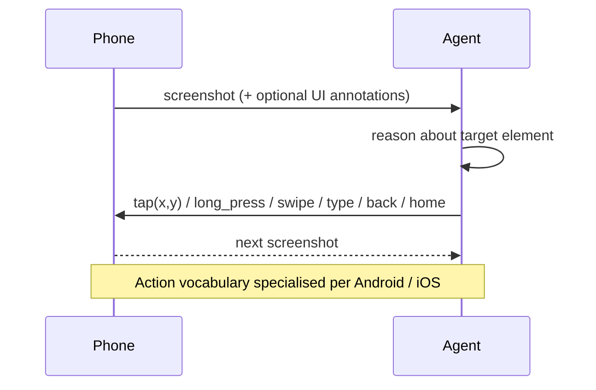

# Mobile UI Agent

**Also known as:** Smartphone Agent, Mobile App Agent, Touch-UI Agent

**Category:** Tool Use & Environment  
**Status in practice:** emerging

## Intent

Drive a smartphone end-to-end through a small, touch-native action vocabulary (tap, long-press, swipe, type, back, home) over screenshots, as a distinct interaction surface from desktop Computer Use and from web Browser Agents.

## Context

A team needs an agent to operate a mobile app on a real or emulated phone: a ride-hailing app, a food delivery app, a banking app, a Chinese super-app. The app exposes no public API and no clean web frontend that mirrors its functionality, so the only surface available is the touch user interface itself.

## Problem

Mouse-and-keyboard action sets borrowed from desktop Computer Use do not match how phones are operated, and the DOM / accessibility tree abstractions used by browser agents do not exist for native mobile apps. Driving the phone purely as pixel coordinates without a touch-shaped action vocabulary leaves the agent reasoning one click at a time over coordinates, which is too low-level to plan with and brittle to screen size, theme, and locale changes.

## Forces

- Mobile actions are touch-native, gesture-based, and screen-coordinate dependent.
- Per-app APIs do not exist; only the UI is available.
- Screen size is small; what fits on one screen does not generalise.
- Visual state is the source of truth, but text is what the model reasons in.

## Therefore

Therefore: define a touch-native action vocabulary (tap, long-press, swipe, type, back, home) over screenshots, so that the agent drives apps that expose no API while keeping the loop platform-agnostic above the gesture layer.

## Solution

Define a touch-native action vocabulary (tap(x,y), long_press(x,y), swipe(dir), type(text), back, home). The agent receives a screenshot (optionally with extracted UI element annotations), reasons in text about which element to act on, emits an action call, and observes the next screenshot. Specialise the action vocabulary per platform (Android vs iOS) but keep the agent loop platform-agnostic.

## Structure

```
Screenshot + history -> agent -> action_call(tap|swipe|type|...) -> device -> next screenshot -> ...
```

## Diagram



## Example scenario

A team tries to reuse their desktop computer-use agent on Android by injecting mouse-and-keyboard actions through ADB. The agent fights the touch interface, mistakes long-press menus for hover tooltips, and cannot find the back button. They rebuild as a mobile-ui-agent: a touch-native action vocabulary (tap, long-press, swipe, type, back, home), screenshots with extracted UI element annotations, and the model reasons about which element to act on instead of which pixel. The agent completes mobile flows like food ordering and ride-booking end to end.

## Consequences

**Benefits**

- Works against any app whose UI is visible, including third-party Chinese super-apps with no APIs.
- Single agent loop generalises across apps once the vocabulary is fixed.
- Vision + small action set is a tractable model footprint.

**Liabilities**

- Coordinate-based taps are brittle to screen size, theme, locale changes.
- Pure-vision grounding mistakes are common; element-annotation pipelines add complexity.
- Sensitive actions (payments, deletions) are easy to mis-fire.

## Failure modes

- Coordinate miss — a tap computed on one screen size or theme lands on the wrong element on another device.
- Misread screen — pure-vision grounding takes a decorative icon for a button, and the agent taps nothing useful or the wrong control.
- Mis-fired sensitive action — a swipe or tap confirms a payment or deletion that the agent meant only to open.
- Platform leak — an Android-only action like back is used on iOS, and the loop stalls on a screen it cannot leave.

## What this pattern constrains

The agent may only emit actions in the registered touch-action vocabulary; arbitrary system or shell access is forbidden by construction.

## Applicability

**Use when**

- The target environment is a smartphone where touch is the only useful input.
- Desktop Computer Use or Browser Agent action sets are the wrong shape for the task.
- A small touch-native vocabulary (tap, swipe, type, back, home) covers the workflow.

**Do not use when**

- The task can be done via a web Browser Agent against the same service.
- Desktop Computer Use is the natural fit and a phone is incidental.
- Pixel-level control without an action vocabulary is acceptable for the use case.

## Components

- Mobile Agent — reasons over screenshots and emits touch-native actions
- Touch Action Vocabulary — small typed set (tap, long_press, swipe, type, back, home)
- Mobile UI Driver — executes actions via ADB on Android or accessibility APIs on iOS
- Screenshot Pipeline — captures frames optionally annotated with extracted UI element bounds
- Platform Adapter — keeps the agent loop platform-agnostic while specialising the action set per OS

## Tools

- Android ADB or appium driver — executes taps, swipes, and key events on real or emulated devices
- iOS accessibility automation — drives the touch action set on iOS targets
- UI element extractor — produces annotated element bounds to augment the raw screenshot

## Evaluation metrics

- Task success on AndroidWorld and similar mobile benchmarks — headline capability
- Tap-coordinate accuracy — fraction of taps landing on the intended element
- Swipe-direction success rate — share of swipes producing the expected scroll or navigation
- Cross-platform parity — delta in task success between Android and iOS runs
- Vision tokens per step — prompt-side cost of feeding screenshots back each loop

## Known uses

- **[AppAgent (Tencent)](https://github.com/TencentQQGYLab/AppAgent)** _available_ — Touch-action vocabulary plus exploration-phase documentation per app.
- **[Mobile-Agent (Alibaba)](https://github.com/X-PLUG/MobileAgent)** _available_ — Vision-first smartphone agent.
- **Mobile-Agent-v2 (Alibaba)** _available_ — Multi-agent mobile assistant: planning, decision, reflection.
- **AutoGLM (Zhipu)** _available_ — Phone agent with decision/grounding split.
- **CogAgent (Tsinghua + Zhipu)** _available_ — Vision-language model purpose-built for GUI screens.

## Related patterns

- _alternative-to_ **Computer Use** — Sibling pattern for desktop UI.
- _alternative-to_ **Browser Agent** — Sibling pattern for web UI.
- _uses_ **Structured Output**
- _complements_ **App Exploration Phase**
- _complements_ **Dual-System GUI Agent**
- _uses_ **Foveated Perception Escalation** — Small screens with dense controls are the case where a coarse view locates a target that it cannot resolve precisely enough to touch.

## References

- [AppAgent: Multimodal Agents as Smartphone Users](https://arxiv.org/abs/2312.13771) — Zhang et al., 2023
- [Mobile-Agent: Autonomous Multi-Modal Mobile Device Agent with Visual Perception](https://arxiv.org/abs/2401.16158) — Wang et al., 2024
- [Mobile-Agent-v2: Mobile Device Operation Assistant with Effective Navigation via Multi-Agent Collaboration](https://arxiv.org/abs/2406.01014) — Wang et al., 2024
