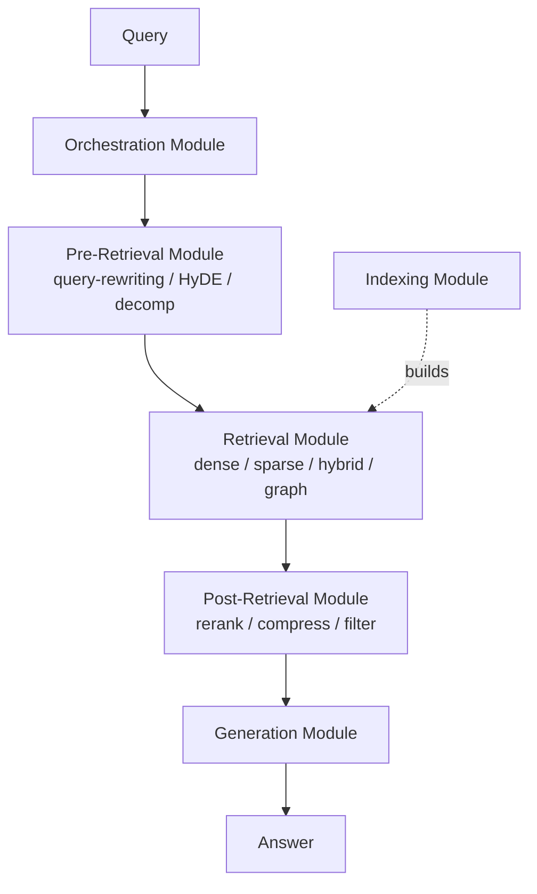

# Modular RAG

**Also known as:** LEGO RAG, Reconfigurable RAG, 模块化RAG, Module-Type / Module / Operator RAG

**Category:** Retrieval & RAG  
**Status in practice:** emerging

## Intent

Decompose RAG into a typed three-layer hierarchy of Module Types, Modules, and Operators so the pipeline (routing, scheduling, fusion, retrieval, post-retrieval, generation) can be rearranged per query rather than running a fixed linear retrieve-then-generate.

## Context

A team has shipped a basic RAG pipeline and the workload has fragmented. Some queries need query rewriting plus reranking; others need a knowledge-graph hop; others want a direct semantic lookup without rerank; some need a routing decision between two corpora. Hard-coding one linear pipeline for the worst-case query wastes latency and cost on the cheap ones, and shipping a second pipeline duplicates everything.

## Problem

A fixed Naive RAG pipeline is too rigid for heterogeneous workloads: every retrieval flows through the same retrieve-rerank-generate stages regardless of query shape, paying the worst-case cost on every request. Forking the pipeline per query type duplicates code, splits operational metrics across pipelines, and loses the ability to share modules. There is no contract between stages, so swapping a reranker, adding a query rewriter, or routing between corpora requires touching the pipeline orchestration directly.

## Forces

- Heterogeneous query mix wants different pipelines, but operating many forked pipelines is expensive.
- Sharing modules across pipelines requires a typed contract between stages.
- Per-query routing and fusion add latency that must be paid for in recall or cost saved elsewhere.
- Reconfigurability invites combinatorial explosion of pipeline shapes that are hard to evaluate.

## Therefore

Therefore: organise the RAG system as Module Types (Indexing, Pre-Retrieval, Retrieval, Post-Retrieval, Generation, Orchestration), each populated by named Modules implemented from typed Operators, so per-query pipelines compose at runtime from a shared inventory.

## Solution

Define six Module Types covering the RAG lifecycle (Indexing, Pre-Retrieval, Retrieval, Post-Retrieval, Generation, Orchestration). Within each, name concrete Modules (e.g. under Pre-Retrieval: Query Rewriting, HyDE, Decomposition). Implement each Module from typed Operators (atomic, swappable steps). At request time, an Orchestration Module assembles a pipeline by picking one Module per stage, possibly with branching, conditional routing, and fusion. Modules expose a typed input/output contract so any compatible Module can swap in; new modules ship without touching orchestration.

## Structure

```
Query --> Orchestration Module (assembles per-request pipeline) --> Pre-Retrieval Module (rewrite / HyDE / decompose) --> Retrieval Module (dense / sparse / hybrid / graph) --> Post-Retrieval Module (rerank / compress / filter) --> Generation Module --> Answer; Indexing Module builds the retrieval stores; each Module is built from typed Operators
```

## Diagram



*Modular RAG organises retrieval as six Module Types; Orchestration picks one Module per stage per request from a shared inventory of typed Operators.*

## Example scenario

A documentation assistant serves three query shapes: lookup queries ('what is the default timeout?'), exploratory queries ('how does the deployment pipeline handle failures?'), and entity-multi-hop queries ('which team owns the service that calls X?'). Under a fixed pipeline, all three pay for query rewriting + dense + sparse + rerank + reasoning. Under Modular RAG, the Orchestration Module routes lookup queries through Retrieval(dense)→Generation only; exploratory queries through Pre-Retrieval(query-rewriting)→Retrieval(hybrid)→Post-Retrieval(rerank)→Generation; multi-hop queries through Retrieval(graph)→Generation. Modules are shared; only the assembled pipeline differs.

## Consequences

**Benefits**

- Per-query pipeline composition — heavy stages pay for themselves only when needed.
- Module reuse across pipelines; one shared inventory replaces N forked pipelines.
- Typed contracts make swapping a reranker or adding a query rewriter a one-line config change.
- Operational metrics aggregate across pipelines per Module, surfacing which Modules earn their cost.

**Liabilities**

- Orchestration complexity — runtime pipeline assembly adds a meta-control surface to debug.
- Combinatorial pipeline space is hard to evaluate exhaustively; eval coverage may lag pipeline shapes.
- Typed contracts impose schema overhead on every Operator boundary.
- Without discipline, the Module inventory grows into a graveyard of near-duplicates.

## Failure modes

- Untested pipeline shape — the orchestrator assembles a module combination no eval has covered, and quality drops on that query type unnoticed.
- Contract mismatch — a swapped module honours the type signature but changes what a field means, and the next stage silently misreads it.
- Module graveyard — near-duplicate rewriters and rerankers pile up, and nobody knows which one a given pipeline uses or why.
- Orchestration as the failure point — the per-request assembly logic picks heavy stages for easy queries, and cost rises instead of falling.

## What this pattern constrains

Pipelines may only be composed from named Modules implementing typed Operator contracts; bespoke retrieval logic outside the Module inventory is forbidden, so all pipeline shapes are inspectable and replaceable.

## Applicability

**Use when**

- The query mix is heterogeneous enough that one linear pipeline overpays on the easy queries.
- Multiple RAG pipelines have started to fork and share their modules informally.
- The team wants per-query routing, fusion, or conditional branching as first-class concerns.
- Module-level eval (recall per Module, cost per Module) is more useful than pipeline-level eval.

**Do not use when**

- The workload is uniform and a single Naive RAG pipeline serves the entire query mix.
- Team capacity cannot maintain a Module inventory plus the orchestration meta-layer.
- Latency budget cannot absorb the per-request orchestration step that picks the pipeline shape.
- Eval coverage cannot expand to match the combinatorial pipeline space.

## Components

- Module Type — the lifecycle stage (Indexing, Pre-Retrieval, Retrieval, Post-Retrieval, Generation, Orchestration)
- Module — a named implementation within a Module Type (e.g. 'Hybrid Search' is a Retrieval Module)
- Operator — atomic swappable building block (e.g. BM25 scorer, RRF fuser, cross-encoder reranker)
- Typed contract — input/output shape every Module implementing a Type must honour
- Orchestration Module — assembles a per-request pipeline from the inventory, with optional branching and fusion

## Tools

- Pipeline orchestration framework — LangGraph, LlamaIndex Workflows, or in-house DAG runner
- Schema enforcement — Pydantic or equivalent to enforce typed Module contracts at boundaries
- Module inventory — registry that tracks each Module's Type, contract version, and eval results

## Evaluation metrics

- Per-Module recall and latency vs. fixed-pipeline baselines
- Per-pipeline cost (sum of Module costs) vs. one-size-fits-all pipeline
- Module reuse ratio — how many distinct pipelines share the same Module
- Orchestration overhead — wall-clock added by per-request pipeline assembly
- Module inventory health — fraction of Modules referenced by at least one shipped pipeline (graveyard detector)

## Known uses

- **[Modular RAG paper reference design (Gao, Xiong, Wang et al., Tongji + Fudan, 2024)](https://arxiv.org/abs/2407.21059)** _available_
- **[LlamaIndex / LangChain advanced retrieval stacks (operator-level swappability)](https://developers.llamaindex.ai/python/framework/module_guides/querying/retriever/)** _available_

## Related patterns

- _generalises_ **Naive RAG**
- _alternative-to_ **Agentic RAG**
- _composes-with_ **Hybrid Search**
- _composes-with_ **Cross-Encoder Reranking**
- _composes-with_ **Query Rewriting**
- _composes-with_ **Hierarchical Retrieval**
- _complements_ **Behavior-Space Architecture** — Modular RAG rearranges modules inside the retrieval subsystem; behavior-space routing decides whether the retrieval subsystem is on the path for a query in the first place.

## References

- [Modular RAG: Transforming RAG Systems into LEGO-like Reconfigurable Frameworks](https://arxiv.org/abs/2407.21059) — Gao, Xiong, Wang, Sun, Bi, Lou, Xiong, Wang, Guo, Zhang, 2024
- [Modular RAG paper — HuggingFace Papers](https://huggingface.co/papers/2407.21059)
- [最全梳理：一文搞懂RAG技术的5种范式](https://cloud.tencent.com/developer/article/2498870)
