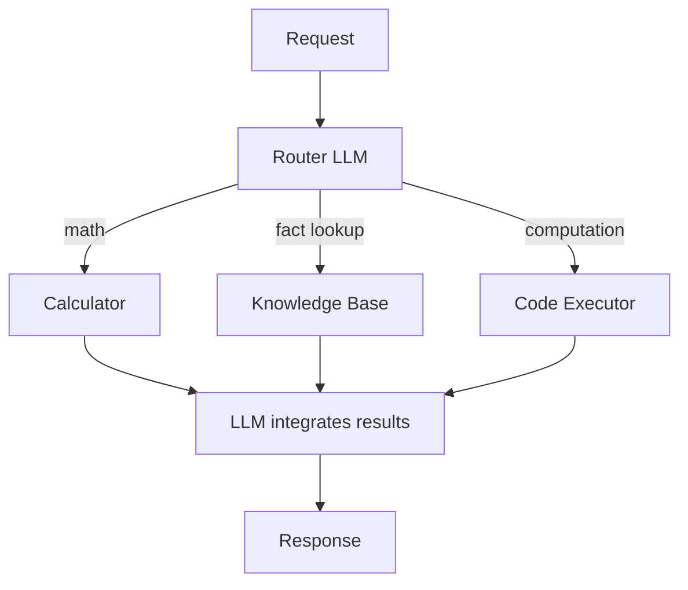

# MRKL Systems (Modular Neuro-Symbolic)

**Also known as:** Modular Reasoning Knowledge and Language, Neuro-Symbolic Router

**Category:** Routing & Composition  
**Status in practice:** mature

## Intent

Route each request through an LLM dispatcher to specialized symbolic or neural expert modules (calculator, knowledge base, code executor) rather than asking one LLM to do everything; integrate the modules' results for the final response.

## Context

An agent faces tasks that combine reasoning (good for LLMs) with operations LLMs are notoriously bad at (exact arithmetic, structured database queries, deterministic computation). Asking the LLM to do all of it produces well-known failures: arithmetic mistakes, table hallucinations, code that doesn't compile.

## Problem

Single-LLM 'do it all' wastes the model on tasks symbolic systems do better, and inherits the LLM's failures on those tasks (calculation errors, fabricated DB facts). Yet rejecting the LLM throws out its reasoning value.

## Forces

- Router design adds an upstream component.
- Expert modules must have callable interfaces.
- Result integration logic is non-trivial when expert outputs are structured.

## Therefore

Therefore: use the LLM as a router/dispatcher to specialized expert modules — symbolic (calculators, databases, formal solvers) or neural (specialist models) — and integrate their results into the LLM's final response.

## Solution

Karpas et al. 2022 — MRKL architecture. (1) Router LLM receives the request, identifies relevant expert modules. (2) Dispatch to each module with structured inputs. (3) Integrate module outputs back into the LLM's reasoning. Expert modules can be calculator (Wolfram Alpha), knowledge base (SQL, vector DB), code executor (Python sandbox), specialist models. Precursor to modern tool-using agents. Pair with tool-use, function-calling, augmented-llm, multi-model-routing, hybrid-symbolic-neural-routing.

## Structure

```
Request --> Router LLM --math--> Calculator | --fact lookup--> Knowledge base | --computation--> Code executor | --specialist--> Expert model --structured results--> LLM integration step --> Response
```

## Diagram



## Example scenario

A research agent gets 'What was Tesla's Q3 2024 revenue, and what's the year-over-year growth rate?' MRKL router dispatches: SQL expert pulls revenue figures from financial DB; calculator expert computes growth rate; LLM integrates and produces 'Tesla's Q3 2024 revenue was $25.18B, growing 7.8% year-over-year.' Asking the LLM alone would risk hallucinating the figures or miscalculating the growth.

## Consequences

**Benefits**

- Exact computation, deterministic DB lookups, and formal reasoning happen in the modules that do them right.
- LLM focuses on what it's good at (language understanding, dispatch, integration).
- Modular structure — adding a new expert is local change.

**Liabilities**

- Router quality dominates: wrong dispatch defeats the purpose.
- Result integration logic for structured module outputs is engineering work.
- Latency overhead from dispatch + module call + integration.

## Failure modes

- Wrong dispatch — the router LLM sends a calculation to the knowledge base or keeps it for itself, and the exact answer the module could give is lost.
- Skipped dispatch — the LLM answers an arithmetic or fact question directly instead of calling the module, and returns a calculation error or made-up fact.
- Bad integration — the module returns correct structured output, but the integration step misreads or paraphrases it wrongly in the final answer.
- Malformed module input — the router builds an input the module cannot parse, and the module errors or computes something else.

## What this pattern constrains

The LLM does not perform tasks the expert modules can perform; dispatch is mandatory for those task classes.

## Applicability

**Use when**

- Tasks mixing reasoning with exact computation or DB lookup.
- Symbolic expert modules available for the relevant operations.
- Router can be trained or prompted reliably.

**Do not use when**

- Pure-language tasks with no symbolic operations.
- No expert modules available.
- Router quality is too low (worse than letting the LLM try).

## Components

- Router LLM — dispatcher
- Expert modules — calculator, KB, code executor, specialist models
- Result-integration LLM step

## Tools

- Router LLM
- Expert modules (calculator, KB, code executor)
- Result-integration LLM step

## Evaluation metrics

- Per-expert dispatch accuracy
- Integration latency
- Hallucinated-fact rate vs LLM-only baseline

## Known uses

- **[Karpas et al. 2022 — 'MRKL Systems' original paper](https://arxiv.org/abs/2205.00445)** _available_
- **[Cited in Bornet et al. Agentic Artificial Intelligence as foundational architecture (ref 12)](https://arxiv.org/abs/2205.00445)** _available_

## Related patterns

- _complements_ **Tool Use**
- _complements_ **Augmented LLM**
- _complements_ **Multi-Model Routing**
- _specialises_ **Hybrid Symbolic-Neural Routing**
- _complements_ **Toolformer**
- _alternative-to_ **Tool-Output Arithmetic Trust** — MRKL routes computation to a symbolic expert (a calculator) instead of asking one model to do the math; this anti-pattern is what happens when that routing is skipped for aggregates over tool data.
- _complements_ **Solver-Ready Formulation Handoff** — That dispatches each request to whichever expert module fits; this is a single fixed handoff whose module is an exact solver and whose output includes a certificate.

## References

- [MRKL Systems: A modular, neuro-symbolic architecture that combines large language models, external knowledge sources and discrete reasoning](https://arxiv.org/abs/2205.00445) — Karpas et al., 2022
