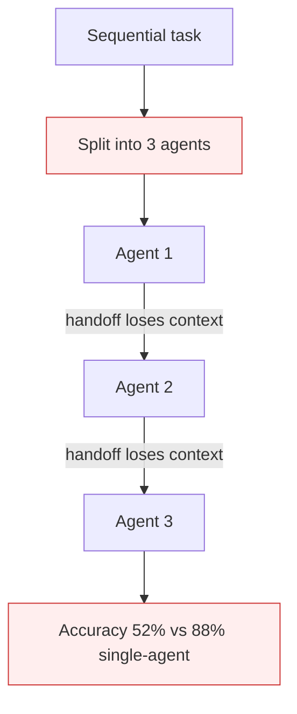

# Multi-Agent on Sequential Workloads

**Also known as:** Multi-Agent Over-Engineering, Pointless Chain Decomposition

**Category:** Anti-Patterns  
**Status in practice:** deprecated

## Intent

Anti-pattern: split a fundamentally sequential workload across multiple agents, degrading accuracy by 39–70% with no parallelization benefit.

## Context

A team has a workflow that is sequential by nature (each step depends on the previous step's output). Pressured by 'multi-agent is the modern way' rhetoric, the team decomposes the workflow into multiple agents with handoffs. The German t3n 2026 quantified analysis: multi-agent only pays when single-agent success >45% AND ≥45% of the workflow is parallelizable.

## Problem

Each agent loses context the previous one had, must re-establish state from handoff messages, and adds a round-trip of latency and cost. Sequential workflows degrade by 39–70% in accuracy under multi-agent decomposition vs single-agent. Cost rises proportionally to handoff count. The decomposition serves neither parallelism nor specialization.

## Forces

- Multi-agent is the prestige architecture in 2026; reviewers ask why a team uses 'only' one agent.
- Sequential workflows look like 'pipelines' which intuitively map to chains-of-agents.
- Per-agent specialization sounds appealing even when context loss costs more than specialization gains.

## Therefore

Therefore: only decompose into multi-agent when (a) ≥45% of the work is genuinely parallelizable AND (b) single-agent baseline already clears ~45% on the task; otherwise keep one agent.

## Solution

Measure single-agent baseline before considering multi-agent. Apply the 45/45 gate: only decompose if both parallelizability and single-agent accuracy clear the threshold. When decomposition is required for non-accuracy reasons (governance, specialization), preserve full context in the handoff message and measure the accuracy delta explicitly. Pair with demo-production-cliff-multiagent awareness.

## Structure

```
Anti-pattern: Sequential task -> split across agents A -> B -> C (handoff messages) -> lost context and lower accuracy. Corrected: Measure single-agent baseline -> 45/45 gate -> single agent, or decompose with full-context handoff and measured accuracy delta.
```

## Diagram



## Example scenario

A team decomposes a 'classify-then-extract-then-summarize' single-agent workflow into 3 specialized agents. Single-agent baseline: 88% end-to-end accuracy. Multi-agent: 52%. Each agent loses the context the previous one had. The 'specialization' did not exceed the context-loss cost. Reverted to single-agent.

## Consequences

**Benefits**

- Short-term: splitting a task across specialised agents looks modular and matches popular multi-agent designs.
- Naming it lets a team require a single-agent baseline before any decomposition.

**Liabilities**

- 39–70% accuracy degradation on sequential workflows under multi-agent decomposition.
- Per-handoff cost overhead with no parallelization gain.
- Engineering effort wasted on multi-agent plumbing for a task that did not need it.

## Failure modes

- Handoff loss — each agent gets only a handoff message and loses context the previous agent had.
- State rebuild — every agent spends effort re-establishing state, and errors creep in at each step.
- Cost per hop — each handoff adds a round-trip of latency and cost with no parallel gain.
- Plumbing waste — the team builds multi-agent machinery for a task one agent would do better.

## What this pattern constrains

No useful constraint; the missing constraint is the 45/45 gate before multi-agent decomposition.

## Applicability

**Use when**

- Never as a default. Cite when reviewing multi-agent decomposition proposals.
- Apply the 45/45 gate: ≥45% parallelizable AND ≥45% single-agent baseline.
- Measure the decomposition's accuracy delta explicitly.

**Do not use when**

- Any workflow whose work is <45% parallelizable.
- Any task where single-agent baseline is below 45% (multi-agent will not save it).
- Any decomposition driven by architectural fashion not by measured benefit.

## Components

- Sequential workflow — cannot benefit from parallelization
- Multi-agent decomposition — adds handoff overhead
- Context-losing handoffs — each agent re-derives state
- Missing 45/45 gate — would have rejected decomposition

## Tools

- Detection signal — monitors or audits that surface this anti-pattern in the wild
- Mitigation pattern infrastructure — the positive pattern that resolves this anti-pattern
- Incident-response playbook — what to do when the anti-pattern fires

## Evaluation metrics

- Incident rate — occurrences per period
- Mean time to detection — how long the anti-pattern runs unobserved
- Cost / damage per incident — measurable impact of each occurrence

## Known uses

- **[t3n: KI-Agenten scheitern nicht am Modell (quantified 39-70% degradation)](https://t3n.de/news/ki-agenten-scheitern-an-architekturfehlern-1730278/)** _available_

## Related patterns

- _complements_ **Demo-Production Cliff (Multi-Agent)**
- _complements_ **Automating a Broken Process**
- _alternative-to_ **Parallelization**
- _alternative-to_ **Augmented LLM**
- _complements_ **Hero Agent**
- _complements_ **One Tool, One Agent**
- _complements_ **Agent Bullwhip Effect** — Sequential degradation loses accuracy when a sequential task is split; the bullwhip amplifies variability across distributed locally-optimising agents.
- _complements_ **Consensus-Averaging Over Expertise** — Sequential degradation loses accuracy splitting a sequential task; consensus-averaging loses it by compromising away the expert's advantage.
- _complements_ **Ghost Delegation** — Sequential degradation loses accuracy splitting a sequential task; ghost delegation loses the subtask entirely when a handoff is dropped.
- _complements_ **Hidden Distributed Monolith (Multi-Agent)** — Sequential degradation is quality decay over a chain; the distributed monolith is the architectural coupling that produces those synchronous chains in the first place.

## References

- [KI-Agenten scheitern nicht am Modell](https://t3n.de/news/ki-agenten-scheitern-an-architekturfehlern-1730278/) — 2026
