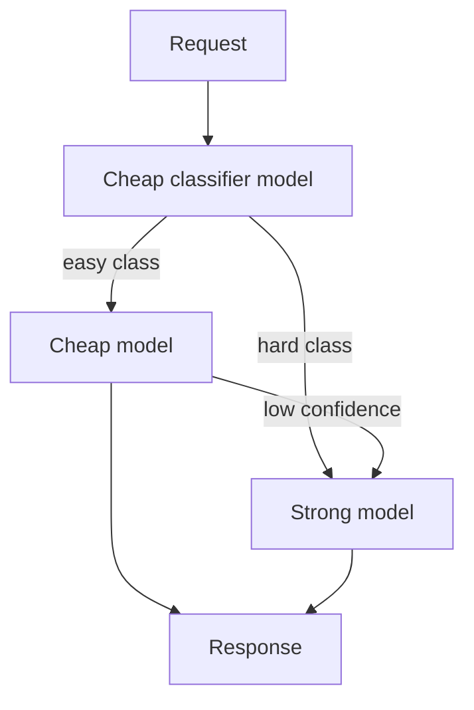

# Multi-Model Routing

**Also known as:** Cascade Routing, Cheap-First Routing, Model Cascading

**Category:** Routing & Composition  
**Status in practice:** mature

## Intent

Send each request to the cheapest model that can handle it well.

## Context

A team is building a production agent and has access to several language models from one or more providers — typically a small cheap model, a mid-tier model, and a frontier model whose per-token price is an order of magnitude higher. The traffic mix is realistic: a lot of the requests are simple extractions, classifications, or rephrasings, while a smaller share genuinely needs the frontier model's depth. The team has to decide which model handles each kind of request.

## Problem

If every request is routed to the frontier model, the bill is wildly larger than it needs to be because the cheap model would have handled most of the traffic at the same quality. If every request is routed to the cheap model, the hard cases come back wrong with no signal that a better model was available. A static single-model choice forces a bad compromise, and naive escalation that always tries the cheap model first and falls back to the strong one on failure can cost more than starting with the strong model.

## Forces

- Quality bar must be measurable per request type.
- Cheap models hallucinate confidently; the router must not trust them blindly.
- Falling back from cheap to expensive on failure costs more than starting expensive.

## Therefore

Therefore: classify each request and bind it to the cheapest model tier that meets its quality bar, escalating only on low confidence, so that spend tracks difficulty instead of defaulting to the strongest model.

## Solution

Combine routing (classify the request) with a per-class model preference. Routing and filter extraction go to the cheap model; the screen-aware dialog or final answer goes to the strong model. Optionally cascade: try cheap, fall back to strong if confidence is low.

## Structure

```
Request --> Cheap classifier model --easy class--> Cheap model --confident--> Response | --low confidence--> Strong model --> Response; --hard class--> Strong model --> Response; cost telemetry tags spend per tier
```

## Diagram



## Example scenario

A SaaS company is paying frontier-model prices for every request, including 'what's the weather in Berlin' and 'extract emails from this paragraph'. The team adds multi-model-routing: a tiny classifier routes simple extractions and routing decisions to a cheap small model and reserves the expensive frontier model for the screen-aware dialog and final answers. A confidence cascade falls back to the strong model when the cheap one returns low-confidence. Total token cost drops by 60 percent with no measurable quality loss on the eval set.

## Consequences

**Benefits**

- Bill drops 5-10x without quality loss when class boundaries match cost boundaries.
- Dev/test runs naturally on cheap models.

**Liabilities**

- Two-model debug surface.
- Vendor lock-in when models diverge in tool calling.

## Failure modes

- Trusting a confident cheap model — the cheap tier answers a hard case with high stated confidence, the cascade never escalates, and the wrong answer ships.
- Escalation tax — most requests fail the cheap tier and fall back to the strong one, so the system pays for two calls where one would have done.
- Class boundary off cost boundary — the request classes do not match what the cheap model can handle, and the expected savings never appear.
- Tool-calling divergence — the two tiers format tool calls differently, and a flow that works on the strong model breaks on the cheap one.

## What this pattern constrains

Each request class is bound to a model tier; agents cannot escalate without routing approval.

## Applicability

**Use when**

- Cost and quality goals diverge across request types.
- A classifier can route requests to a cheap or strong model with acceptable accuracy.
- A cascade with low-confidence fallback to the strong model is feasible.

**Do not use when**

- A single model already meets the price-performance target.
- Routing classification is too inaccurate to be safe.
- Operational complexity of multi-model deployment is unjustified by the savings.

## Components

- Difficulty classifier — small model or rule that labels each request as easy or hard
- Cheap-model tier — handles the easy class and the first leg of confidence cascades
- Strong-model tier — frontier model reserved for the hard class and low-confidence escalations
- Confidence cascade — gate that promotes a cheap-model result to the strong model when uncertain
- Cost telemetry — per-request token spend tagged by tier for ongoing tuning

## Tools

- Multiple LLM provider APIs across price tiers — Haiku/Sonnet/Opus, gpt-mini/gpt, or equivalent
- Classifier model or feature-based router — the cheapest viable component the budget allows
- Cost-and-quality dashboard — per-class hit rate, per-class score, per-class spend

## Evaluation metrics

- Per-class quality on the strong vs cheap tier — confirms the cheap tier meets the bar on its lane
- Class-distribution drift — share of traffic the classifier sends to each tier over time
- Escalation rate from cheap to strong — fraction of cheap responses promoted on low confidence
- Cost per resolved request vs single-strong-model baseline — the saving this pattern is meant to deliver
- Misroute cost — quality regressions when an easy classification turned out hard

## Known uses

- **Bobbin (Stash2Go)** _available_ — gpt-5.4-mini for routing/filters; gpt-5.4 for screen-aware dialog.
- **[Sparrot](https://marco-nissen.com/sparrot/)** _available_ — The LLM provider is treated as interchangeable medium; multiple providers are wired in and the agent's identity sits in the loop and files, not in any one model behind the API.

## Related patterns

- _specialises_ **Routing**
- _complements_ **Cost Gating**
- _complements_ **Fallback Chain**
- _alternative-to_ **Hero Agent**
- _complements_ **Provider Fallback**
- _alternative-to_ **Hidden Mode Switching**
- _used-by_ **Dual-System GUI Agent**
- _generalises_ **Open-Weight Cascade**
- _complements_ **Multilingual Voice Agent Stack**
- _used-by_ **Degenerate-Output Detection**
- _alternative-to_ **RL-Trained Conductor Orchestrator**
- _complements_ **Provider-String Routing**
- _alternative-to_ **Vendor Lock-In**
- _complements_ **Adaptive Compute Allocation**
- _complements_ **Hybrid Symbolic-Neural Routing**
- _generalises_ **Complexity-Based Routing**
- _alternative-to_ **Hierarchical Retrieval**
- _alternative-to_ **Top-Tier Model For Everything (Cost)**
- _complements_ **Large Action Models (LAMs)**
- _complements_ **MRKL Systems (Modular Neuro-Symbolic)**
- _complements_ **Large Reasoning Model (LRM) Paradigm**
- _complements_ **Advisor Consult** — Routing picks one model per request before the run; the advisor keeps a single cheap model on the whole run and buys stronger judgement only at the turns that need it. The two stack: route easy requests to a small model with no advisor, hard ones to a mid-tier executor with one.

## References

- [OpenAI / Anthropic model selection guides](https://platform.openai.com/docs/guides/model-selection) — 2024
