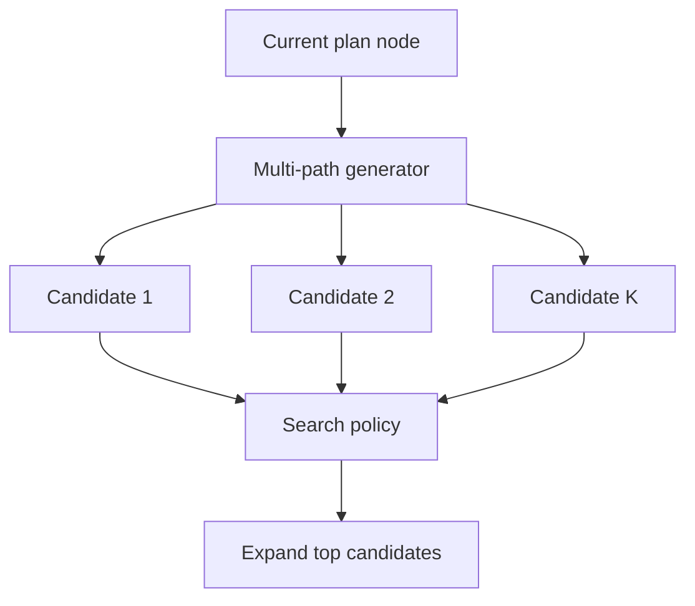

# Multi-Path Plan Generator

**Also known as:** Branching Plan Generator, Candidate-Path Producer

**Category:** Planning & Control Flow  
**Status in practice:** mature

## Intent

Generate multiple candidate next-steps at each plan node enabling later selection — the planning generator pattern paired with tree-of-thoughts / LATS-style search.

## Context

A team uses tree-of-thoughts or LATS (Language Agent Tree Search) for plan search. The generator step that produces candidate next-steps is often conflated with the search policy. Naming the generator separately allows mixing different generators with different search policies.

## Problem

When generator and search policy are fused, neither can be tuned independently. The generator's quality limits the search; the search's strategy limits how generator candidates are used. Isolating the generator (this pattern) from the search policy enables independent tuning. Distinct from single-path-plan-generator and from tree-of-thoughts (the full search algorithm).

## Forces

- Generator and search policy are often described together, making them hard to swap.
- Multi-path generators are expensive — N candidate steps per node.
- Quality of candidates depends heavily on generator design.

## Therefore

Therefore: isolate the multi-path generator as a named component that produces K candidate next-steps per node, given the current node and history; the search policy decides which candidates to expand.

## Solution

Multi-path generator interface: (current_node, history, K) → [candidate_step_1, ..., candidate_step_K]. Search policy (tree-of-thoughts, LATS, beam search, MCTS) decides which candidates to expand. Generator and search policy are separate components and can be swapped independently. Pair with tree-of-thoughts, lats, single-path-plan-generator (alternative), beam search.

## Structure

```
Current plan node (+ history, K) --> Multi-path generator --> candidates 1..K --> Candidate evaluator (scores) --> Search policy (tree-of-thoughts / LATS / beam / MCTS) --> expand chosen candidates --> new nodes in candidate tree
```

## Diagram



## Example scenario

A code-refactoring agent uses LATS search. Generator: at each node it produces K=4 candidate refactoring approaches (rename, extract method, inline, restructure). Search policy: evaluates expected reward per candidate (heuristic + LLM scorer) and expands the top 2. Generator and search policy are separate; team experiments with generator quality (different prompts) without touching search policy.

## Consequences

**Benefits**

- Generator and search policy tuneable independently.
- Same generator can drive different search algorithms.
- Candidate quality is a measurable per-generator property.

**Liabilities**

- K× cost per node vs single-path.
- Generator must be designed to produce diverse candidates.
- Storage of candidate tree grows with depth × branching.

## Failure modes

- Near-duplicate candidates — the generator returns K versions of the same step, and the search policy has nothing real to choose between.
- Cost per node — K candidates at every node multiply model calls, and a deep tree costs far more than planned.
- Tree storage growth — the candidate tree is kept in full, and memory grows with depth times branching.
- Generator picks — the generator ranks or filters its own candidates, and the separate search policy is quietly bypassed.

## What this pattern constrains

The generator produces K candidates and does not decide which to expand; search policy is a separate component.

## Applicability

**Use when**

- Plan path quality varies significantly — search pays off.
- Cost budget allows K× per-node generation.
- Search algorithm benefits from diverse candidate generation.

**Do not use when**

- Single-path is sufficient (use single-path-plan-generator).
- Cost budget cannot absorb K× per-node generation.
- No clear evaluator for candidate quality (search has no signal to act on).

## Components

- Multi-path generator — produces K candidates per node
- Search policy — separate component that decides which to expand
- Candidate evaluator — scores candidates for the search policy
- Candidate tree — stores expanded paths

## Tools

- LLM API — produces K candidates per node
- Search policy (ToT/LATS/beam)
- Candidate evaluator

## Evaluation metrics

- Branching factor K — actual vs declared
- Candidate-quality variance
- Search depth × candidate-count cost

## Known uses

- **[elcamy: 【論文紹介】LLMベースのAIエージェントのデザインパターン18選](https://blog.elcamy.com/posts/20431baf/)** _available_

## Related patterns

- _complements_ **Tree of Thoughts**
- _complements_ **Language Agent Tree Search**
- _alternative-to_ **Single-Path Plan Generator**
- _complements_ **Best-of-N Sampling**
- _complements_ **Adaptive Branching Tree Search**
- _complements_ **Incremental Model Querying**
- _complements_ **Generate-and-Test Strategy**

## References

- [【論文紹介】LLMベースのAIエージェントのデザインパターン18選](https://blog.elcamy.com/posts/20431baf/) — 2026
