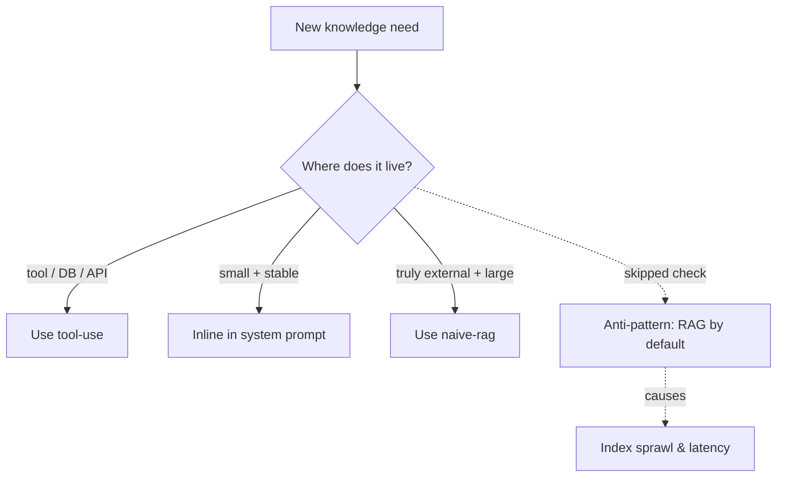

# Naive-RAG-First

**Also known as:** RAG-By-Default, Vector-Store-First

**Category:** Anti-Patterns  
**Status in practice:** deprecated

## Intent

Anti-pattern: reach for naive RAG before checking whether the knowledge actually needs retrieval.

## Context

A team is starting a new knowledge-grounded agent — a customer-support bot, an internal Q&A assistant, a docs helper — and the field's reference architectures push retrieval-augmented generation (RAG, where the system embeds documents into a vector store and looks up passages by semantic similarity) as the default move. The team builds the vector index before checking where the answer-bearing knowledge actually lives. Often the real source is a database, an internal API, a search service, or a small set of stable documents that would fit in the system prompt.

## Problem

When the knowledge lives in a structured store, semantic retrieval over embeddings is the wrong shape: the agent gets approximate, stale passages where a typed SQL query or a single API call would return an exact, fresh answer. The team pays embedding pipeline cost, vector store cost, and re-indexing cost on every update, and quality drops compared to the simpler design because retrieval is solving the wrong problem. Naive RAG also adds an entire failure surface — chunking, embedding drift, recall holes — that a typed tool call simply does not have.

## Forces

- RAG is on every reference architecture.
- Vector stores feel like a moat.
- Tool use is sometimes harder to build than RAG.

## Therefore

Therefore: locate where the knowledge actually lives — a database, API, search service, or a small inlined document — before adding a vector index, so that retrieval is shaped to the data rather than reflexed onto it.

## Solution

Don't reach for RAG first. Check whether the knowledge lives in a tool (database, API, search service), a scoped system prompt, or a small inlined document. Only adopt RAG when those genuinely do not work. See tool-use, naive-rag for when it does.

## Structure

```
Anti-pattern: knowledge need -> build RAG pipeline by default -> embeddings over structured data -> approximate, stale answers. Corrected: knowledge need -> check tool (database, API, search), scoped prompt, or inline document -> use RAG only if none fits.
```

## Diagram



## Example scenario

A team's first move on a new internal Q&A bot is to spin up a vector index over the company wiki. After three weeks they discover that 80 percent of questions are about live ticket status, which is in their helpdesk database, and a vector search over stale wiki pages cannot answer them. They name the failure naive-rag-first: they tear out the index for those queries and route them to a typed helpdesk tool call. RAG stays only for the genuine free-text knowledge questions where the wiki is authoritative.

## Consequences

**Benefits**

- Short-term: RAG is a familiar default with ready-made frameworks, so it looks like the quick path to grounding.
- Naming it lets a team ask where the knowledge lives before choosing retrieval.

**Liabilities**

- Architectural complexity that pays for nothing.
- Retrieval misses that a SQL query would not.
- Embedding maintenance burden.

## Failure modes

- Approximate where exact exists — the agent retrieves fuzzy passages about a value that a single database query would return exactly.
- Stale index — data changes, the embeddings lag, and answers come from outdated chunks.
- Extra failure surface — chunking, embedding drift, and recall misses cause errors that a direct tool call would never have.

## What this pattern constrains

Avoiding it imposes an ordering rule: a retrieval pipeline must not be built before checking whether the knowledge lives in a tool, a database query, a scoped prompt, or a small inlined document.

## Applicability

**Use when**

- Cite this entry when RAG is proposed as the first answer to any knowledge gap.
- You are already here if a vector pipeline serves content that would fit in the system prompt or behind one API call.
- Adopt naive-rag only after tool-use, scoped prompts, and inlined documents have genuinely failed.

**Do not use when**

- Any project where vector indexes are added by reflex without checking alternatives.
- Any setting where a SQL query, API call, or inlined document would already answer the need.
- Any team treating RAG as a default rather than a deliberate choice.

## Components

- Reflexive RAG bootstrap — vector index built before any source survey
- Embedding pipeline — re-indexes every document update at recurring cost
- Approximate retriever — returns semantic-similarity passages where a typed query would return an exact row
- Missing source-locator step — would route knowledge needs to DB, API, or prompt before reaching for embeddings

## Tools

- Vector store — primary retrieval surface even when the data is structured
- Structured store or API — the underused tool that would answer most queries exactly

## Evaluation metrics

- Structured-answer-miss rate — fraction of queries answered from stale passages where a SQL or API call would have been exact
- Re-indexing cost per update — recurring spend driven by the embedding pipeline
- Retrieval-recall hole rate — share of authoritative answers the vector index fails to surface
- RAG-versus-tool win rate on the same workload — comparison across a fixed eval set; the gap exposes mis-shaped retrieval

## Known uses

- **[Anthropic contextual retrieval](https://www.anthropic.com/engineering/contextual-retrieval)** _available_ — Published as a corrective to naive chunk-and-embed RAG, with measured retrieval-failure reductions over the naive baseline it replaces.

## Related patterns

- _conflicts-with_ **Naive RAG** — RAG is fine; RAG-first is not.
- _alternative-to_ **Tool Use**
- _alternative-to_ **Synthetic Filesystem Overlay**
- _complements_ **Memory Poisoning**
- _complements_ **Over-Search and Under-Search**

## References

- [Retrieval-Augmented Generation for Large Language Models: A Survey](https://arxiv.org/abs/2312.10997) — Gao et al., 2023
