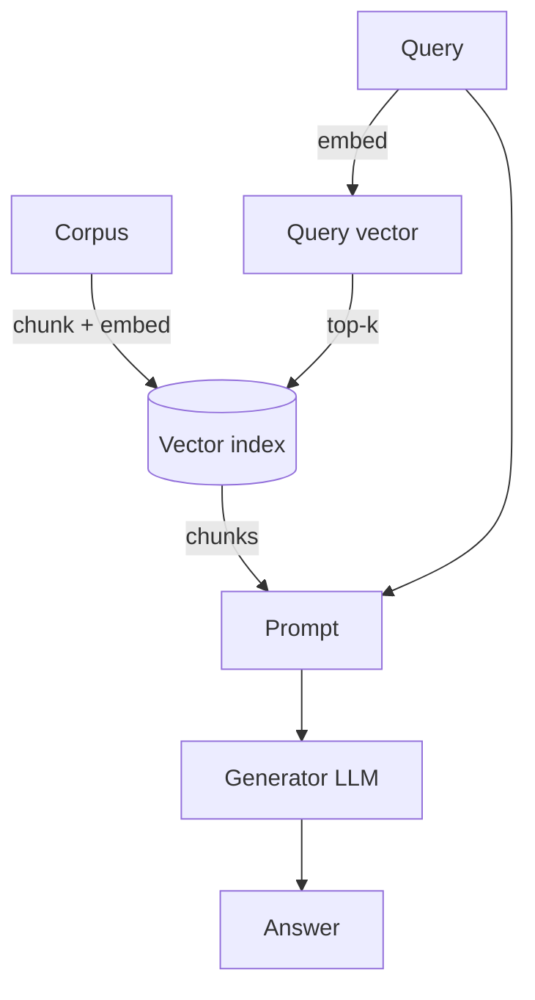

# Naive RAG

**Also known as:** Retrieval-Augmented Generation, Top-K Retrieve-and-Stuff

**Category:** Retrieval & RAG  
**Status in practice:** mature

## Intent

Condition the generator on top-k chunks retrieved from an external dense index so knowledge lives outside parameters.

## Context

A team needs a model to answer questions whose answers depend on information that lives in a corpus too large to fit into the prompt — internal documentation, a knowledge base, a product catalogue, recent news, a body of research papers. The corpus also changes regularly, faster than retraining the base model would allow, so any answers based on the model's training data alone will go stale or be missing entirely.

## Problem

A bare language model has no access to information beyond what is baked into its weights, and any attempt to answer from parametric memory alone tends to hallucinate plausible-sounding answers, cannot cite a source, and cannot be updated without retraining. The team needs the model to pull relevant external knowledge in at query time, but doing so requires deciding how to chunk the corpus, how to index it, what to retrieve per query, and how to feed it into the prompt. Without that retrieval machinery, the model is stuck with what it already knew at training time.

## Forces

- Chunk size trades context loss for retrieval recall.
- Embedding choice constrains retrieval quality.
- Single-shot retrieval misses multi-hop questions.

## Therefore

Therefore: chunk-embed the corpus, retrieve top-k by similarity to the query embedding, and condition generation on the retrieved chunks, so that knowledge lives outside the model parameters.

## Solution

Chunk the corpus. Embed each chunk with a dense encoder. At query time, embed the query, retrieve top-k by similarity, prepend chunks to the prompt, generate. The simplest production RAG pipeline.

## Structure

```
Index: Corpus --chunk--> Chunks --embed--> Vector index. Query: Query --embed--> Query vector --top-k similarity--> Chunks --> Prompt assembler (chunks + query) --> Generator LLM --> Answer
```

## Diagram



## Example scenario

A startup ships a support assistant whose knowledge changes weekly — release notes, pricing, integration guides. Bake-it-into-the-prompt does not scale and fine-tuning on every release is impractical. They adopt naive-rag: chunk the docs, embed with a dense encoder, index, and at query time retrieve top-k and prepend to the prompt. The pipeline is the simplest possible and ships in a week. Knowledge updates now flow by re-indexing the docs, not by retraining or redeploying the model.

## Consequences

**Benefits**

- Knowledge updates without retraining.
- Citations become possible.

**Liabilities**

- Chunk boundaries destroy context.
- Top-k retrieval is recall-oriented; precision suffers without reranking.
- No iterative retrieval; multi-hop fails.

## Failure modes

- Severed context — the chunk boundary cuts a fact away from the sentence that names its subject, and the chunk that holds the answer never matches the query.
- Distractor in the top-k — a chunk that shares the query's words but not its answer ranks high, and the generator answers from it.
- Multi-hop miss — the answer needs two chunks linked by an entity the query never mentions, and one retrieval pass returns only the first.
- Parametric override — retrieval returns nothing useful, and the generator answers from memory with no sign that the retrieved set was empty or weak.

## What this pattern constrains

The generator may use only retrieved chunks plus its parametric memory; the retrieval set is the boundary.

## Applicability

**Use when**

- Knowledge lives outside the model and must be conditioned on at query time.
- Citations must be tied to retrieved sources, not invented from parameters.
- A simple chunk-and-embed pipeline meets the recall and quality bar.

**Do not use when**

- The needed knowledge is already in a tool, database, or scoped system prompt (see naive-rag-first).
- Global, corpus-wide questions need GraphRAG or hierarchical retrieval instead.
- Chunk-level retrieval is the wrong shape for the queries you actually serve.

## Components

- Chunker — splits the corpus into retrieval-sized passages at index time
- Embedding encoder — dense model that vectorises both chunks and queries
- Vector index — stores chunk vectors and serves top-k nearest-neighbour lookups
- Prompt assembler — prepends retrieved chunks to the user query before generation
- Generator LLM — answers conditioned on the retrieved chunks plus its parametric memory

## Tools

- Embedding model — dense encoder for chunks and queries
- Vector index — approximate nearest-neighbour store such as FAISS, Pinecone, or pgvector
- LLM API — generator that consumes the chunk-augmented prompt

## Evaluation metrics

- Answer faithfulness against retrieved chunks — share of claims supported by the prepended evidence
- Recall@k of the gold chunk — does the retriever surface the document that contains the answer
- Hallucination rate when retrieval misses — fallback-to-parametric failure mode this pattern is supposed to reduce
- p95 retrieval latency — single-shot retrieval budget that downstream patterns build on
- Cost per answered query — combined embedding, index, and generator spend

## Known uses

- **[LangChain / LlamaIndex default RAG](https://www.langchain.com/)** _available_
- **Most enterprise document-QA deployments** _available_

## Related patterns

- _generalises_ **HyDE**
- _composes-with_ **Cross-Encoder Reranking**
- _generalises_ **Contextual Retrieval**
- _alternative-to_ **GraphRAG**
- _specialises_ **Agentic RAG**
- _conflicts-with_ **Naive-RAG-First** — Naive RAG is fine; treating it as the only answer is the anti-pattern.
- _composes-with_ **Chain of Verification**
- _generalises_ **Vector Memory**
- _complements_ **Citation Streaming**
- _generalises_ **RAFT**
- _generalises_ **Hybrid Search**
- _alternative-to_ **Hallucinated Citations**
- _used-by_ **App Exploration Phase**
- _used-by_ **Augmented LLM**
- _used-by_ **Citation Attribution**
- _generalises_ **Query Rewriting**
- _generalises_ **HippoRAG**
- _specialises_ **Modular RAG**
- _complements_ **Over-Search and Under-Search**
- _generalises_ **Hierarchical Retrieval**
- _complements_ **Streaming Feature Pipeline**
- _complements_ **FTI LLM Pipeline Split**
- _alternative-to_ **Vectorless Reasoning-Based Retrieval** — Vectorless reasoning-based retrieval replaces the embed-chunk-similarity pipeline with reasoning-driven navigation of the document's section tree.
- _complements_ **Semantic Response Cache** — The cache sits in front of the retrieve-then-generate pipeline and short-circuits it on near-duplicate queries before any retrieval runs.
- _specialises_ **Table-Augmented Generation** — TAG positions retrieval as the special case where the synthesised query is a point lookup of a few records; TAG generalises it to arbitrary computation plus per-row model calls.

## References

- [Retrieval-Augmented Generation for Knowledge-Intensive NLP Tasks](https://arxiv.org/abs/2005.11401) — Lewis, Perez, Piktus, Petroni, Karpukhin, Goyal, Küttler, Lewis, Yih, Rocktäschel, Riedel, Kiela, 2020
- [Agent design pattern catalogue: A collection of architectural patterns for foundation model based agents](https://doi.org/10.1016/j.jss.2024.112278) — Yue Liu, Sin Kit Lo, Qinghua Lu, Liming Zhu, Dehai Zhao, Xiwei Xu, Stefan Harrer, Jon Whittle, 2025
