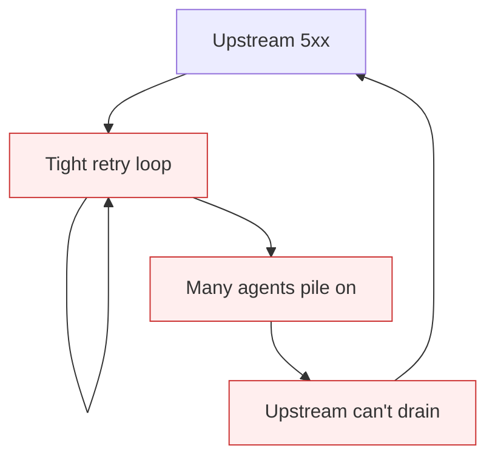

# Naive Retry Without Backoff

**Also known as:** Tight-Loop Retry, Thundering-Herd Retry

**Category:** Anti-Patterns  
**Status in practice:** deprecated

## Intent

Anti-pattern: retry failed model or tool calls immediately, amplifying load on systems that are already failing.

## Context

An agent calls a model API or downstream tool that returns 5xx, rate-limit, or timeout errors during a degradation event. The orchestrator wraps the call in a tight retry loop with no backoff and no jitter, often with a high or unbounded retry count.

## Problem

The retry loop fires immediately on failure, so every instance of the agent piles onto the failing upstream at the same instant. Recovery is delayed because the upstream cannot drain its queue. When many agent instances share a backend, the retry storm itself becomes the outage. Distinct from unbounded-loop, which is about logical step counts; this is about call-attempt pacing inside one step.

## Forces

- Transient errors are real and retries do help when paced sensibly.
- Tight retry loops are the default in many SDK code samples.
- Per-call backoff complicates timing analysis, but its absence breaks production.

## Therefore

Therefore: every retry path must use exponential backoff with jitter, a bounded attempt budget, and respect the upstream's Retry-After signal when present.

## Solution

Use exponential backoff (e.g. 1s, 2s, 4s, 8s, with ±25% jitter), cap attempt count (typically 3–5), and honor `Retry-After` headers. Distinguish retryable errors (5xx, 429, timeout) from non-retryable (4xx other than 429). Pair with circuit-breaker so once attempts exhaust, the agent stops calling the failing dependency entirely until a health probe succeeds.

## Structure

```
Anti-pattern: Call fails -> immediate retry from every instance -> thundering herd -> longer outage. Corrected: Call fails -> classify retryable -> exponential backoff + jitter + attempt cap + Retry-After -> circuit-breaker after exhaustion.
```

## Diagram



## Example scenario

An ingestion agent processes 5,000 documents per hour. The embedding API enters a degraded window. The agent retries each failed call immediately, without backoff. Each running agent instance hammers the embedding API at full rate. The embedding API's queue never drains because the retry rate equals the success rate. The degradation lasts 4× longer than the underlying incident.

## Consequences

**Benefits**

- Short-term: an immediate retry is one line of code and often hides brief, isolated glitches.
- Naming it lets a team separate retry pacing from step-count limits and review both.

**Liabilities**

- Thundering-herd retries amplify upstream outages and delay recovery.
- Bills spike on rate-limited APIs because retry attempts still count.
- Difficult to distinguish 'real failure' from 'retry-induced failure' in metrics.

## Failure modes

- Retry storm — many agent instances retry a failing upstream at the same moment and keep it down.
- Slow recovery — the upstream cannot drain its queue because retries arrive faster than it clears them.
- Billed retries — retries on a rate-limited API count against usage and raise the bill.
- Retrying the unfixable — the agent retries a 4xx error that will never succeed, wasting attempts and time.

## What this pattern constrains

No useful constraint; the missing constraint is bounded-and-paced retry semantics.

## Applicability

**Use when**

- Never. Cite when reviewing retry implementations.
- Use exponential backoff with jitter, bounded attempts, and Retry-After respect.
- Pair with circuit-breaker for outage isolation.

**Do not use when**

- Any retry path with no delay between attempts.
- Any retry path with unbounded attempt count.
- Any retry that ignores upstream Retry-After signals.

## Components

- Retry wrapper — fires immediately on failure with no delay
- Upstream service — already degraded, cannot drain queue
- Concurrent agent instances — all retry at the same instant
- Missing backoff scheduler — would spread attempts in time

## Tools

- Detection signal — monitors or audits that surface this anti-pattern in the wild
- Mitigation pattern infrastructure — the positive pattern that resolves this anti-pattern
- Incident-response playbook — what to do when the anti-pattern fires

## Evaluation metrics

- Incident rate — occurrences per period
- Mean time to detection — how long the anti-pattern runs unobserved
- Cost / damage per incident — measurable impact of each occurrence

## Known uses

- **[Production agentic workflow 2026 failure taxonomy (digitalapplied.com)](https://www.digitalapplied.com/blog/agentic-workflow-anti-patterns-orchestration-mistakes-2026)** _available_

## Related patterns

- _complements_ **Circuit Breaker**
- _complements_ **Missing Idempotency on Agent Calls**
- _complements_ **Rate Limiting**
- _alternative-to_ **Unbounded Loop** — Unbounded-loop is about logical steps; naive-retry-without-backoff is about call-attempt pacing inside one step.
- _complements_ **Fallback Chain**
- _complements_ **Symptom-Remediation Thrashing** — Naive retry re-fires a failed call; symptom remediation re-fires a succeeding fix that masks the root cause while the metric recovers.

## References

- [Agentic Workflow Anti-Patterns: Orchestration Mistakes (2026)](https://www.digitalapplied.com/blog/agentic-workflow-anti-patterns-orchestration-mistakes-2026) — 2026
