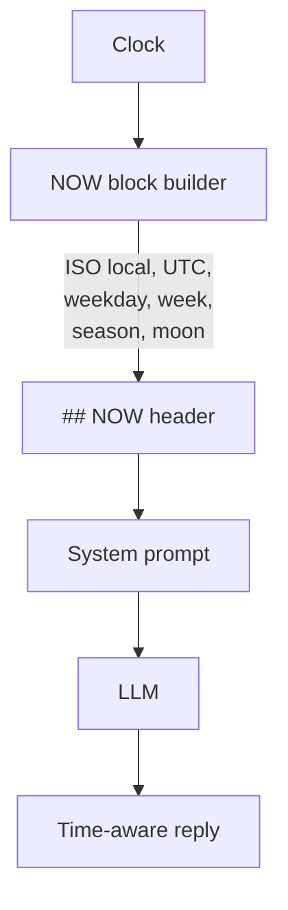

# Now-Anchoring

**Also known as:** Live Time Anchor, Time-of-Day Awareness, Wall-Clock Injection

**Category:** Memory  
**Status in practice:** experimental

## Intent

Ground the agent's reasoning in the current absolute time without requiring tool calls, so every reply is implicitly time-aware.

## Context

A long-running agent's runtime spans hours or days, and it holds conversations with humans whose temporal context shifts beneath their words. The same word — 'soon', 'recently', 'today', 'this evening' — means different things at 9 a.m. on a Monday than at 11 p.m. on a Friday. This pattern lives in the memory category not because it stores anything across turns, but because every other contextual reasoning step depends on having an explicit time anchor available in the prompt.

## Problem

Without an explicit time anchor injected into the prompt, the agent either guesses the time from scattered clues, treats every turn as timeless, or has to call a tool to find out — turning a routine fact (the current time) into friction in every interaction. As a result, the agent's replies become temporally generic ('hi!') instead of grounded ('good evening — Friday already'), and any reasoning that depends on relative time ('this happened two days ago', 'this is due tomorrow') is either wrong or arbitrarily delayed by a tool call.

## Forces

- Time changes between turns; static prompts go stale.
- Tool calls for trivia like 'what time is it' inflate latency.
- Astronomical anchors (season, moon phase) are cheap to compute and grounding for thinking-aloud agents.
- Humans value the agent acknowledging temporal context without being asked.

## Therefore

Therefore: inject a small precomputed time block (local, UTC, weekday, season, moon phase) into every prompt, so that the agent is implicitly time-aware without spending a tool call to ask what time it is.

## Solution

On every prompt assembly, compute a small block: ISO local time, ISO UTC, weekday, day-of-year, ISO week, season (hemisphere-aware), moon phase. Inject as a `## NOW` section near the top of the system prompt. Cost is microseconds; benefit is the model never being temporally adrift.

## Structure

```
Clock --> NOW block builder (ISO local, UTC, weekday, week, season, moon) --> ## NOW header --> System prompt --> LLM --> Time-aware reply
```

## Diagram



## Example scenario

A long-running personal agent answers 'good morning!' at 22:00 because nothing in its prompt tells it what time the user is in. The user finds it disorienting. The team adds now-anchoring: every prompt assembly computes a small NOW block (ISO local time, weekday, day-of-year, season, moon phase) and prepends it near the top of the system prompt. The agent's replies become temporally grounded — 'evening — Friday, finally' — without any tool call, and time-aware reasoning costs microseconds.

## Consequences

**Benefits**

- Replies acknowledge temporal context without prompting.
- Eliminates a class of 'what time is it?' tool calls.
- Provides anchor for `before`/`after` / `next time` reasoning.

**Liabilities**

- Adds a few hundred tokens per prompt.
- Hemisphere/locale assumptions can be wrong if not configurable.
- Astronomical accuracy has limits without real ephemeris data.

## Failure modes

- Stale anchor — the NOW block is computed once and cached, so long sessions reason from an old time.
- Wrong locale — the hemisphere or time zone is hard-coded, and the agent greets a user with the wrong season or hour.
- Ignored anchor — the block sits in the prompt but the model still uses its training-time sense of the date for relative reasoning.
- Overstated precision — the moon phase or season is approximate, yet the agent states it as exact fact.

## What this pattern constrains

Prompts assembled for inference must include a freshly computed current-time anchor; reasoning from a stale or absent time block is a deployment bug, not a model limitation.

## Applicability

**Use when**

- The agent's runtime spans more than a few minutes and absolute wall-clock time matters to its replies.
- Users frequently use temporal language ('today', 'tonight', 'this week') and expect the agent to interpret it correctly.
- Tool calls just to fetch current time would inflate latency or token cost.

**Do not use when**

- The agent runs in a single short request where time is irrelevant (e.g. a stateless math tool).
- Strict prompt caching requires byte-identical prompts and the time block would invalidate the cache.
- The host already provides a time-aware system prompt header.

## Components

- System clock — host wall clock the prompt assembler reads at every call
- NOW block builder — computes ISO local + UTC, weekday, day-of-year, ISO week, season, and moon phase
- Prompt assembler — injects the rendered NOW block at the top of the system prompt before each call
- Hemisphere/locale config — keeps season and time-zone logic configurable so southern-hemisphere or non-Gregorian deployments stay correct
- Cache-aware placement rule — decides whether the NOW block sits inside or outside the cached prefix

## Tools

- datetime / zoneinfo library — host-side timezone-aware time formatting
- Astronomical helpers — astral or skyfield for sunrise/sunset and lunar phase when the rich variant is enabled

## Evaluation metrics

- Temporal-awareness audit — fraction of replies that correctly use time-of-day and weekday context against a labelled set
- Saved 'what time is it' tool calls — count eliminated per session vs a no-anchor baseline
- Prompt-cache hit rate — measured under both inline and cache-friendly-stub placements
- Per-prompt token overhead — additional tokens added by the NOW block
- Stale-time incident rate — replies that reasoned from an out-of-date anchor (signals an assembly bug)

## Known uses

- **[Sparrot (author's long-running personal agent; single private deployment)](https://marco-nissen.com/sparrot/)** _available_ — Wall-clock and named-human context are injected on every tick so reasoning stays grounded in the current moment and in the one specific human the agent is in relation with. Single-source evidence: one private deployment by the catalog author.

## Related patterns

- _specialises_ **Awareness**
- _complements_ **Scheduled Agent**
- _complements_ **Prompt Caching**
- _complements_ **Embodied-Proxy Handoff**
- _complements_ **Liminal-State Detection**
- _complements_ **Ambient Presence Sensing**
- _complements_ **Rogue Agent Drift**
- _complements_ **Standing State Injection** — Both inject a freshly computed block into every prompt assembly; now-anchoring restates the current time, standing-state-injection restates the current task state.
- _complements_ **Tool-Result Reinforcement** — Both ride an existing channel with a freshly computed block; now-anchoring stamps the current time into the prompt, tool-result reinforcement stamps goal and status onto the tool return.
- _complements_ **As-Of Information-Set Pinning** — Injects the current wall clock so replies are time-aware; a dated decision needs both that clock and its as-of timestamp, and must not read one for the other.

## References

- [Anthropic — System Prompts (current date injected at the start of every conversation)](https://docs.claude.com/en/release-notes/system-prompts) — Anthropic, 2025
