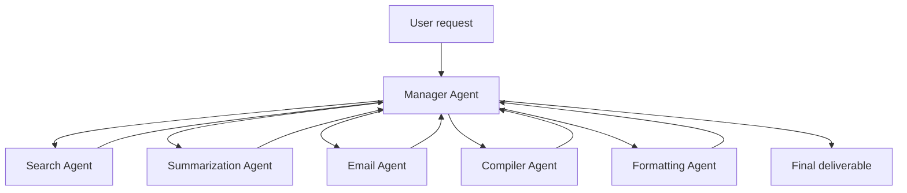

# One Tool, One Agent

**Also known as:** Specialist-Per-Tool Design, Microservices-Style Agent Decomposition

**Category:** Multi-Agent  
**Status in practice:** emerging

## Intent

Design agent systems as a team of narrow single-purpose agents, each owning one tool or one capability, rather than a single super-agent that handles every tool — the agent analogue of microservices over monolith.

## Context

A team designs a workflow agent. The temptation: one big agent with the full tool catalog, doing 'everything'. Reality: this monolith is hard to debug, hard to evaluate, hard to evolve, and often performs worse than specialized agents because the LLM has to context-switch across too many tool semantics.

## Problem

Monolithic agents accumulate complexity in one prompt and one tool catalog. They debug poorly (where did this fail?), evaluate poorly (which capability regressed?), evolve poorly (every change risks every workflow). They often degrade because the LLM's attention is split across too many tool semantics.

## Forces

- Multi-agent decomposition adds orchestration overhead.
- Specialist agents have to communicate, with handoff cost.
- More agents = more cost = more model calls.

## Therefore

Therefore: decompose by capability — one agent per tool, one agent per concern, one agent per logical role — and coordinate via an orchestrator (manager) agent. Each specialist is small, evaluable, replaceable.

## Solution

For each major capability the system needs (search, summarization, formatting, delivery), instantiate a dedicated specialist agent. Add a manager / orchestrator agent that decomposes user requests and routes to specialists. Each specialist owns its narrow tool catalog and has its own eval suite. Pair with orchestrator-workers, supervisor, hierarchical-agents, multi-agent-sequential-degradation awareness (don't decompose what's intrinsically sequential).

## Structure

```
User request --> Manager (decompose and route only) --> Search | Summarisation | Email | Compiler | Formatting agent (one tool each, own eval suite) --results--> Manager --> Final deliverable
```

## Diagram



## Example scenario

A newsletter automation system. Naive: one super-agent that does search, summarization, formatting, delivery. Result: hard to debug, summarization regression when search prompt changed. With One Tool One Agent: Search Agent (finds articles), Summarization Agent (3-bullet summaries), Email Agent (sends daily), Compiler Agent (organizes selected articles), Newsletter Formatting Agent (Mon publication), Manager Agent (coordinates). Each has narrow scope and its own eval. Result: 300k subscribers in one month, debuggable.

## Consequences

**Benefits**

- Per-specialist eval suites catch regressions per capability.
- Replacing one specialist (better model, better tool) doesn't touch others.
- Debugging localizes to one specialist's prompt and tools.

**Liabilities**

- Orchestration overhead — manager agent must coordinate.
- Handoff cost per specialist hop.
- Cost scales with agent count; for trivial tasks the overhead exceeds the benefit.

## Failure modes

- Overhead on trivial tasks — a simple request passes through the manager and several specialists, and hop cost exceeds the work.
- Splitting sequential work — an inherently sequential task is cut across specialists, and each hop loses context the next one needed.
- Manager takes on domain logic — the orchestrator starts doing search or formatting itself, and the narrow boundaries blur.
- Hand-off loss — a specialist's output is reshaped at each hop, and the final deliverable drifts from what the first specialist found.

## What this pattern constrains

No specialist owns more than one tool / capability; the orchestrator owns coordination only, not domain logic.

## Applicability

**Use when**

- Workflows decomposable into ≥3 specialized capabilities.
- Capabilities have meaningfully different prompts / tools / eval criteria.
- Coordination overhead is acceptable.

**Do not use when**

- Trivial single-tool workflows.
- Intrinsically sequential workloads (see multi-agent-sequential-degradation).
- Coordination overhead exceeds benefit.

## Components

- Manager / orchestrator agent — coordinates
- Specialist agents — one per tool/capability
- Per-specialist eval suite
- Handoff protocol between specialist and manager

## Tools

- Manager / orchestrator agent
- Specialist agents per capability
- Per-specialist eval suite
- Handoff protocol

## Evaluation metrics

- Per-specialist regression rate
- Handoff overhead (latency, cost) per workflow
- Specialist-replacement frequency without downstream impact

## Known uses

- **[Bornet et al. — Agentic Artificial Intelligence, Chapter 8 (newsletter case study with Search/Summarization/Email/Compiler/Formatting/Manager specialists)](https://www.worldscientific.com/worldscibooks/10.1142/14380)** _available_

## Related patterns

- _complements_ **Orchestrator-Workers**
- _complements_ **Supervisor**
- _complements_ **Hierarchical Agents**
- _complements_ **Multi-Agent on Sequential Workloads** — Apply One Tool One Agent only when work is parallelizable; sequential workloads fail under it.
- _complements_ **Two Human Touchpoints**
- _complements_ **Magentic-One Generalist Multi-Agent**
- _alternative-to_ **Hierarchical Tool Selection**

## References

- [Agentic Artificial Intelligence — Chapter 8](https://www.worldscientific.com/worldscibooks/10.1142/14380) — 2025
