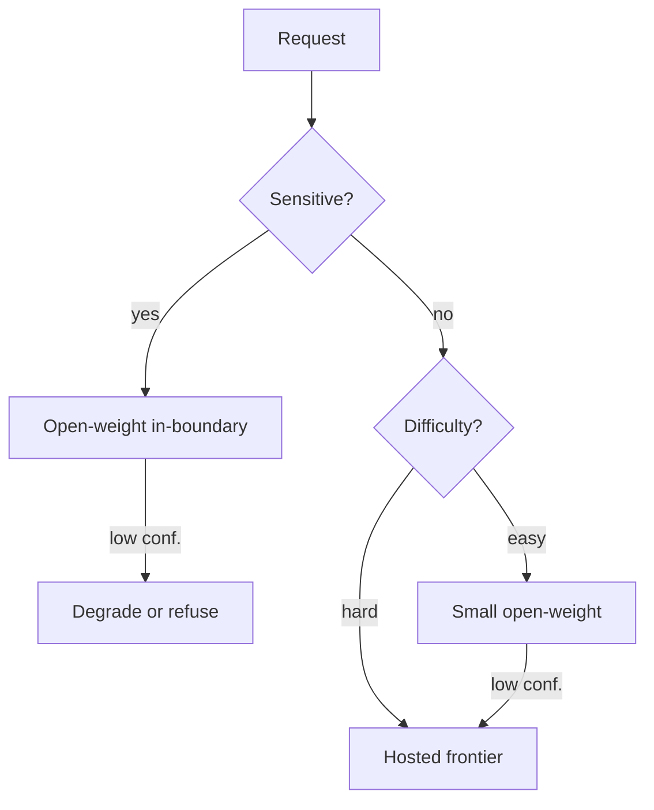

# Open-Weight Cascade

**Also known as:** Permissive-License Cascade, Sovereign Routing, Self-Hostable Cascade

**Category:** Routing & Composition  
**Status in practice:** emerging

## Intent

Build a multi-model cascade where lower tiers are open-weight, self-hostable models that run inside the operator's boundary, and only escalations cross to a hosted frontier model — giving cost arbitrage *and* sovereignty.

## Context

An operator in a regulated environment — a European bank, a healthcare provider, a government agency — is building an agent and wants both the cost benefits of a multi-tier model cascade and the assurance that sensitive data does not leave their controlled boundary. Open-weight models that can be self-hosted have become capable enough to handle most requests at low cost, but a small share of hard requests still benefit from a hosted frontier model. The operator already runs at least one open-weight model on infrastructure they control.

## Problem

A simple cheap-first cascade routes the easy requests to an open-weight model and the hard ones to a hosted frontier model, which means every borderline request quietly leaks its data to a vendor outside the regulated boundary. An open-weight-only cascade keeps everything in-house but takes a noticeable capability hit on the rare hard request that really needs the frontier model. Neither extreme satisfies the operator who needs cost arbitrage on insensitive traffic and strict in-boundary processing on sensitive traffic.

## Forces

- Most requests are easy; cheap models handle them.
- Hard requests need frontier capability.
- Some requests must never leave the boundary regardless of difficulty.
- Open-weight models close the capability gap at a delay.

## Therefore

Therefore: classify requests by sensitivity before difficulty and pin sensitive traffic to an in-boundary open-weight tier, so that the cost-arbitrage cascade can never leak the data that must stay home.

## Solution

Stratify requests by sensitivity *and* difficulty before routing. (1) Sensitive requests: forced down the open-weight path even if confidence is low; degrade gracefully or refuse rather than escalate. (2) Insensitive easy requests: small open-weight model. (3) Insensitive hard requests: escalate to hosted frontier model. The router enforces the sensitivity classification before any model call.

## Structure

```
Request -> Sensitivity classifier -> [sensitive: open-weight only path] | [insensitive: cheap-first cascade with hosted frontier as fallback].
```

## Diagram



## Example scenario

A European bank wants the cost-and-quality benefits of a multi-tier model cascade but is bound by data-residency rules that forbid sending customer queries to a hosted US frontier model. The team builds an open-weight-cascade: requests are first stratified by sensitivity, sensitive ones are forced down the on-prem open-weight tier (and degrade or refuse rather than escalate), and only insensitive hard requests are allowed to escalate to the hosted frontier model. They get the cost arbitrage without violating residency for sensitive traffic.

## Consequences

**Benefits**

- Compliant fast-path for sensitive workloads.
- Cost arbitrage on the insensitive path.
- Operator can swap model tiers without re-architecting.

**Liabilities**

- Sensitivity classifier is the new failure surface.
- Quality cliff at the sensitive boundary if the open-weight tier under-performs.
- Operational overhead of running two stacks.

## Failure modes

- Sensitivity misclassification — a sensitive request is labelled insensitive, takes the cheap-first path, and its data reaches the hosted frontier model outside the boundary.
- Quality cliff on sensitive traffic — the in-boundary model is too weak for a hard sensitive request, and users get many degraded answers or refusals.
- Escalation shortcut — a low-confidence fallback added later sends any open-weight miss to the hosted tier, skipping the sensitivity gate.
- Two-stack drift — the self-hosted tier falls behind on updates and evals while the hosted tier moves ahead, and the gap grows unnoticed.

## What this pattern constrains

A request classified as sensitive may not be routed to a hosted frontier model; the hosted tier is only reachable from the insensitive path.

## Applicability

**Use when**

- Sensitive requests must stay inside an operator-controlled boundary even when borderline.
- Insensitive easy requests can be served cheaply by a small open-weight model.
- Insensitive hard requests can be safely escalated to a hosted frontier model.

**Do not use when**

- Data sovereignty is not a concern and a hosted-only cascade is simpler.
- Self-hosting open-weight models is operationally unaffordable.
- Sensitivity classification cannot be made reliable enough to enforce routing.

## Components

- Sensitivity classifier — first gate; decides whether the request may ever cross the boundary
- In-boundary open-weight tier — self-hosted model that handles all sensitive traffic
- Insensitive difficulty router — second gate that splits easy vs hard inside the insensitive path
- Hosted frontier tier — external strong model reachable only from the insensitive path
- Degrade-or-refuse handler — fallback for sensitive low-confidence cases where escalation is forbidden

## Tools

- Self-hosted inference stack — vLLM, TGI, or Triton serving Mistral, Mixtral, Pharia, Llama weights
- Hosted frontier API — Anthropic, OpenAI, Google, or Mistral Large for the insensitive hard lane
- Data-classification service — DLP scanner or PII detector that feeds the sensitivity gate
- Routing policy engine — enforces the residency rule before any model call leaves the boundary

## Evaluation metrics

- Sensitivity-classifier recall on a labelled audit set — share of truly sensitive requests caught
- Boundary-leak count — confirmed cases where a sensitive request reached the hosted tier (target zero)
- Quality gap between open-weight and hosted tiers on the insensitive eval — capability cliff size
- Cost-arbitrage saving on the insensitive path — share of traffic served cheaply by self-hosted models
- Degrade-or-refuse rate on sensitive low-confidence requests — operational cost of sovereignty

## Known uses

- **[Mistral](https://mistral.ai/)** _available_ — Open-weight (Mistral 7B, Mixtral) plus hosted (Mistral Large, Medium 3.5) tiers — operators commonly cascade them.
- **Aleph Alpha PhariaAI multi-model** _available_ — On-prem Pharia models plus optional hosted escalation.

## Related patterns

- _specialises_ **Multi-Model Routing**
- _uses_ **Fallback Chain**
- _complements_ **Sovereign Inference Stack**
- _complements_ **PII Redaction**
- _complements_ **Provider Fallback**
- _complements_ **Agentic Supply Chain Compromise**
- _alternative-to_ **Complexity-Based Routing**
- _complements_ **Top-Tier Model For Everything (Cost)**

## References

- [Mistral AI — Models](https://mistral.ai/)
