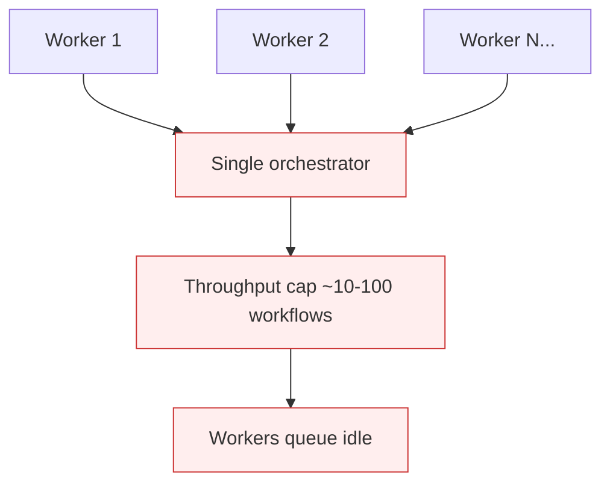

# Orchestrator as Bottleneck

**Also known as:** Single-Process Scheduler Bottleneck, Centralized Orchestrator Cap

**Category:** Anti-Patterns  
**Status in practice:** deprecated

## Intent

Anti-pattern: route all agent runs through a single-process orchestrator that becomes the system-wide concurrency ceiling.

## Context

A team adopts a workflow engine or supervisor pattern early and runs it as a single process. Workers scale horizontally, but the orchestrator is one box managing state, dispatching events, and tracking run progress.

## Problem

The orchestrator becomes the load-bearing single point of contention. Practical scaling ceiling sits around 10–100 concurrent workflows depending on how chatty the orchestrator is. Adding workers does not help; they queue waiting for orchestrator decisions. The fix is structural (sharded orchestrator, event-driven dispatch, or stateless-reducer per workflow) and expensive to retrofit once business logic depends on the centralized view.

## Forces

- Centralized orchestrators are dramatically easier to reason about, debug, and visualize.
- Sharding orchestration breaks naive global views (cross-workflow queries become expensive).
- The bottleneck only shows up at scale, after the architecture is hard to change.

## Therefore

Therefore: from day one, design the orchestrator path to be horizontally partitionable — per-tenant, per-workflow-type, or per-shard — so it can scale beyond a single process without a rewrite.

## Solution

Partition orchestrator state by run id, tenant, or workflow type. Use durable event stores (Kafka, Temporal, Postgres logical replication) so multiple orchestrator replicas can subscribe independently. Where a single global view is needed, build it as a materialized projection of the event log, not as the orchestrator's local state. Pair with stateless-reducer-agent so each workflow can be rehydrated on any replica.

## Structure

```
Anti-pattern: All runs -> single-process orchestrator (central state) -> workers wait -> fixed concurrency ceiling. Corrected: Runs -> durable event log -> orchestrator replicas partitioned by run id / tenant / workflow type -> global view as materialized projection.
```

## Diagram



## Example scenario

A team builds a multi-agent system on a single Python supervisor process. Works fine for 30 concurrent workflows. At 200 concurrent workflows the supervisor pegs CPU dispatching events; workers idle waiting for assignments. Adding workers does nothing. The fix is sharding the supervisor by tenant id, which requires rewriting all cross-tenant analytics queries that assumed a single in-memory view.

## Consequences

**Benefits**

- Short-term: one central orchestrator is easy to reason about and gives a single view of all runs.
- Naming it lets a team plan partitionable orchestration before business logic depends on central state.

**Liabilities**

- Throughput ceiling at 10–100 concurrent workflows regardless of worker scale.
- Single point of failure for the entire agent estate.
- Retrofit to a sharded design after the fact is structurally expensive.

## Failure modes

- Worker queue-up — more workers are added, but they all wait on the single orchestrator for decisions.
- Estate-wide outage — the one orchestrator process fails, and every agent workflow stops.
- Chatty ceiling — a talkative orchestrator caps the system at a few dozen concurrent workflows.
- Costly retrofit — business logic grows around the central view, so sharding later means a large rewrite.

## What this pattern constrains

No useful constraint; the missing constraint is horizontally partitionable orchestration from day one.

## Applicability

**Use when**

- Never as the long-term design. Cite when reviewing centralized supervisor architectures.
- Partition orchestrator state by run id or tenant from day one.
- Build global views as projections over the event log, not orchestrator local state.

**Do not use when**

- Any production agent estate built on a single-process supervisor.
- Any orchestrator whose throughput cannot scale by adding replicas.
- Any system whose global queries depend on orchestrator in-memory state.

## Components

- Centralized orchestrator process — single point of contention
- Worker pool — scales horizontally but blocks on orchestrator decisions
- Shared run state — held in orchestrator memory, not partitionable
- Missing shard router — would partition workflows across orchestrator replicas

## Tools

- Detection signal — monitors or audits that surface this anti-pattern in the wild
- Mitigation pattern infrastructure — the positive pattern that resolves this anti-pattern
- Incident-response playbook — what to do when the anti-pattern fires

## Evaluation metrics

- Incident rate — occurrences per period
- Mean time to detection — how long the anti-pattern runs unobserved
- Cost / damage per incident — measurable impact of each occurrence

## Known uses

- **[Production agentic workflow 2026 failure taxonomy (digitalapplied.com)](https://www.digitalapplied.com/blog/agentic-workflow-anti-patterns-orchestration-mistakes-2026)** _available_

## Related patterns

- _complements_ **Stateless Reducer Agent**
- _alternative-to_ **Event-Driven Agent**
- _complements_ **Durable Workflow Snapshot**
- _complements_ **Blocking Sync Calls in Agent Loop**
- _alternative-to_ **Supervisor**
- _complements_ **Infrastructure Burst Bottleneck (Agent Scale-Out)**
- _complements_ **Supervisor Cognitive Overload** — Orchestrator-as-bottleneck saturates a coordinating agent; supervisor cognitive overload saturates the coordinating human.
- _complements_ **Hidden Distributed Monolith (Multi-Agent)** — Orchestrator-as-bottleneck is single-orchestrator throughput; the distributed monolith is the whole topology being coupled despite looking like independent services.

## References

- [Agentic Workflow Anti-Patterns: Orchestration Mistakes (2026)](https://www.digitalapplied.com/blog/agentic-workflow-anti-patterns-orchestration-mistakes-2026) — 2026
