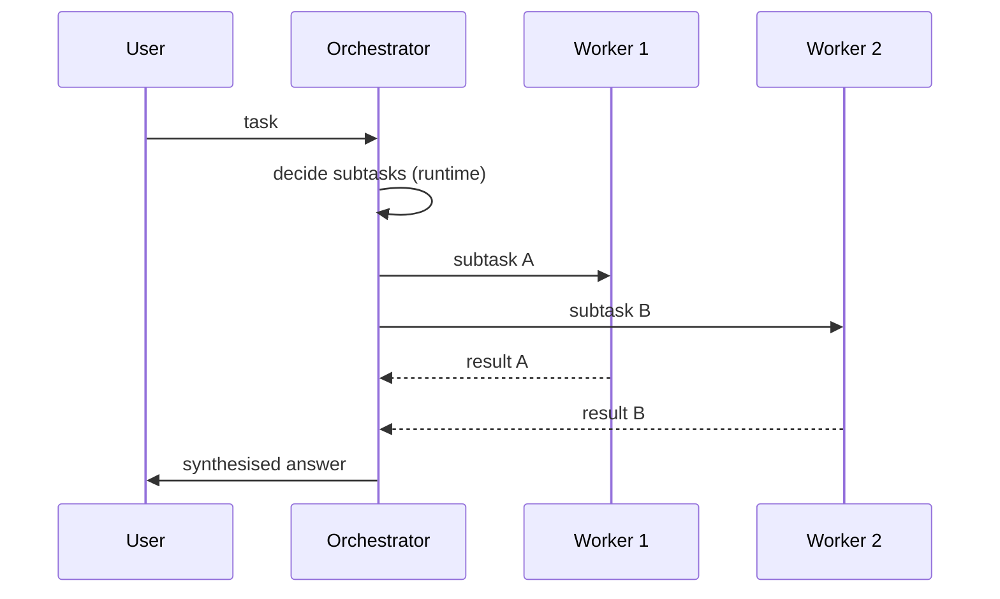

# Orchestrator-Workers

**Also known as:** Dynamic Decomposition, Orchestrator-Subagents

**Category:** Multi-Agent  
**Status in practice:** mature

## Intent

An orchestrator dynamically breaks a task into subtasks at runtime and delegates each to a worker LLM, then synthesises results.

## Context

A team is handling tasks where the right decomposition cannot be known in advance and depends on the input. A coding agent asked to audit a repository does not know how many languages or services it will find; a research agent does not know how many sub-questions a brief will need until it reads the brief. The number and shape of sub-tasks is data-dependent. This is distinct from supervisor, which routes work to a fixed set of pre-existing specialist agents; orchestrator-workers decides the sub-tasks at run time.

## Problem

A static decomposition — a fixed plan-and-execute pipeline or a hard-coded prompt chain — cannot handle tasks whose shape depends on the input. Trying to enumerate every possible sub-task in the prompt produces a sprawling system that still misses the cases the team did not anticipate. Picking the wrong decomposition at design time forces every request through it, even the ones it does not fit. The team needs decomposition to happen after the task arrives, not before.

## Forces

- The orchestrator must reason at a higher level than any worker.
- Workers should not have to know they are workers.
- Synthesis must reconcile conflicting worker outputs.

## Therefore

Therefore: let an orchestrator decide subtasks at runtime, hand each to a worker, and synthesise the returned results, so that data-dependent decomposition is handled without committing to a static plan up front.

## Solution

Orchestrator agent receives the task, decides at runtime what subtasks to spawn, hands each to a worker (often via tool call), collects results, and synthesises the final output. Worker count and roles can vary per task.

## Structure

```
Task --> Orchestrator --decide subtasks at runtime--> Workers 1..N (each sees only its subtask) --results--> Orchestrator --synthesise--> Answer
```

## Diagram



## Example scenario

A coding agent receives a vague request — 'audit our service for unused dependencies and unused env vars'. A static plan-and-execute pipeline cannot decide upfront how many sub-tasks there are because it depends on what the audit finds. The team uses orchestrator-workers: the orchestrator inspects the repo, decides at runtime to spawn one worker per detected language toolchain, collects each worker's findings, and synthesises a single audit report. The worker count varies from one repo to the next.

## Consequences

**Benefits**

- Handles tasks with data-dependent decomposition.
- Workers stay simple; complexity lives in the orchestrator.

**Liabilities**

- Orchestrator failure is unrecoverable without retry logic.
- Token cost scales with worker count; budget awareness matters.

## Failure modes

- Single point of failure — the orchestrator errors mid-task, and without retry logic all worker results are lost.
- Cost blow-up — the orchestrator spawns many workers for a modest task, and token cost scales with the worker count.
- Bad split — the runtime decomposition misses a needed subtask, and the synthesis has a hole no worker was asked to fill.
- Context-starved worker — a worker sees only its subtask and makes a choice that conflicts with another worker's result.

## What this pattern constrains

Workers see only their assigned subtask; only the orchestrator has the global view.

## Applicability

**Use when**

- The shape of decomposition depends on the input and cannot be planned statically.
- An orchestrator agent can decide subtasks at runtime and synthesise results.
- Worker count and roles legitimately vary per task.

**Do not use when**

- Static decomposition (Plan-and-Execute, Prompt Chaining) already fits the task.
- Per-call orchestration overhead is unacceptable for the latency budget.
- Synthesis is unreliable and worker outputs cannot be reconciled.

## Components

- Orchestrator agent — decides subtasks at runtime based on the input and synthesises results
- Worker LLM — focused agent that executes one subtask without global view
- Runtime subtask spec — typed instruction the orchestrator emits per spawned worker
- Synthesis step — orchestrator step that reconciles conflicting worker outputs into the final answer
- Retry policy — orchestrator-side handler for worker failures and unrecoverable orchestrator errors

## Tools

- LLM API — one orchestrator call plus one per worker, often heterogeneous models per worker
- Tool catalogue — exposed to workers as scoped palettes per subtask shape
- Parallel-dispatch runtime — fans out workers simultaneously when subtasks are independent

## Evaluation metrics

- Decomposition appropriateness — sample-audited match between subtasks and the input task
- Worker count distribution — how it varies per task and against a budget cap
- Synthesis-conflict rate — share of tasks where worker outputs disagreed and synthesis had to choose
- End-to-end success rate — measured against a static-decomposition baseline
- Total token cost per task — orchestrator plus all spawned workers

## Known uses

- **Anthropic Building Effective Agents (Workflow #4)** _available_
- **Claude Code subagents** _available_
- **Anthropic Multi-Agent Research** _available_
- **OpenAI Deep Research** _available_

## Related patterns

- _alternative-to_ **Supervisor**
- _alternative-to_ **Plan-and-Execute**
- _generalises_ **Subagent Isolation**
- _generalises_ **Lead Researcher**
- _complements_ **Inter-Agent Communication**
- _generalises_ **Hierarchical Agents**
- _complements_ **Dynamic Expert Recruitment**
- _generalises_ **Agent-as-Tool Embedding**
- _uses_ **Augmented LLM**
- _generalises_ **RL-Trained Conductor Orchestrator**
- _alternative-to_ **Clone Fan-Out Research**
- _generalises_ **Planner-Generator-Evaluator Harness**
- _complements_ **Role-Typed Subagents**
- _complements_ **One Tool, One Agent**
- _generalises_ **Magentic-One Generalist Multi-Agent**
- _alternative-to_ **Dynamic Topology Routing** — A fixed star around a hub versus a topology chosen per task, of which the star is one option.
- _alternative-to_ **Behavior-Space Architecture** — Orchestrator-workers decomposes a task within one fixed architecture; behavior-space routing decides which architectures exist for a query before any decomposition.
- _alternative-to_ **Control-Loop-Mapped Agent Chain** — There an orchestrator decomposes the task at runtime and synthesises the results with a model call; here the decomposition is fixed by the chain before the run and the synthesis step is a selector network.

## References

- [Anthropic: Building Effective Agents](https://www.anthropic.com/research/building-effective-agents) — 2024
