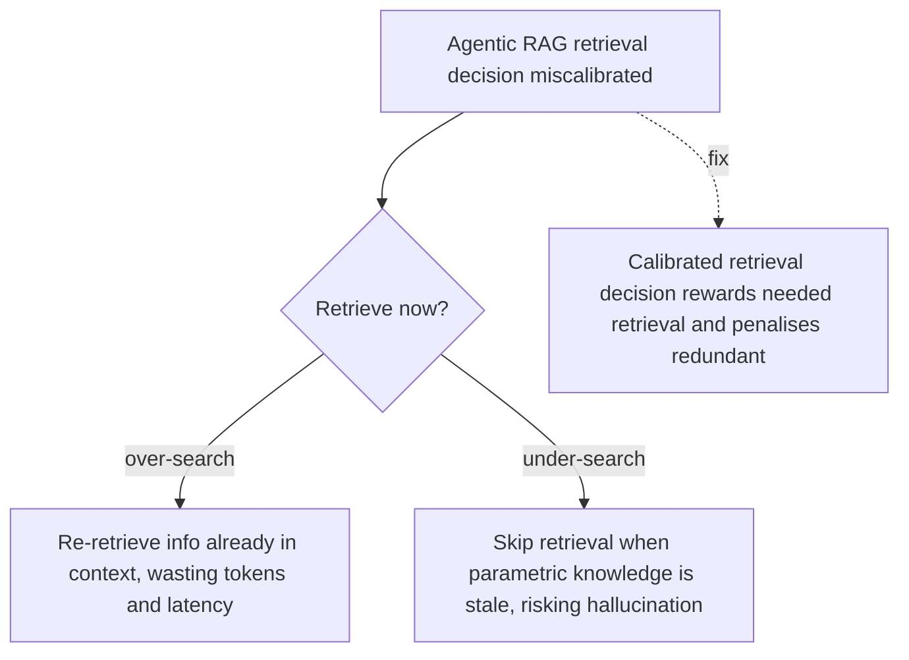

# Over-Search and Under-Search

**Also known as:** Retrieval-Frequency Miscalibration

**Category:** Anti-Patterns  
**Status in practice:** deprecated

## Intent

Anti-pattern: let an agentic RAG system miscalibrate when to retrieve, so it either re-retrieves information already in context or skips retrieval when its parametric knowledge is stale.

## Context

An agent has search-as-tool wired into its loop and decides at each step whether to invoke retrieval. The decision policy is implicit — it falls out of the prompt and the model's general disposition rather than from a calibrated signal. The team measures end-to-end task accuracy and tool-call counts, but not whether each individual retrieval was warranted.

## Problem

The agent re-retrieves passages it has already seen in the same context window (over-search), burning tokens and latency on duplicates, and it skips retrieval when its parametric knowledge is wrong (under-search), producing confident hallucinations. Both failures are invisible at the aggregate metric level — accuracy averages can stay flat while individual queries either pay for the same passage four times or get answered from stale weights. The HiPRAG paper measures over-search at double-digit baseline rates in standard agentic-RAG setups, with under-search rates rising under reinforcement-learning training that rewards short trajectories.

## Forces

- Naive policies (always retrieve, never retrieve) are easy; calibrated policies require a learned or rule-based decision signal.
- End-to-end accuracy hides retrieval miscalibration because the agent can still arrive at correct answers via expensive or lucky paths.
- Token cost and latency from over-search compound silently; hallucinations from under-search are noticed only when a downstream check catches them.

## Therefore

Therefore: instrument retrieval decisions with per-step process rewards or rule-based gates, measure over-search and under-search rates separately on a held-out eval, and tune the agent's decision policy on those signals — not on end-to-end accuracy alone.

## Solution

Don't ship agentic RAG without calibrated retrieval decisions. Adopt agentic-rag with explicit retrieval-decision instrumentation: per-step rewards that penalise redundant retrieval and reward retrieval when parametric knowledge is insufficient. Track over-search and under-search rates as first-class evaluation metrics. Compare against naive-rag (always retrieve) and naive-rag-first (RAG-by-reflex) as baselines — the goal is calibrated, not maximally agentic.

## Structure

```
Anti-pattern: Query -> uncalibrated retrieve-or-not decision -> redundant retrieval or skipped retrieval -> waste or hallucination. Corrected: Query -> calibrated retrieval decision (per-step reward + over/under-search metrics) -> retrieve only when knowledge is missing.
```

## Diagram



*Over-Search and Under-Search failure-mode pathway.*

## Example scenario

A team ships an agentic-RAG assistant that reaches 82% accuracy on its eval. After three months of complaints about latency and cost, they instrument per-step retrieval decisions. They find the agent re-retrieves the same three policy documents on every fourth turn (over-search at 31%), and on 9% of queries it skips retrieval entirely and answers from stale parametric knowledge (under-search). They add a process-reward signal that penalises duplicate retrieval and rewards retrieval when the model's confidence is low. Over-search drops to 4%, under-search to 2%, accuracy rises to 87%, and token cost per query falls by 38%.

## Consequences

**Benefits**

- Short-term: an agentic retrieval loop looks smarter than always-retrieve and seems to need no extra measurement.
- Naming it lets a team track over-search and under-search rates as separate evaluation metrics.

**Liabilities**

- Token spend and latency inflated by repeat retrievals on context the agent already holds.
- Confident hallucinations from skipped retrieval when parametric knowledge is stale or wrong.
- Aggregate accuracy metrics mask the failure; only per-step retrieval-decision evaluation surfaces it.

## Failure modes

- Duplicate fetch — the agent retrieves the same passage several times in one context window and pays for each copy.
- Stale-weight answer — the agent skips retrieval on a question its parametric knowledge gets wrong and answers with confidence.
- Flat average — overall accuracy stays steady, so neither failure is seen until per-step retrieval decisions are measured.
- Short-trajectory bias — training that rewards short runs teaches the agent to skip retrieval more often.

## What this pattern constrains

No useful constraint; the missing constraint is a calibrated retrieval-decision policy with per-step measurement.

## Applicability

**Use when**

- Never. Cite when reviewing an agentic-RAG system that has no per-step retrieval-decision metric.
- Demand over-search and under-search rates as first-class evaluation outputs.
- Instrument retrieval decisions with process rewards or rule-based gates.

**Do not use when**

- Any agentic-RAG system measured only on end-to-end accuracy.
- Any retrieval loop where the agent decides when to search without a calibrated signal.
- Any deployment where token spend on retrieval has never been audited per-query.

## Components

- Trigger condition — what causes the over-search and under-search pattern to manifest
- Affected surface — the part of the system where the failure shows up
- Detection signal — what an operator would observe when this is happening

## Tools

- Observability — logs, traces, and metrics that surface the pattern
- Eval harness — runs that quantify exposure to the pattern

## Evaluation metrics

- Over-search rate — fraction of retrieval calls whose returned content was already present in the agent's context window
- Under-search rate — fraction of queries answered from parametric knowledge where retrieval would have changed the answer
- Tokens-per-correct-answer — total retrieval-input tokens divided by correct answers; rises with over-search
- Hallucination rate on retrieval-skipped queries — share of confidently wrong answers when retrieval was not invoked
- Process-reward signal coverage — fraction of retrieval decisions evaluated by a per-step reward rather than only end-to-end accuracy

## Known uses

- **[HiPRAG: Hierarchical Process Rewards for Efficient Agentic Retrieval Augmented Generation](https://arxiv.org/abs/2510.07794)** _available_ — Names the failure modes explicitly; reduces over-search to 2.3% via fine-grained process rewards.
- **[SoK: Agentic Retrieval-Augmented Generation](https://arxiv.org/abs/2603.07379)** _available_ — Surveys retrieval-misalignment risks in agentic RAG.
- **[Agentic Retrieval-Augmented Generation: A Survey on Agentic RAG](https://arxiv.org/abs/2501.09136)** _available_ — Surveys dynamic-retrieval-policy design space.

## Related patterns

- _alternative-to_ **Agentic RAG** — calibrated retrieval decisions are the fix
- _complements_ **Naive RAG** — always-retrieve baseline against which over-search regression is measured
- _complements_ **Naive-RAG-First** — the upstream architecture decision; this anti-pattern is the per-step retrieval calibration failure
- _complements_ **Deliberation Over Observation** — There the substituted object is a retrieved document and the miscalibration is two-sided; here it is any environment interaction and the effect is monotone in the thinking budget.

## References

- [HiPRAG: Hierarchical Process Rewards for Efficient Agentic Retrieval Augmented Generation](https://arxiv.org/abs/2510.07794) — 2025
- [SoK: Agentic Retrieval-Augmented Generation](https://arxiv.org/abs/2603.07379) — 2026
- [Agentic Retrieval-Augmented Generation: A Survey on Agentic RAG](https://arxiv.org/abs/2501.09136) — 2025
