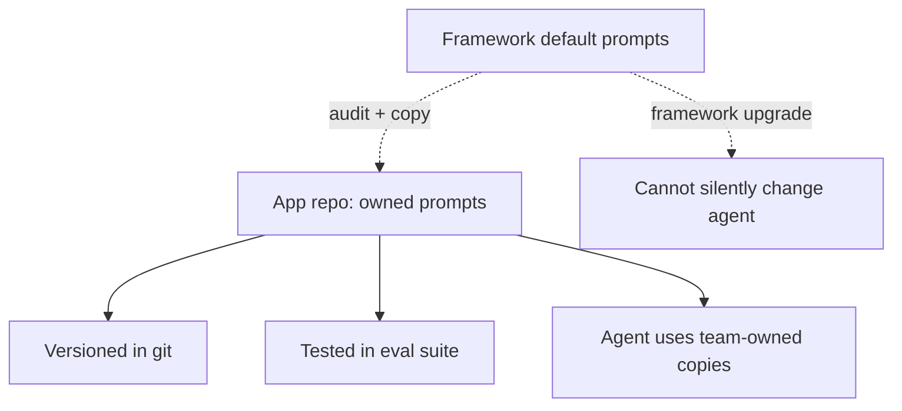

# Own Your Prompts (12-Factor Agents)

**Also known as:** 12-Factor Prompts, Production-Owned Prompts

**Category:** Governance & Observability  
**Status in practice:** emerging

## Intent

Every prompt in a production agent is versioned, tested, and owned by the team in the application repo — never inherited as a framework default.

## Context

A team uses an agent framework (LangChain, LlamaIndex, etc.) that ships default system prompts. Production agents inherit these defaults without auditing them. When the framework updates, the prompt changes silently.

## Problem

Framework-default prompts are not visible in the team's codebase, are not versioned by the team, are not tested by the team's eval suite. The team has no record of what prompt was in production at any historical moment. Differs from existing prompt-versioning by adding the no-framework-defaults stance — version is necessary but not sufficient.

## Forces

- Framework defaults are convenient; rewriting them is initial effort.
- Some framework defaults are quite good and reinventing them is a regression risk.
- Team-owned prompts mean team-owned maintenance burden.

## Therefore

Therefore: the team copies every prompt the agent uses (system, developer, examples) into its own repo, versions them like code, and tests them like code — framework upgrades cannot silently change production behavior.

## Solution

At project start, audit every prompt the framework uses; copy into application repo as first-class files. Wire the agent to use the team-owned copies, not framework defaults. Version with git. Test in eval suite. Framework upgrades cannot change agent behavior without a team-controlled prompt change. Pair with prompt-versioning, eval-as-contract, deterministic-control-flow-not-prompt, stateless-reducer-agent.

## Structure

```
Framework default prompts --audit + copy--> App repo prompt files (team-owned) --> versioned in git + tested in eval suite --> Agent wiring loads team-owned copies only; framework upgrade --> no change to agent prompts without a team commit
```

## Diagram



## Example scenario

A team uses LangChain. Initial audit reveals the agent uses 3 prompts (ReAct system, tool-summary, retry-suggestion) inherited from LangChain defaults. Team copies all 3 into app/prompts/, wires the agent to use those, removes default-inheritance code path. A later LangChain upgrade changes the default ReAct prompt — team's agent is unaffected. Eval suite covers the actual prompts in use.

## Consequences

**Benefits**

- Prompt-change traceable to specific commits.
- Framework upgrades cannot silently change agent behavior.
- Eval suite covers what the agent actually uses.

**Liabilities**

- Upfront work to extract and own framework defaults.
- Maintenance burden — team is now responsible for the prompts.
- Framework improvements to defaults must be evaluated and merged manually.

## Failure modes

- Missed default in the audit — the initial audit misses a summarisation or retry prompt buried in the framework, and that one still changes on every framework upgrade.
- Fallback to framework prompt — a missing file path makes the agent silently fall back to the framework default, and the owned copy is never used.
- Copied and forgotten — the team owns the prompts but never reviews framework improvements to them, and fixes upstream never reach the agent.
- Owned but untested — the prompts sit in the repo under version control, but the eval suite does not exercise some of them, so changes ship unchecked.

## What this pattern constrains

No prompt the agent uses is sourced from a framework default; all prompts live in the application repo under team ownership.

## Applicability

**Use when**

- Production agent built on a framework with default prompts.
- Behavior reproducibility across framework upgrades matters.
- Team can absorb prompt-maintenance burden.

**Do not use when**

- Prototype or experimental agent.
- Framework defaults are explicitly considered acceptable.
- No team capacity for prompt ownership.

## Components

- Prompt audit — initial extraction of framework defaults
- App-repo prompt files — versioned, owned by team
- Agent wiring — uses team-owned copies, not framework defaults
- Eval coverage — tests the prompts the agent actually uses

## Tools

- App-repo prompt files (versioned)
- Eval suite covering app-owned prompts
- Wiring to bypass framework defaults

## Evaluation metrics

- Prompt-change traceability — every change has a commit
- Framework-upgrade behavior delta — none expected
- Eval coverage % of app-owned prompts

## Known uses

- **[devstockacademy: 12-Factor Agents (Polish roundup) — 'Own Your Prompts'](https://devstockacademy.pl/blog/narzedzia-i-automatyzacja/12-factor-agents-jak-budowac-agenty-ai-w-produkcji/)** _available_
- **[humanlayer/12-factor-agents](https://github.com/humanlayer/12-factor-agents)** _available_

## Related patterns

- _specialises_ **Prompt Versioning**
- _complements_ **Eval as Contract**
- _complements_ **Deterministic Control Flow, Not Prompt**
- _complements_ **Stateless Reducer Agent**
- _complements_ **Spec-Driven Loop**
- _complements_ **Agentic Golden Path** — Owning standards as versioned artifacts is what lets the golden path assemble them into agent context.

## References

- [12-Factor Agents: jak budować agenty AI](https://devstockacademy.pl/blog/narzedzia-i-automatyzacja/12-factor-agents-jak-budowac-agenty-ai-w-produkcji/) — 2026
- [humanlayer/12-factor-agents](https://github.com/humanlayer/12-factor-agents) — 2026
