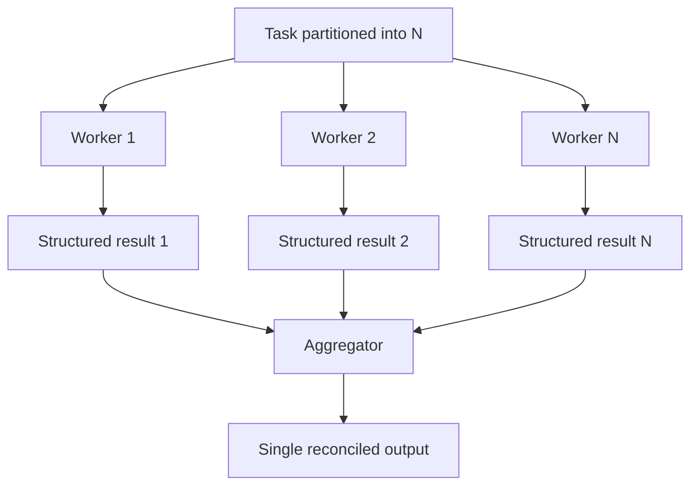

# Parallel Fan-Out / Gather

**Also known as:** Fan-Out Fan-In, Parallel + Aggregator

**Category:** Multi-Agent  
**Status in practice:** emerging

## Intent

Multiple independent agents execute in parallel on a partitioned task; a dedicated aggregator agent reconciles their results into a single output.

## Context

A team uses parallelization for throughput. The post-parallel reconciliation step is implicit — either the orchestrator does ad-hoc merging or downstream code assembles the parts. The aggregator role is unnamed.

## Problem

Without a named aggregator, reconciliation logic accretes in the orchestrator or in downstream consumers. Conflicts between parallel results (disagreement, overlap, missing pieces) have no designated handler. Distinct from generic parallelization by naming the aggregator role.

## Forces

- Parallel results often disagree — reconciliation policy must be explicit.
- Adding an aggregator means another agent (or step) in the path.
- Aggregator design is hard for unstructured outputs.

## Therefore

Therefore: name the aggregator role explicitly — N workers fan out in parallel on partitioned sub-tasks, a dedicated aggregator (agent or deterministic merger) reconciles their outputs into one result.

## Solution

Partition the task into N sub-tasks. Spawn N workers in parallel; each emits a structured result. The aggregator (a dedicated agent or a deterministic merger) takes the N results and produces one output. Conflict resolution policy is part of the aggregator's design. Distinct from existing parallelization by mandating the named aggregator role. Pair with parallelization, scatter-gather-saga, heterogeneous-model-council-with-judge.

## Structure

```
Task --partition into N--> Workers 1..N (in parallel) --structured results--> Aggregator (conflict-resolution policy) --> Single reconciled output
```

## Diagram



## Example scenario

A research agent fans out 5 sub-agents on 5 sub-questions. Each emits a structured finding {claim, citation, confidence}. The aggregator takes all 5, deduplicates citations, resolves contradictions (preferring higher-confidence or majority), and emits one consolidated report. Without the named aggregator role, downstream code would have had to merge ad-hoc.

## Consequences

**Benefits**

- Reconciliation logic lives in one named place, not scattered.
- Conflict-resolution policy is explicit and auditable.
- Aggregator can be specialized (cheaper model) while workers stay strong.

**Liabilities**

- Aggregator can become its own bottleneck if N is very large.
- Aggregator design adds one more component to the architecture.
- Quality of aggregation depends on worker-output structure.

## Failure modes

- Aggregator bottleneck — N grows large, and the single aggregator cannot merge results as fast as the workers produce them.
- Unstructured worker output — workers return free-form text, and the aggregator guesses how to line up their results.
- Silent gap — one partition fails or returns nothing, and the aggregator merges the rest into an output that looks complete.
- Reconciliation leak — the orchestrator or a downstream consumer starts fixing conflicts itself, and merge logic is split across components again.

## What this pattern constrains

Reconciliation may not be performed by the orchestrator or downstream code; only the designated aggregator may merge worker outputs.

## Applicability

**Use when**

- Task naturally partitions into N parallel sub-tasks.
- Outputs can be reconciled by a separate component.
- Reconciliation policy is non-trivial enough to deserve its own role.

**Do not use when**

- Sub-tasks are not independent and produce conflicting state.
- Reconciliation is so trivial that a dedicated aggregator is overhead.
- Aggregator would itself become the bottleneck for large N.

## Components

- Task partitioner — splits work into N sub-tasks
- Workers — N parallel agents producing structured results
- Aggregator — dedicated agent that reconciles N results
- Conflict-resolution policy — embedded in aggregator design

## Tools

- Task partitioner
- Parallel worker pool
- Dedicated aggregator agent

## Evaluation metrics

- Aggregator conflict-resolution rate
- Per-worker variance in output quality
- End-to-end speedup vs sequential

## Known uses

- **[Google ADK: 8 multi-agent design patterns (Korean roundup)](https://nextplatform.net/best-ai-architecture-google-multi-agent-eight-design-patterns/)** _available_
- **[Habr: multi-agent feedback for drawing instruction (Russian, fan-out/fan-in council)](https://habr.com/ru/articles/1037770/)** _available_

## Related patterns

- _specialises_ **Parallelization**
- _complements_ **Scatter-Gather Plus Saga**
- _specialises_ **Heterogeneous-Model Council with Synthesis Judge**
- _alternative-to_ **MapReduce for Agents**
- _alternative-to_ **Voting-Based Cooperation**
- _generalises_ **Heterogeneous-Model Council with Synthesis Judge**
- _complements_ **Contract Net Protocol**

## References

- [베스트 AI 아키텍처 | 구글이 제안하는 멀티 에이전트 8대 디자인 패턴](https://nextplatform.net/best-ai-architecture-google-multi-agent-eight-design-patterns/) — 2026
- [Как мы проектировали multi-agent feedback для обучения рисованию](https://habr.com/ru/articles/1037770/) — 2026
