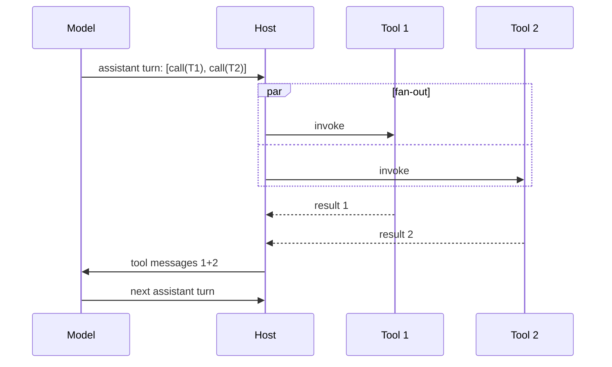

# Parallel Tool Calls

**Also known as:** Concurrent Function Calls, Multi-Tool Turn

**Category:** Routing & Composition  
**Status in practice:** mature

## Intent

Allow the model to emit several independent tool calls in one assistant turn; the host executes them in parallel.

## Context

A tool-using agent is on a task where the next step naturally splits into several independent lookups or actions — fetch three records from different tables, read four files, query two APIs that have nothing to do with each other. The provider's chat API supports a single assistant turn that contains more than one tool call, and the model is capable of identifying these independent calls in one breath rather than thinking step by step.

## Problem

If the agent issues these calls sequentially, the wall-clock latency is the sum of every call even though none of them depend on the others, and the product feels sluggish for no good reason. Building a full directed-acyclic-graph planner that schedules tool calls and tracks dependencies is heavyweight for the simple case where the model already knows which calls are independent. The team needs a lighter way to let independent calls run at the same time without standing up a planner.

## Forces

- Concurrency limits per provider.
- Provider must support multi-tool-call turns.
- Aggregation of results back into the next turn.
- Models sometimes emit dependent calls in one turn despite the prompt; the host must detect or document this contract.

## Therefore

Therefore: let the assistant turn carry several independent tool calls and have the host fan them out concurrently under a bounded budget, so that independent steps share wall-clock time instead of stacking it.

## Solution

The provider's API allows the assistant turn to contain multiple tool calls. The host fans them out concurrently (with bounded concurrency and rate-limit handling). Results return as multiple tool messages; the next assistant turn sees all of them.

## Structure

```
Model --assistant turn [call T1, call T2, ...]--> Host fan-out executor (bounded concurrency, rate-limit guard) --parallel--> Tool 1 | Tool 2 | ... --results keyed by call id--> Result joiner --> tool messages --> Model next turn
```

## Diagram



## Example scenario

An agent that summarises a support ticket needs to fetch the customer record, the recent invoice, and the last three tickets — three independent calls. Sequential dispatch takes a second per call and makes the bot feel sluggish. The team enables parallel-tool-calls in the provider API: the model emits all three tool calls in one assistant turn, the host fans them out concurrently with bounded concurrency, and the next assistant turn sees all three results. Latency drops from three seconds to about one without changing the model.

## Consequences

**Benefits**

- Lower wall-clock latency on parallelisable steps.
- Simpler than full DAG planning.

**Liabilities**

- Provider-specific behaviour.
- Host concurrency control complexity.
- Silent correctness bugs when accidentally-dependent calls are parallelised.

## Failure modes

- Hidden dependency — the model puts a call that needs another call's result in the same turn, both run at once, and the second uses missing or stale data.
- Rate-limit burst — the host fans out many calls to one strict tool at once and gets throttled, so the turn is slower than sequential calls.
- Lost result pairing — a tool message comes back without the right call id, and the next turn reads one tool's result as another's.
- Provider mismatch — a model or provider that does not emit multi-call turns is swapped in, and the expected speed-up quietly disappears.

## What this pattern constrains

Tool calls in the same assistant turn are treated as independent; cross-call dependencies are not allowed within one turn.

## Applicability

**Use when**

- The model frequently issues multiple independent tool calls per turn.
- The provider's API supports multiple tool calls in one assistant message.
- The host can fan out concurrent calls with bounded concurrency and rate-limit handling.

**Do not use when**

- Tool calls have hard sequential dependencies.
- Concurrency would breach external rate limits or transactional invariants.
- Heavyweight DAG planning is already in place and parallel calls would conflict.

## Components

- Multi-call assistant turn — provider-supported message format carrying several tool calls
- Host fan-out executor — runs the calls concurrently under a bounded concurrency limit
- Per-tool adapter — invokes each tool and returns a tool-message result keyed to its call id
- Result joiner — collects all tool messages into the next assistant turn's context
- Rate-limit guard — backoff and queue logic for tools with strict per-second limits

## Tools

- Provider tool-use API supporting multiple tool calls per assistant turn — OpenAI, Anthropic, equivalents
- Async runtime (asyncio, Trio, Go routines) — the host-side fan-out primitive
- Bounded-concurrency semaphore — caps simultaneous tool invocations per dependency

## Evaluation metrics

- Mean tool calls per assistant turn — how often the model actually parallelises
- Wall-clock latency reduction vs sequential dispatch — the saving the pattern is meant to deliver
- Independence violation rate — sampled audit of turns where the calls turned out to depend on each other
- Concurrency saturation — share of turns hitting the host's concurrency cap or upstream rate limits
- Result-join failure rate — turns where a fan-out result was dropped or mis-keyed

## Known uses

- **OpenAI parallel function calling** _available_
- **Anthropic parallel tool use** _available_
- **Claude Code multi-tool turns** _available_
- **Cursor parallel reads** _available_

## Related patterns

- _uses_ **Tool Use**
- _alternative-to_ **LLMCompiler**
- _specialises_ **Parallelization**
- _alternative-to_ **Code-as-Action Agent**
- _alternative-to_ **Speculative Agentic Actions** — Parallel tool calls fan out calls already known to be independent within one turn; speculative actions execute the predicted likely-NEXT call before the agent has confirmed it needs it, and discard it on a miss.

## References

- [OpenAI: Parallel function calling](https://platform.openai.com/docs/guides/function-calling)
- [Anthropic: Tool use](https://platform.claude.com/docs/en/agents-and-tools/tool-use/overview)
