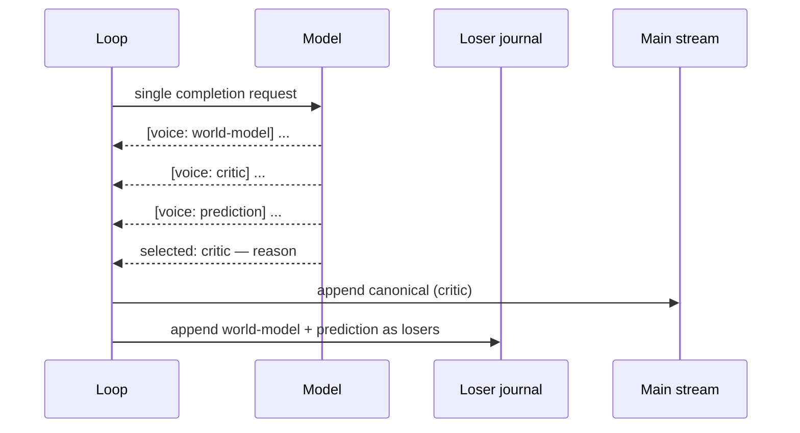

# Parallel-Voice Proposer

**Also known as:** Multi-Voice Generation, Internal Proposers, Tagged-Voice Self-Selection

**Category:** Cognition & Introspection  
**Status in practice:** experimental

## Intent

Generate several candidate thoughts in parallel under named voices and have the same model pick the canonical one, logging the losers as audit.

## Context

A team is running a single-agent loop on a workload where the model often produces confident-sounding output that masks real internal disagreement. Best-of-N sampling — generating N independent completions and scoring them — would help but is too expensive per tick, and running a sequential inner-committee of personas is too slow. The team wants to surface disagreement within a single completion without paying for either alternative.

## Problem

Single-pass generation collapses whatever internal tension the model has into a confident-sounding mean, and downstream consumers see only the polished result. Running multiple completions in sequence under different personas slows the loop and depends fragilely on role-ordering effects. Best-of-N needs an external reward model to pick the winner, and for many tasks no such scorer exists. The team is forced to choose between cheap-but-overconfident, slow-and-ordered, or expensive-and-needs-a-judge.

## Forces

- Parallel voices in one completion are cheap but risk all sounding the same.
- Self-selection from candidates can rubber-stamp the first one.
- Logging losers costs disk and tokens but is the auditable substrate.
- More than three or four voices bloat the prompt without adding signal.

## Therefore

Therefore: emit two or three candidate thoughts in one completion each tagged with a named voice that frames a distinct perspective, then have the same model select the canonical and log the rest, so that internal disagreement is preserved as evidence instead of collapsing into a confident mean.

## Solution

Prompt the model to produce two or three candidate next-thoughts in one completion, each prefixed with a voice tag such as `[voice: world-model]`, `[voice: critic]`, `[voice: prediction]`. Then ask for a single `selected: <voice>` line with a one-sentence reason. The canonical thought enters the main stream; the losers are appended to a proposer-losers log for inspection. Voices that never win across a rolling window become eligible for retirement; that retirement decision is explicit, not silent.

## Structure

```
Loop --one completion request--> Model --> 2-3 voice-tagged candidates ([voice: world-model], [voice: critic], [voice: prediction]) + 'selected: <voice>' with reason --> canonical -> main stream; losers -> proposer-losers log (read-only audit); rolling win counts --> explicit retirement decision
```

## Diagram



*One completion emits multiple voice-tagged candidates plus a selection line; the canonical enters the main stream, the losers go to an audit log.*

## Example scenario

A long-running personal agent keeps producing single-line responses that sound certain but are wrong in subtle ways. The team rebuilds the per-tick generation as Parallel-Voice Proposer: the model emits three tagged candidates (world-model, critic, prediction) in one completion, then a final line names the selected voice and gives a one-sentence reason. The canonical thought enters the stream; the losers are appended to an audit log. Retrospective review shows the critic voice was correctly catching overconfidence the agent had been emitting solo.

## Consequences

**Benefits**

- Internal disagreement is preserved rather than collapsed.
- One completion is cheaper than sequential persona calls.
- Loser log creates an audit substrate for retrospective analysis.

**Liabilities**

- Same model means correlated voices; true diversity is limited.
- Self-selection can rubber-stamp the first candidate without rotation strategy.
- Prompt overhead per tick is non-trivial when voices are kept distinct.

## Failure modes

- Echo voices — all candidates come from the same model in one completion and say nearly the same thing under different tags.
- First-candidate stamp — the selection line keeps picking whichever voice appeared first, so the comparison adds nothing.
- Loser re-promotion — a later step copies a losing voice from the audit log back into the main stream.
- Silent voice retirement — a voice that rarely wins is dropped without the explicit decision, and the team loses track of what was removed.

## What this pattern constrains

Each generation governed by this pattern must emit at least two voice-tagged candidates; the selected canonical is the only one entered into main memory and the losers are read-only audit, never re-promoted by the model.

## Applicability

**Use when**

- Single-pass generation produces overconfident output that hides real disagreement.
- Inner-committee's sequential roles are too slow per tick.
- An external reward model for best-of-N is not available.

**Do not use when**

- The agent's task does not benefit from surfaced disagreement.
- Token budget will not absorb two or three voice-tagged candidates per call.
- Auditability of internal disagreement is not a goal.

## Components

- Voice Set — two or three named voices with distinct framings
- Single-Completion Proposer — emits all voice-tagged candidates in one call
- Self-Selector — final line names the canonical voice with a one-sentence reason
- Loser Journal — append-only log of non-selected candidates
- Voice Retirement — explicit decision to drop a voice that never wins

## Tools

- LLM API — single completion that emits all candidates plus the selection line
- Structured JSON store — append-only loser journal for audit

## Evaluation metrics

- Voice-win distribution — selection counts per voice over a rolling window
- Rubber-stamp rate — share of selections matching the first candidate emitted
- Loser-becomes-right rate — audit sample where retrospective review preferred a losing candidate
- Token overhead per call — extra tokens spent on tagged candidates vs single-pass generation

## Known uses

- **Author's long-running personal agent (single private deployment)** _available_ — Single-source evidence: one private deployment by the catalog author; no independently documented use yet.

## Related patterns

- _alternative-to_ **Inner Committee**
- _alternative-to_ **Debate**
- _alternative-to_ **Best-of-N Sampling**

## References

- [The Society of Mind](https://archive.org/details/societyofmind00mins) — Marvin Minsky, 1986
- [Self-Consistency Improves Chain of Thought Reasoning in Language Models](https://arxiv.org/abs/2203.11171) — Xuezhi Wang et al., 2022
