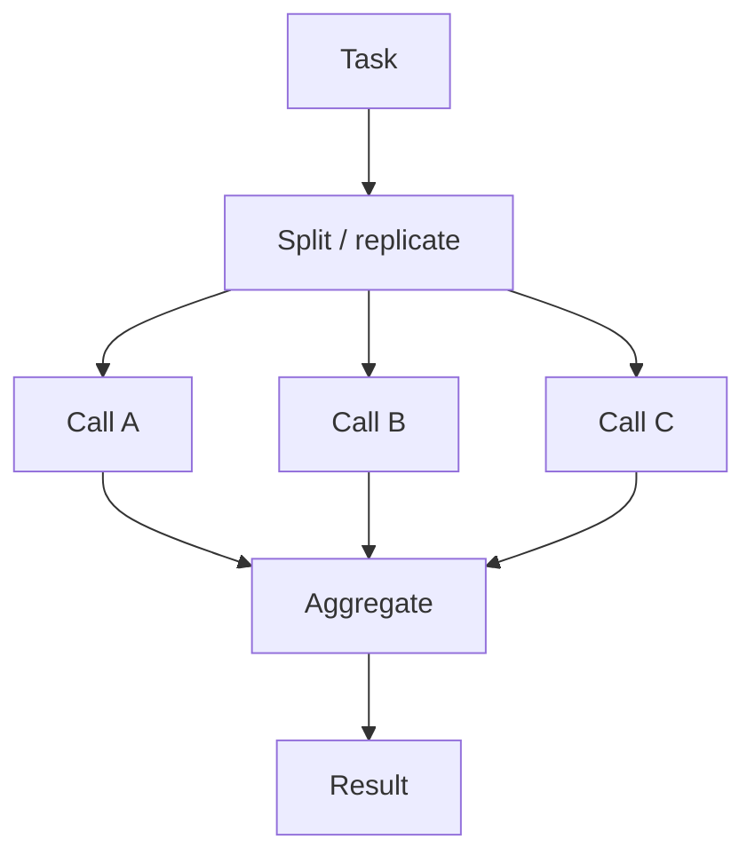

# Parallelization

**Also known as:** Sectioning, Voting, Parallel Branches

**Category:** Routing & Composition  
**Status in practice:** mature

## Intent

Run independent LLM calls concurrently and combine results.

## Context

A task either splits cleanly into independent subtasks that can run side by side — for example reviewing a pull request for security, style, and test coverage — or benefits from running the same prompt several times and combining the results, which is the basis of self-consistency style voting in mathematical reasoning. In both cases the agent is making more than one LLM call where none of the calls depend on each other's output. The provider's rate limits and the team's budget can absorb running these calls in parallel.

## Problem

If independent subtasks run one after another, the user waits for the sum of every call even though nothing forces the order. If the model produces only one attempt at a hard reasoning problem, an unlucky sample can be wrong with no chance of catching it because there is nothing to compare against. Sequential single-attempt execution leaves both latency and quality on the table whenever the work is genuinely parallelisable.

## Forces

- Concurrency limits and rate limits.
- Aggregation logic for voting (majority? best? union?).
- Cost multiplies linearly with parallel branches.

## Therefore

Therefore: fan independent work or repeated attempts out into concurrent LLM calls and join them at a single aggregator, so that latency drops on sectioning and outliers surface on voting.

## Solution

Two flavours. Sectioning: split a task into independent subtasks, run them concurrently, concatenate results. Voting: run the same task multiple times, aggregate by majority or judge.

## Structure

```
Task --> Splitter (sectioning) or Replicator (voting) --> Call A | Call B | Call C (no shared state) --> Aggregator (concatenate / majority / judge) --> Result
```

## Diagram



## Example scenario

A code-review agent runs three independent checks on each PR — security scan, style review, and test-coverage analysis. Running them in series adds up to thirty seconds per PR. The team applies parallelization in its sectioning flavour: the three checks run as concurrent LLM calls and the results concatenate into one review. For high-stakes PRs they also use the voting flavour: the security check runs three times and an aggregator emits the majority verdict, catching the occasional outlier hit.

## Consequences

**Benefits**

- Wall-clock latency drops; quality rises (voting).
- Independent failures isolate cleanly.

**Liabilities**

- Cost scales with branch count.
- Aggregation logic is its own correctness problem.

## Failure modes

- False independence — sectioned subtasks actually depend on each other, and the concatenated result contradicts itself at the seams.
- Correlated votes — every branch makes the same mistake from the same prompt, so the majority vote confirms the wrong answer.
- Poisoned join — one branch fails or times out, and the aggregator drops the whole result or merges an error into it.
- Fan-out cost — branch count is raised for quality, and the spend grows linearly while the gain flattens.

## What this pattern constrains

Branches cannot share state during execution; aggregation is the only join point.

## Applicability

**Use when**

- Independent subtasks can run concurrently to cut wall-clock time.
- Voting across multiple attempts catches outliers a single run would miss.
- Aggregation by concatenation, majority, or judge is feasible.

**Do not use when**

- Subtasks have hard dependencies that force sequential execution.
- The cost of running multiple attempts outweighs the quality gain.
- No reliable aggregation step is available for the votes.

## Components

- Splitter or replicator — fans the task into sectioning subtasks or repeated voting branches
- Parallel branches — independent LLM calls that share no state during execution
- Aggregator — majority vote, judge model, union, or concatenation depending on flavour
- Concurrency controller — bounds the fan-out width against rate limits and budget
- Failure-isolation wrapper — per-branch error handling that does not poison the join

## Tools

- Async LLM client (LangChain `RunnableParallel`, asyncio gather, Promise.all) — drives the fan-out
- Multiple LLM API keys or load-balanced endpoints — sustain the parallel request rate
- Aggregation library — voting helpers, judge prompts, or merge utilities

## Evaluation metrics

- Wall-clock latency vs sequential baseline (sectioning) — the speedup the fan-out delivers
- Quality lift over single-attempt baseline (voting) — accuracy gain from majority or judge
- Branch agreement rate (voting) — how often branches converge, which calibrates n
- Cost multiplier per resolved request — branch count times unit cost
- Aggregation-step error rate — judge or vote miscalls measured on a labelled set

## Known uses

- **Anthropic Building Effective Agents (Workflow #3)** _available_
- **Self-consistency in mathematical reasoning** _available_

## Related patterns

- _generalises_ **Self-Consistency**
- _generalises_ **MapReduce for Agents**
- _generalises_ **Best-of-N Sampling**
- _used-by_ **LLMCompiler**
- _generalises_ **Parallel Tool Calls**
- _alternative-to_ **Prompt Chaining**
- _used-by_ **Lead Researcher**
- _generalises_ **Clone Fan-Out Research**
- _complements_ **Iteration Node**
- _alternative-to_ **Race Conditions on Shared Tool Resources**
- _generalises_ **Parallel Fan-Out / Gather**
- _alternative-to_ **Multi-Agent on Sequential Workloads**
- _generalises_ **Scatter-Gather Plus Saga**

## References

- [Anthropic: Building Effective Agents](https://www.anthropic.com/research/building-effective-agents) — 2024
