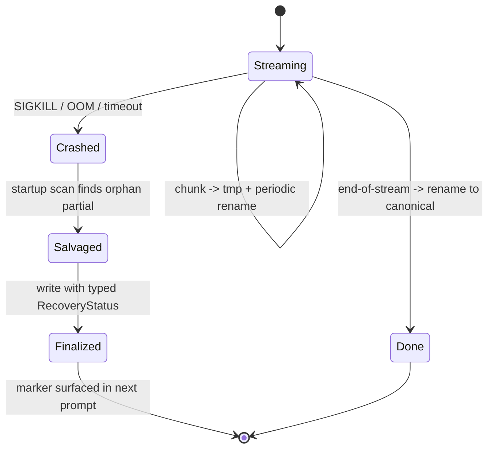

# Partial-Output Salvage

**Also known as:** Crash-Safe Streaming, Tmp-Replace Thought Recovery, Recovered-Partial Marker

**Category:** Cognition & Introspection  
**Status in practice:** emerging

## Intent

Stream every model token to a tmp-plus-atomic-replace partial file so crashes mid-inference leave a consistent salvage, then promote partials at startup with a typed recovery marker the model can see.

## Context

A team is running a long-lived agent on hardware that occasionally crashes: the out-of-memory killer takes the process, a watchdog timer issues a hard kill signal, a deploy restarts the container mid-stream. Per-call inference is long enough that losing a stream halfway through represents minutes of model time and meaningful context. Separately the agent already has a resumption pattern for process state, but that pattern only restores what was durably written before the crash, not the tokens that were streaming when it landed.

## Problem

When a hard kill arrives mid-stream, the partial output exists only in in-process memory and is lost completely. The next run sees no record that anything was happening, so it neither finishes the work nor warns the user about the gap. Worse, the agent may later return to the same topic with no awareness that a prior attempt died mid-sentence, and confidently begin again with no acknowledgement that a partial result might exist somewhere. Per-chunk fsync would solve durability but is too expensive to do on every token.

## Forces

- Per-chunk fsync is expensive; tmp-plus-rename is the affordable compromise.
- Recovery should be visible to the model, not silent — surprise about a partial is itself signal.
- A partial-thought stub must not be treated as a finished thought.
- Recovery markers must be typed (timeout vs hard crash) so triage is meaningful.

## Therefore

Therefore: stream every chunk to a tmp file with periodic atomic rename to the canonical partial path; at startup promote any orphan partial to a real thought file with a typed recovery marker and surface the recovery event in the next prompt, so that the model sees it is reading a salvage.

## Solution

Mechanical finite-state machine. On stream start: open `partial.tmp`, write a start marker with thought-id, timestamp, model id. On each chunk: append to tmp, periodically `os.rename(tmp, partial)` for atomicity. On normal stream end: rename to the canonical thought path, delete partial. On startup: scan for orphan `partial.*` files, finalize each with a typed RecoveryStatus enum (RECOVERED_FROM_PARTIAL for hard kill, TIMEOUT_PARTIAL for watchdog timeout). The next prompt's system context includes `last_partial_recovery: <status>` so the model can adjust.

## Structure

```
Stream start --> partial.tmp (thought-id, timestamp, model id) --each chunk: append + periodic atomic rename--> partial --normal end--> rename to canonical thought, delete partial | crash --> startup scan finds orphan partial --> finalize with RecoveryStatus (RECOVERED_FROM_PARTIAL | TIMEOUT_PARTIAL) --> last_partial_recovery in next prompt
```

## Diagram



*Tmp-plus-rename keeps the partial file consistent at all times; startup salvage finalizes orphans with a typed marker.*

## Example scenario

A long-running personal agent runs on a machine where the OOM killer occasionally takes the process. A four-minute reasoning trace gets killed at the three-minute mark and the entire stream is lost — the agent has no idea anything happened on the next run. The team adds Partial-Output Salvage: each chunk streams to `partial.tmp` with periodic atomic rename. On startup, orphan partials are finalized with a RECOVERED_FROM_PARTIAL marker that appears in the next prompt's system context. The agent sees the salvage, knows it was reading a partial, and decides whether to continue or restart the line of thought.

## Consequences

**Benefits**

- Mid-stream tokens are not lost on hard crash.
- Typed recovery marker preserves debuggability rather than hiding the salvage.
- Atomic rename keeps the partial file readable at every moment.

**Liabilities**

- Rename overhead per N chunks is non-zero.
- Partials add filesystem clutter if not periodically cleaned.
- Recovery surfaced in the prompt costs tokens every time it fires.

## Failure modes

- Partial treated as finished — a recovered fragment is loaded as a completed thought, and the agent builds on half a sentence.
- Torn write — the rename runs too rarely, so the crash loses everything since the last rename even though tokens were streamed.
- Orphan clutter — partial files that were salvaged are never cleaned, and the startup scan gets slower each run.
- Missing marker — the recovery status is not placed in the next prompt, so the model returns to the topic unaware a prior attempt died.

## What this pattern constrains

Partial thought files cannot be silently consumed; every salvaged partial carries a typed recovery marker that propagates into the next prompt, and the model is not allowed to treat a recovered partial as if it were a completed thought.

## Applicability

**Use when**

- The runtime can SIGKILL the agent mid-stream and that loses meaningful work.
- Inference is long enough per call that a partial stream has real value.
- Filesystem supports atomic rename in the working directory.

**Do not use when**

- Inference is fast enough that crashes never land mid-stream in practice.
- Partial output has no semantic value (e.g. binary embeddings only).
- The model cannot be trusted with a typed recovery marker without spiralling.

## Components

- Stream Writer — emits each chunk to partial.tmp
- Periodic Atomic Rename — replaces the canonical partial path with the tmp file
- Startup Scanner — finds orphan partial.* files after a crash
- Recovery Marker — typed enum distinguishing hard kill from watchdog timeout
- Next-Prompt Injector — surfaces last_partial_recovery into system context

## Tools

- Filesystem rename — atomic replacement of the partial canonical path
- Structured JSON store — finalized thought files with recovery markers

## Evaluation metrics

- Mid-stream loss rate — chars lost between last rename and crash, vs ungated baseline
- Salvage finalisation count — orphan partials promoted per restart
- Marker-consumption rate — share of recovered partials whose marker actually shifted the next reply
- Rename overhead — wall-clock cost of the periodic atomic rename per N chunks

## Known uses

- **Author's long-running personal agent (single private deployment)** _available_ — Single-source evidence: one private deployment by the catalog author; no independently documented use yet.

## Related patterns

- _complements_ **Agent Resumption**
- _composes-with_ **Append-Only Thought Stream**

## References

- [ARIES: A Transaction Recovery Method Supporting Fine-Granularity Locking and Partial Rollbacks Using Write-Ahead Logging](https://cs.stanford.edu/people/chrismre/cs345/rl/aries.pdf) — C. Mohan, Don Haderle, Bruce Lindsay, Hamid Pirahesh, Peter Schwarz, 1992
- [POSIX rename(2) atomicity](https://pubs.opengroup.org/onlinepubs/9699919799/functions/rename.html) — IEEE / The Open Group, 2018
