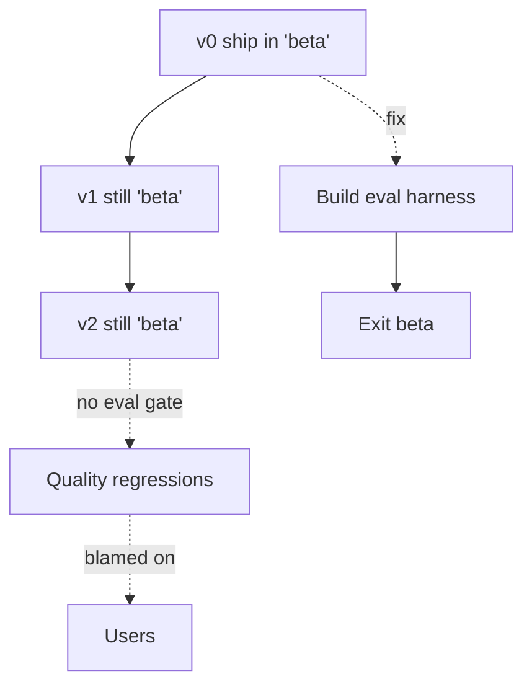

# Perma-Beta

**Also known as:** Forever Beta, Eval Vacuum

**Category:** Anti-Patterns  
**Status in practice:** deprecated

## Intent

Anti-pattern: ship the agent in 'beta' indefinitely so that quality regressions are someone else's problem.

## Context

A team launches an agent product to real users under a 'beta' label, without building an evaluation harness that can measure quality regressions across releases. Months later, the product is still labelled beta, partly because the team genuinely has not measured quality, partly because removing the label would commit them to a quality bar they have no way to defend. The label has quietly shifted from a signal of active iteration to a shield against accountability.

## Problem

Without an evaluation harness, every release is a guess: regressions land invisibly, model upgrades are accepted or rejected on vibe, and customer-facing quality drifts without anyone noticing until churn reveals it. Beta becomes a permanent excuse that costs nothing to keep and absorbs all accountability for unmeasured quality. Eventually a competitor ships a graduated version of a similar product and the beta team discovers, too late, that they never had a measurement story.

## Forces

- Eval harnesses cost time to build.
- GA promises commit to quality bars.
- Beta lets product move fast.

## Therefore

Therefore: build the eval harness, set quality gates, and exit beta on a published date, so that regressions become visible and the label stops absorbing accountability for unmeasured quality.

## Solution

Don't. Build the eval harness and exit beta. See eval-harness, llm-as-judge, shadow-canary.

## Structure

```
Anti-pattern: agent shipped as beta -> no eval harness -> releases and model swaps unmeasured -> quality drifts. Corrected: eval harness + judge + shadow canary -> measured releases -> exit beta with owned quality.
```

## Diagram



## Example scenario

A startup launches its agent product as 'beta' and uses the label as a blanket excuse for any quality complaint. Eighteen months later the agent is still beta, there is no eval harness, and customers have started churning to a competitor that ships GA. The team names the failure perma-beta and forces an exit: build the eval suite, set quality gates, fix the regressions blocking GA, and remove the beta label. The label was hiding the fact that nobody actually knew whether the product was getting better or worse.

## Consequences

**Benefits**

- Short-term: the beta label lowers expectations and lets the team ship without building measurement.
- Naming it lets a team set the exit criteria for beta in advance.

**Liabilities**

- Trust erosion.
- No SLA defensibility.
- Quality stagnates without measurement.

## Failure modes

- Invisible regression — a release lowers quality, and no eval harness catches it, so users find it first.
- Model upgrade on vibe — a new model version is accepted because it feels better, with no measurement.
- Accountability sink — every quality complaint is answered with 'it is beta', and nobody owns the problem.

## What this pattern constrains

Avoiding it imposes an accountability rule: 'beta' cannot be a permanent disclaimer; a release must carry an eval harness and an explicit exit condition, or the label is hiding unowned quality regressions.

## Applicability

**Use when**

- Cite this entry when the beta label is the answer to every quality complaint.
- You are already here if the product has been 'beta' for quarters with no eval harness or exit criteria.
- Build eval-harness, gate releases with llm-as-judge and shadow-canary, and exit beta deliberately.

**Do not use when**

- Any agent serving real users where regressions matter.
- Any product where 'beta' is being used as an excuse for missing evaluation.
- Any team that has the resources to build an eval harness but has not.

## Components

- Beta label on the product surface — used as a shield against quality accountability past its useful life
- Release pipeline — ships new versions without a regression-detection gate
- Missing eval harness — would measure quality across releases and gate GA
- Model-upgrade decision — accepted or rejected on vibe rather than measured deltas

## Tools

- Eval harness — missing measurement surface that would expose regressions per release
- Shadow-canary or LLM-as-judge gate — missing release control that would block bad ships

## Evaluation metrics

- Time-since-launch-still-in-beta — months elapsed past a reasonable graduation window
- Eval coverage of shipped features — fraction of capabilities backed by a regression-tracking eval set
- Release-rejection rate from automated gates — near zero indicates no gating at all
- User-reported-regression rate per release — climbs because internal measurement does not catch issues first

## Known uses

- **[Google Bard 'Experiment' label (2023-2024)](https://blog.google/technology/ai/try-bard/)** _deprecated_ — Shipped to the public for a year while labeled an experiment; the label acknowledged unreliability without reducing exposure, and quality complaints were answered with the beta framing.

## Related patterns

- _alternative-to_ **Eval Harness**
- _alternative-to_ **Shadow Canary**
- _conflicts-with_ **Eval as Contract**
- _complements_ **Demo-to-Production Cliff**
- _complements_ **Automating a Broken Process**
- _complements_ **Agentic Skill Atrophy**
- _complements_ **Agentic Debt**
- _alternative-to_ **Rigor Relocation**
- _complements_ **Hidden Validation-Work Amplification**
- _complements_ **Agent Sprawl** — Perma-beta is one agent shipped without a measurement story; agent sprawl is the fleet-scale version where many agents run with no success metric and no owner.
- _complements_ **Silent Pilot-to-Production Promotion** — Both keep a misleading status label to dodge accountability: perma-beta ships forever in 'beta' to defer quality ownership; this defers the go-live decision by staying forever in 'pilot'. The shared mechanism is a label that lags reality.
- _conflicts-with_ **Agent Withdrawal Criteria** — An expiry date and pre-agreed exit thresholds make the indefinite-beta dodge impossible: a breach or a lapsed review forces a recorded decision.

## References

- [ai-standards/ai-design-patterns (Perma-Beta)](https://github.com/ai-standards/ai-design-patterns)
