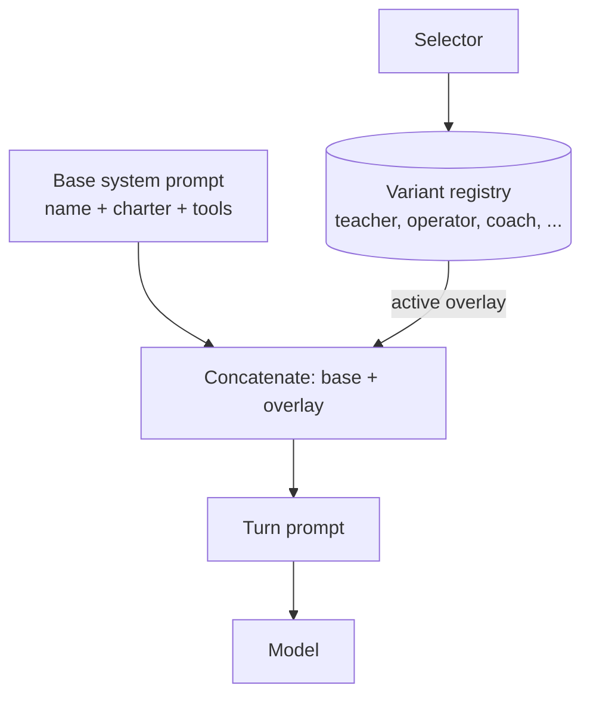

# Personality Variant Overlay

**Also known as:** Voice Overlay, Facet Voicing, Persona Overlay (identity-preserving)

**Category:** Multi-Agent  
**Status in practice:** experimental

## Intent

Let one agent speak in several named voices that overlay the base identity rather than replacing it, so the agent can shift register without losing identity continuity or splitting into separate personas.

## Context

A team is building a long-lived agent with an explicit base personality (charter, name, tone). Different conversational situations want different registers — teacherly, terse-and-operational, playful, gravely serious — and the team does not want to ship them as separate agents that each lose continuity with the others. The team also does not want the agent to vanish behind a persona it then has to drop, because identity continuity is the whole point. The need is for several labelled voices that are visibly the same agent.

## Problem

Forcing every register into one neutral voice flattens the agent and makes some moves impossible (a teacherly explanation in the same flat tone as a deadpan technical note). Spinning up separate personas as different agents preserves register but breaks continuity — each persona has its own short memory, and the user is now talking to a stranger when the register shifts. A jailbreak-style 'now act as X' overlay loses identity entirely because the base personality is overwritten rather than overlaid. None of these match the situation where the agent should still be itself, but speaking in a particular voice.

## Forces

- Identity continuity matters more than register variety: the base name and personality must remain visible.
- Some moves genuinely need a different register; uniform tone forecloses them.
- Variants must be a finite labelled set, not free-form impersonation.
- The overlay must be reversible and visible: caller must know which variant is active.
- Memory and tools stay shared across variants; the agent does not forget itself when shifting.

## Therefore

Therefore: define a finite set of named variants, each as an additive overlay that appends a 'speaking in the voice of <name>' instruction to the base system prompt rather than replacing it, and route situational selection through that overlay, so the agent retains one identity, one memory, and one toolset while gaining a labelled set of registers it can speak in.

## Solution

Maintain a small registry of named variants (e.g. 'teacher', 'operator', 'caring-coach', 'archivist'). Each variant is a short overlay block — a few sentences describing tone, pacing, vocabulary — that is concatenated onto the base system prompt at turn time, never replacing it. The agent (or an upstream selector) chooses a variant per turn. The chosen variant is visible in telemetry and may be visible to the user. Memory, tools, charter, and name are shared across all variants. Variant overlays must not contradict the base charter: the registry is curated, not user-supplied.

## Structure

```
Turn --> Selector --pick variant--> Variant registry (curated overlays) --active overlay--> Concatenate(base prompt: name + charter + tools, overlay) --> Model --> reply; shared memory and tools, active variant logged
```

## Diagram



*Variant overlay is appended onto the base prompt; selector picks one per turn, identity stays invariant.*

## Example scenario

A long-running personal agent normally answers in a neutral register. When the user asks for help understanding a paper, the selector activates the 'teacher' variant: the overlay appends a few sentences about pacing, scaffolding, and example-first explanation. When the user asks for incident triage, the 'operator' variant is selected: short imperative sentences, no scaffolding. Across both, the agent's name, charter, and memory are unchanged; the user sees a banner indicating which variant is active. The same memory of yesterday's conversation is available in both voices.

## Consequences

**Benefits**

- Register can shift without identity loss.
- A finite labelled set is auditable; user and operators can see which voice is active.
- Memory and tools are shared, so the agent does not forget itself when the voice changes.

**Liabilities**

- Variants drift toward parody if the overlay is too thick.
- Selection logic becomes another small policy to maintain.
- Users may interpret a variant shift as inauthenticity if it isn't announced.

## Failure modes

- Parody voice — an overlay is written too thick, and the 'teacher' variant starts to sound like a caricature.
- Charter conflict — an overlay contradicts the base charter, and the agent behaves against its own rules in that voice.
- Unannounced shift — the voice changes mid-conversation without notice, and the user reads it as the agent being fake.
- Selector misfire — the selector picks a cheerful coaching voice for a terse operational question.

## What this pattern constrains

Variant overlays cannot override the base charter or change the agent's name and core personality; replacement-style persona swaps that erase the base identity are forbidden.

## Applicability

**Use when**

- The agent has an explicit base personality the team wants to preserve.
- Different situations call for different registers without losing continuity.
- Selection is from a finite, curated set rather than free-form impersonation.

**Do not use when**

- Persona switching needs to fully replace identity (e.g. red-team simulation).
- Variants would diverge enough to warrant separate agents with their own memories.
- There is no shared charter for the overlays to leave untouched.

## Components

- Base system prompt — invariant charter, name, and core personality the variants may not override
- Variant registry — finite curated set of labelled voice overlays (teacher, operator, coach, archivist)
- Variant selector — chooses one overlay per turn from the registry
- Concatenation step — appends the active overlay onto the base prompt at turn time
- Visibility marker — telemetry or UI banner that surfaces which variant is currently active

## Tools

- LLM API — one call per turn with the concatenated base-plus-overlay prompt
- Shared memory store — same memory backend across all variants so the agent does not forget itself
- Shared tool palette — identical tools regardless of which voice is active

## Evaluation metrics

- Identity-continuity score — user-reported sense that the agent is still itself across variant shifts
- Variant-appropriateness rate — sampled turns where the active variant matched the situation
- Charter-override incidents — outputs where the overlay contradicted the base charter
- Variant transparency — share of variant shifts that were visibly announced to the user
- Selector accuracy — agreement between selector choice and human-rated ideal variant

## Known uses

- **[Sparrot](https://marco-nissen.com/sparrot/)** _available_ — Named variants overlay the base personality file; only one variant is active at a time; the base identity name is explicitly refused as a variant name; conflicts between variants are resolved into a journal entry rather than merged into the base.

## Related patterns

- _alternative-to_ **Inner Committee** — Inner-committee runs several voices internally and emits one; variant-overlay emits one voice that is one of several labelled options.
- _alternative-to_ **Role Assignment** — Role-assignment splits roles across agents; variant-overlay keeps roles inside one agent.
- _alternative-to_ **Role-Typed Subagents** — Role-typed-subagents is the anti-pattern of splitting prematurely; variant-overlay is its identity-preserving inverse.
- _complements_ **Constitutional Charter** — The charter is what variants must not overwrite.
- _complements_ **Agent Persona Profile**

## References

- [Personas as a Way to Model Truthfulness in Language Models](https://arxiv.org/abs/2310.18168) — Joshi et al., 2024
- [Role Play with Large Language Models](https://www.nature.com/articles/s41586-023-06647-8) — Murray Shanahan, Kyle McDonell, Laria Reynolds, 2023
