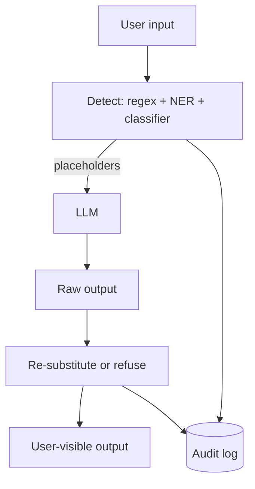

# PII Redaction

**Also known as:** Data Loss Prevention, Sensitive Data Filtering

**Category:** Safety & Control  
**Status in practice:** mature

## Intent

Detect and remove personally identifiable information from inputs to and outputs from the model.

## Context

A team runs an agent in a regulated environment — healthcare, finance, public sector — where legal frameworks (the EU General Data Protection Regulation, the US Health Insurance Portability and Accountability Act, sectoral data-protection rules) restrict what personally identifying information the system is allowed to see, store, log, or pass on to a third party. The agent's inputs and outputs flow through prompt logs, trace stores, evaluation harnesses, and, for hosted models, the provider's infrastructure.

## Problem

Large language models echo what they see in context: any personally identifying information that enters the prompt can end up in the model's response, in the application's trace log, in the eval harness export, and in the third-party provider's request records. Once a customer's name, date of birth, or social-security number has crossed those boundaries, containment is essentially impossible after the fact. Without detection and redaction at the boundary where data enters the model, the operator cannot honestly claim that personal data is protected.

## Forces

- Detection precision vs recall.
- Reversible vs irreversible redaction.
- Token-level vs entity-level redaction.

## Therefore

Therefore: detect PII at the boundary, substitute placeholders before the model sees it, and re-substitute or refuse on the way out, so that personal data never enters prompts, logs, or third-party training surfaces.

## Solution

Pre-process inputs: detect PII (regex + NER + classifier), replace with placeholders. Post-process outputs: re-substitute placeholders back, or refuse if outputs contain unrequested PII. Audit log of redactions.

## Structure

```
User input --> Detect PII (regex + NER + classifier) --placeholders--> LLM --> Raw output --> Re-substitute placeholders or refuse unrequested PII --> User; detections and substitutions --> Audit log
```

## Diagram



## Example scenario

A health-tech company's support agent logs are reviewed by a security auditor who finds patient names and dates of birth in plaintext across hundreds of transcripts, and worse, the model has occasionally echoed an SSN back into a response. The team installs pii-redaction: an input pipeline detects PII via regex plus NER and substitutes placeholders before anything reaches the model; an output pipeline re-substitutes only when explicitly required and refuses on unrequested PII. Every redaction is logged for audit. The next audit finds zero plaintext PII.

## Consequences

**Benefits**

- Compliance posture improves.
- Logs and prompts become safer to retain.

**Liabilities**

- Redaction errors are user-visible.
- Some workflows need PII; redaction must be selective.
- Re-identification risk: redacted artefacts plus side-channel data still re-identify; redaction is not anonymisation.
- Detection has known evasions: leetspeak, homoglyphs, partial-token splits; false negatives are the security failure.

## Failure modes

- Evasion miss — a name or number written with homoglyphs or split across tokens slips past detection and reaches the model and the trace log.
- Over-redaction — a workflow that needs the customer's address gets a placeholder instead, and the agent cannot finish the task.
- False anonymity — redacted records are shared as if anonymous, and side-channel data re-identifies the people in them.

## What this pattern constrains

PII categories listed in the policy must not appear in model inputs or outputs without explicit authorisation.

## Applicability

**Use when**

- Inputs to the model may carry personally identifiable information.
- Outputs and logs must not echo PII the user did not request.
- Detectors (regex, NER, classifier) can be combined for acceptable recall.

**Do not use when**

- Data is already PII-free at the boundary that feeds the model.
- Detector false-positive rates would break the user experience.
- End-to-end encryption or other controls already cover the same risk.

## Components

- PII detector — composite of regex, named-entity recogniser, and classifier on the inbound path
- Placeholder substituter — replaces detected PII with typed tokens before the model sees the prompt
- Re-substitution gate — restores original values on the outbound path only when explicitly authorised
- Redaction audit log — record of detections, substitutions, and re-substitutions

## Tools

- NER model — entity recogniser tuned for names, addresses, identifiers
- Regex library — patterns for SSNs, card numbers, IBANs, phone formats
- PII classifier — supervised model that catches entities the regex misses

## Evaluation metrics

- Detection recall — share of policy-defined PII categories the detector caught
- False-positive redaction rate — non-PII tokens the detector wrapped as placeholders
- Plaintext-PII leakage incidents — logs or outputs found with unredacted personal data
- Re-identification risk score — residual identifiability after redaction plus side channels

## Known uses

- **Microsoft Presidio** _available_
- **AWS Comprehend PII** _available_

## Related patterns

- _specialises_ **Input/Output Guardrails**
- _complements_ **Session Isolation**
- _complements_ **Secrets Handling**
- _complements_ **Open-Weight Cascade**
- _used-by_ **Agent Middleware Chain**
- _alternative-to_ **Agent Tool-Invocation Data Black-Box** — PII redaction removes personal data from inputs and outputs as a remedy; the data black box is the failure where personal data flows to undisclosed third-party services with no redaction or disclosure.
- _complements_ **Cumulative Disclosure Accounting** — Redaction cleans identifiers out of one payload; here every payload is already clean and the disclosure exists only in the join across payloads.

## References

- [microsoft/presidio](https://github.com/microsoft/presidio)
