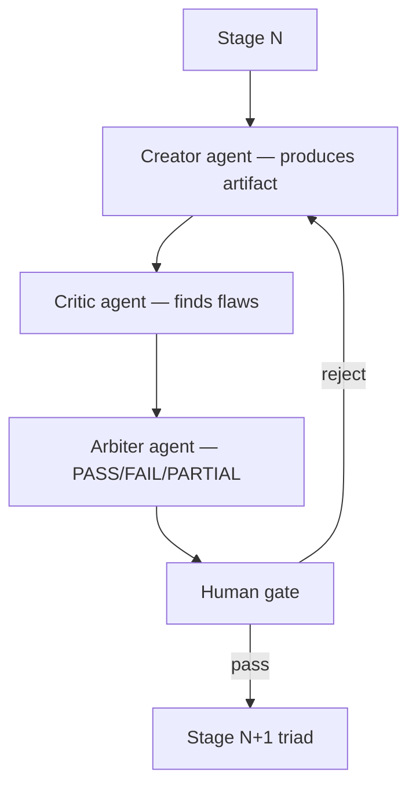

# Pipeline Triad Pattern

**Also known as:** Creator-Critic-Arbiter Triad, Maker-Checker-Approver for Agents

**Category:** Multi-Agent  
**Status in practice:** emerging

## Intent

Staff each pipeline stage with a triad — Creator generates an artifact, Critic finds flaws, Arbiter makes a binding PASS/FAIL/PARTIAL decision — with four explicit human gates between stages.

## Context

A team replaces a sequential human pipeline (analyst → developer → reviewer → tester) with agents. Naive replacement (one agent per stage) loses the cross-check that human pipelines had built-in. Critical decisions get rubber-stamped because no agent has the role of Arbiter.

## Problem

Single-agent-per-stage pipelines lose the maker-checker-approver structure that gave human pipelines their robustness. Without explicit Creator/Critic/Arbiter triads, agents drift, errors propagate, and there's no binding decision point. Russian Habr 2026 source documents this as the pattern from banking compliance applied to agent pipelines.

## Forces

- Triads triple per-stage cost compared to single-agent stages.
- Human gates between stages add latency.
- Arbiter role requires clear authority to pass/fail/partial — not just another reviewer.

## Therefore

Therefore: every pipeline stage runs a Creator-Critic-Arbiter triad; four explicit human gates (requirement validation, readiness, deployment, production confirmation) span the entire pipeline.

## Solution

Per stage: Creator agent produces the artifact (spec, code, test, doc). Critic agent finds flaws with detailed reasoning. Arbiter agent makes PASS/FAIL/PARTIAL decision with citation to both Creator's output and Critic's flaws. Between stages: four human gates structurally enforce review at requirement, readiness, deployment, production-confirmation transitions. Mirrors banking maker-checker-approver compliance. Pair with supervisor-plus-gate, policy-gated-agent-action, human-in-the-loop.

## Structure

```
Stage N: Creator (artefact) --> Critic (flaws with reasons) --> Arbiter (PASS / FAIL / PARTIAL, citing both) --> Human gate --> [pass: Stage N+1 triad | reject: back to Creator]
```

## Diagram



## Example scenario

A bank's customer-onboarding pipeline replaces analyst→developer→tester with three triads. Stage 1 (KYC document analysis): Creator extracts fields, Critic flags inconsistencies, Arbiter rules PASS/FAIL/PARTIAL. Human gate 1 (requirement validation): officer reviews high-PARTIAL cases. Stage 2 (risk-scoring): another triad. Human gate 2 (readiness). And so on. Mirrors how a human team would have worked, with cross-check baked in.

## Consequences

**Benefits**

- Maker-checker-approver structure imported into agent pipelines.
- Arbiter decisions are auditable as bound to specific Creator output + Critic flaws.
- Four human gates provide structural enforcement of review at high-leverage moments.

**Liabilities**

- Triple per-stage cost; quadruple latency from human gates.
- Arbiter role can become rubber-stamp without strict role discipline.
- Engineering effort to instantiate triads correctly is non-trivial.

## Failure modes

- Rubber-stamp arbiter — the arbiter passes the creator's artefact without weighing the critic's flaws, and the triad becomes a single agent with extra cost.
- Gate fatigue — human reviewers at the four gates approve by habit, and the gates stop catching anything.
- Latency pile-up — waiting on human gates between every stage makes a short pipeline take days.
- Missing triad role — a stage runs with only a creator to save cost, and errors pass to the next stage without a check.

## What this pattern constrains

No pipeline stage executes without all three triad roles (Creator + Critic + Arbiter); no inter-stage transition without passing the appropriate human gate.

## Applicability

**Use when**

- Pipelines where the maker-checker-approver structure was load-bearing in the human equivalent.
- Stage-level decisions have material consequences.
- Cost and latency budgets allow triads + human gates.

**Do not use when**

- Lightweight pipelines where single-agent stages suffice.
- Tight latency budget incompatible with triad + human gates.
- Stage decisions are reversible and low-stakes.

## Components

- Creator agent — produces the stage's artifact
- Critic agent — names flaws against rubric
- Arbiter agent — binding PASS/FAIL/PARTIAL with citation
- Human gates — four structural review points spanning the pipeline
- Triad orchestrator — sequences the three roles per stage

## Tools

- Creator/Critic/Arbiter agents per stage
- Triad orchestrator
- Human gate UI — four mandatory checkpoints

## Evaluation metrics

- Arbiter PASS/FAIL/PARTIAL distribution per stage
- Human gate intervention rate
- End-to-end pipeline throughput vs single-agent stages

## Known uses

- **[Habr (Russian): Pipeline Triad Pattern — конвейер AI-агентов вместо команды разработки](https://habr.com/ru/articles/1023554/)** _available_

## Related patterns

- _complements_ **Supervisor-Plus-Gate**
- _complements_ **Policy-Gated Agent Action (KRITIS)**
- _complements_ **Human-in-the-Loop**
- _complements_ **Approval Queue**
- _specialises_ **Generator-Critic Separation**

## References

- [Pipeline Triad Pattern: конвейер AI-агентов вместо команды разработки](https://habr.com/ru/articles/1023554/) — 2026
