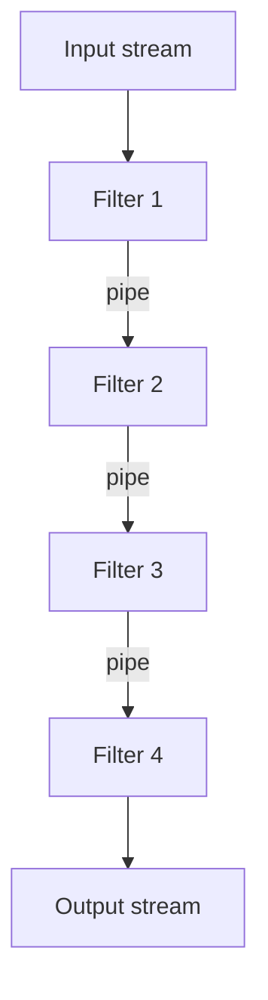

# Pipes and Filters

**Also known as:** Pipeline, Streaming Pipeline, EIP Pipeline

**Category:** Routing & Composition  
**Status in practice:** mature

## Intent

Compose stream-shaped processing as a chain of small filters connected by pipes.

## Context

A team is building a data-transformation flow in which input passes through several distinct steps before becoming output — for example a document goes through PDF extraction, OCR cleanup, language detection, chunking, and embedding, or an inbound message goes through parsing, classification, transformation, validation, and formatting. Each stage has a single responsibility and could in principle be tested or reused on its own, but only if it has a clean boundary. The team is choosing how to structure the code.

## Problem

If the whole transformation lives in one monolithic function, the stages are tangled together and none of them can be tested in isolation; a bug in the OCR step is only reachable by running the entire pipeline end to end. If the team writes a bespoke pipeline each time, every project reinvents the plumbing for connecting one stage to the next and the stages cannot be shared across pipelines. Both extremes block the reuse and isolated testing the team wants.

## Forces

- Filter granularity: too small = overhead; too big = back to monolith.
- Pipe contracts (typed messages) need agreement.
- Backpressure across pipes.

## Therefore

Therefore: decompose the transformation into small single-responsibility filters connected by typed pipes, so that each stage is testable in isolation and reusable across pipelines.

## Solution

Decompose the transformation into small filters with single responsibilities. Connect them via typed pipes (function call, queue, stream). Each filter is testable in isolation. Filters can be reused across pipelines.

## Structure

```
Input stream --> Filter 1 --typed pipe--> Filter 2 --typed pipe--> Filter 3 --typed pipe--> Filter N --> Output stream; pipeline composer checks types at each seam
```

## Diagram



## Example scenario

A document-processing agent has grown into a 1500-line monolith that does PDF extraction, OCR cleanup, language detection, chunking, and embedding all in one function — and is impossible to test in isolation. The team rebuilds it as pipes-and-filters: each stage becomes a small filter with a single responsibility, connected by typed pipes. The OCR-cleanup filter can now be tested against a fixture in isolation, the chunking filter is reused by another product, and a new language-detection filter is dropped in without touching the others.

## Consequences

**Benefits**

- Composability and testability.
- Reuse across pipelines.

**Liabilities**

- Pipeline visibility: hard to see end-to-end behaviour.
- Latency adds across stages.

## Failure modes

- Contract mismatch — one filter changes its output shape, the next filter misreads it, and the error surfaces several stages later.
- Wrong granularity — filters are cut so small that per-stage overhead dominates, or so large that a filter is a small monolith again.
- Backpressure stall — a slow filter fills its input queue, upstream stages block or drop items, and throughput collapses.
- Invisible end-to-end behaviour — each filter passes its own tests, but nobody can see why the full pipeline output is wrong.

## What this pattern constrains

Filters communicate only through pipes with typed contracts.

## Applicability

**Use when**

- A transformation can be decomposed into small filters with single responsibilities.
- Filters benefit from being individually testable and reusable across pipelines.
- Typed pipes (call, queue, stream) connect filters cleanly.

**Do not use when**

- The transformation is small enough that a single function is clearer.
- Filter boundaries would be artificial and add plumbing without payoff.
- Strong cross-stage state coupling defeats the filter abstraction.

## Components

- Filter — small single-responsibility processing stage with a typed input and output
- Pipe — typed connector between filters (function return, queue, or stream)
- Pipeline composer — assembles filters in order and enforces type compatibility at the seams
- Filter registry or library — reusable filters shared across pipelines
- Backpressure controller — handles slow consumers when pipes are queues or streams

## Tools

- Stream or queue runtime — Kafka, Redis Streams, Apache Beam, or in-process generators
- Schema enforcement — Pydantic, JSON Schema, or Protocol Buffers on each pipe contract
- LangChain `RunnableSequence` or equivalent — function-call-style pipelines for LLM stages

## Evaluation metrics

- Per-filter unit-test coverage — share of filters with isolated fixtures and assertions
- Filter reuse count across pipelines — concrete evidence the decomposition paid off
- End-to-end latency vs monolith baseline — overhead the pipe boundaries added
- Schema-violation rate at each pipe — frequency of contract breaks between stages
- Stage-level failure attribution — share of incidents pinned to a single filter rather than the whole flow

## Known uses

- **Enterprise Integration Patterns (Hohpe, Woolf)** _available_
- **LangChain Runnable composition** _available_

## Related patterns

- _generalises_ **Prompt Chaining**
- _composes-with_ **MapReduce for Agents**
- _used-by_ **Chat Chain**
- _alternative-to_ **Topic-Based Routing**

## References

- [Enterprise Integration Patterns](https://www.enterpriseintegrationpatterns.com/) — Gregor Hohpe, Bobby Woolf, 2003
