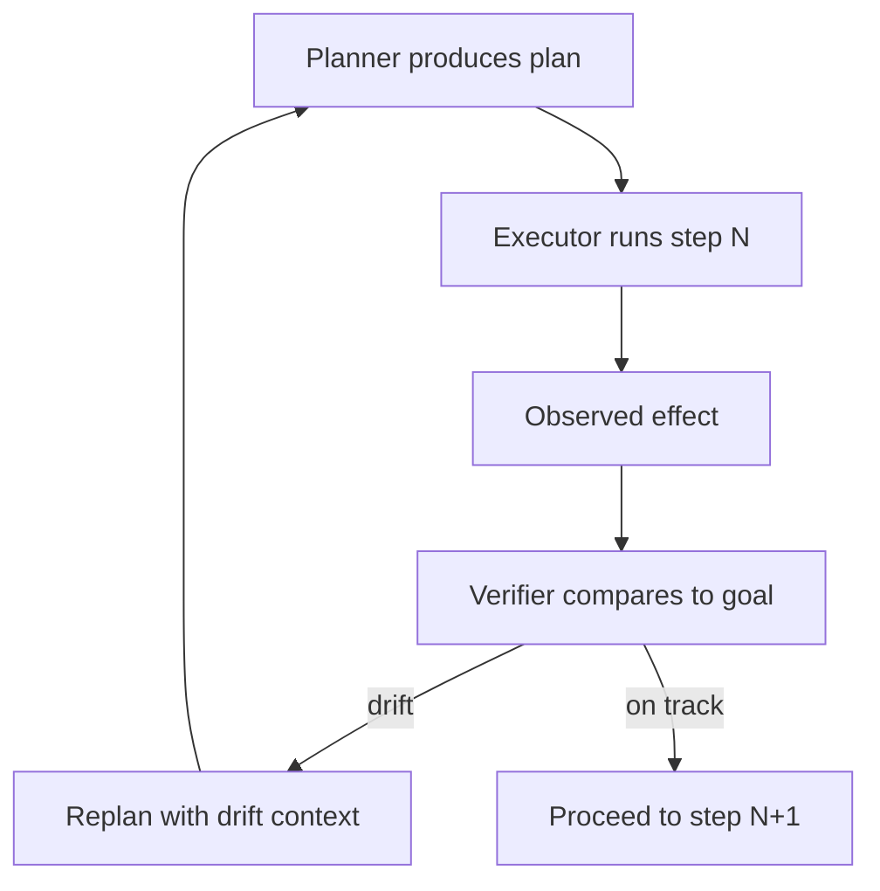

# Planner-Executor-Verifier (PEV)

**Also known as:** PEV, Triadic Plan-Verify-Execute

**Category:** Verification & Reflection  
**Status in practice:** emerging

## Intent

Triadic specialization where a planner produces the plan, an executor runs it, and a separate verifier checks each step's effects against the original goal.

## Context

A team uses plan-and-execute for multi-step agents. Verification of step success is either skipped (executor runs blindly) or done by the same model that planned (which carries the same biases). Tool failures get retried but goal drift goes unchecked.

## Problem

Plan-and-execute without independent verification cannot detect that 'step succeeded' is not the same as 'plan progressed toward goal'. A tool can return success while the world state diverges from what the plan assumed. By the time the plan completes, drift has accumulated. Distinct from plan-and-execute by mandating the third independent verifier role.

## Forces

- Adding a verifier adds latency and a third model call per step.
- Verifier must reason about goal-progress, not just step-success.
- Some tool effects are not observable by a verifier external to the tool.

## Therefore

Therefore: institute three named roles — Planner produces the plan; Executor runs each step; Verifier checks each step's *effect against the original goal* and triggers replan on drift.

## Solution

Three components, possibly three model calls per step: Planner (one-shot or incremental), Executor (executes step, gets tool result), Verifier (compares post-step state against goal expectation). On verifier reject, trigger replan with the observed drift as context. Distinct from plan-and-execute (which has no verifier) and from evaluator-optimizer (which is per-output not per-step). Pair with replan-on-failure, mental-model-in-the-loop-simulator, stochastic-deterministic-boundary.

## Structure

```
Planner -> plan -> Executor runs step N -> observed effect -> independent Verifier compares to goal --on track--> step N+1; --drift--> replan with drift as context -> Planner
```

## Diagram



## Example scenario

A coding agent plans 'refactor module X'. Planner produces 12 steps. Executor runs step 4 (rename function). Verifier checks: 'does the refactor still compile? do all callers still resolve?' Verifier flags 3 unresolved callers in step 4's effect. Replan triggered with the call-site list as new constraints. Without PEV, the executor would have proceeded to step 5 with broken intermediate state.

## Consequences

**Benefits**

- Goal-drift caught at the step where it occurs, not at the end.
- Verifier as a distinct role gives a clean place to add policy or quality checks.
- Auditable: per-step verifier verdicts are a record of plan health.

**Liabilities**

- Three calls per step is expensive in latency and cost.
- Verifier blind spots become a new failure mode (verifier rubber-stamps everything).
- Some tool effects are not visible to verifier without instrumenting the tool.

## Failure modes

- Rubber-stamp verifier — the verifier accepts any step the tool reported as successful, and drift builds up exactly as without it.
- Invisible effect — the tool's real effect is not observable without instrumentation, so the verifier compares against nothing.
- Replan churn — the verifier flags small drift on every step, and the planner replans so often the task never finishes.
- Self-verify shortcut — the executor's model is reused as verifier to save a call, and its errors pass its own check.

## What this pattern constrains

No plan step's effect is accepted without an independent verifier check; same-model self-verify is excluded.

## Applicability

**Use when**

- Multi-step plans where goal-drift between steps is costly.
- Step effects can be observed and compared against goal expectation.
- Latency budget allows per-step verification.

**Do not use when**

- Single-step or trivial plans where verification is overkill.
- Tool effects are not observable to an external verifier.
- Cost or latency budget cannot absorb 3× model calls per step.

## Components

- Planner — produces multi-step plan from goal
- Executor — runs each step with appropriate tools
- Verifier — compares post-step effect against goal expectation
- Replan trigger — fires on verifier drift detection
- Drift log — per-step verifier verdicts as plan-health record

## Tools

- Planner LLM call
- Executor with tool client
- Verifier LLM call — goal-progress check

## Evaluation metrics

- Per-step verifier reject rate
- Replan trigger frequency
- End-to-end goal-attainment rate vs plan-and-execute without verifier

## Known uses

- **[Joakim Vivas: 17 Patrones de Arquitecturas Agénticas de IA (Spanish, named with PEV acronym)](https://www.joakimvivas.com/tech/17-patrones-arquitecturas-agenticas-ia/)** _available_

## Related patterns

- _specialises_ **Plan-and-Execute**
- _alternative-to_ **Planner-Executor-Observer**
- _complements_ **Replan on Failure**
- _complements_ **Stochastic-Deterministic Boundary (SDB)**
- _alternative-to_ **Evaluator-Optimizer**
- _complements_ **Mental-Model-In-The-Loop Simulator**
- _complements_ **Strategic Preparation Phase**
- _complements_ **Generate-and-Test Strategy**
- _alternative-to_ **Phantom Action Completion** — PEV is the corrective architecture: a separate verifier checks each step's effects against the goal, which is exactly the read-back this anti-pattern omits.

## References

- [17 Patrones de Arquitecturas Agénticas de IA y su Rol en Sistemas de Gran Escala](https://www.joakimvivas.com/tech/17-patrones-arquitecturas-agenticas-ia/) — 2026
