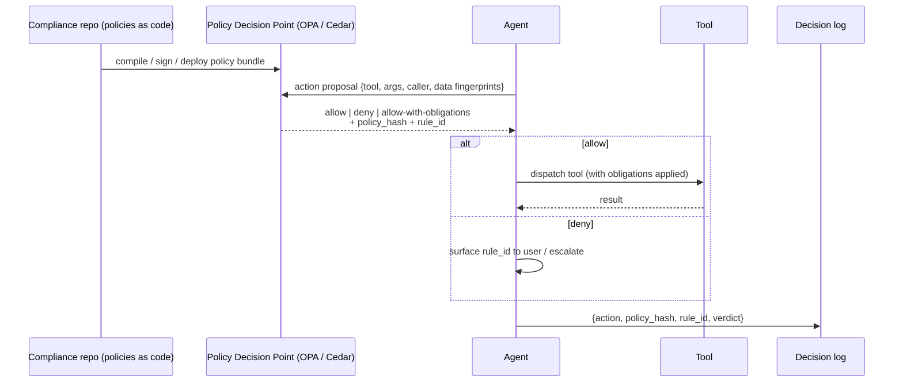

# Policy-as-Code Gate

**Also known as:** OPA Action Gate, Compiled Governance, Policy-as-Prompt, Rego-Gated Agent, External Policy Engine

**Category:** Safety & Control  
**Status in practice:** emerging

## Intent

Evaluate every proposed agent action against externally-managed machine-readable policies before dispatch, so compliance authorship lives outside the prompt and outside the agent code.

## Context

A team runs an agent in a regulated or compliance-sensitive domain — banking, insurance, public-sector, critical infrastructure — where the set of permitted actions is determined by policy documents that compliance, legal, or security functions own and update. The agent has a non-trivial action surface (transfers, account changes, external API calls of varying risk) and the rules over that surface change more often than the agent code. The people who write the rules are not the same people who write the prompts or deploy the agent.

## Problem

When the governance rules live inside the system prompt or are hard-coded in the agent, every policy change becomes a prompt edit followed by a redeploy, and the compliance officers responsible for the rules cannot read, audit, or change them without going through engineering. Natural-language rules embedded in the prompt also have no signed version, no machine-evaluable contract with the action that actually fired, and no independent audit trail an auditor can replay. Without an external, machine-readable policy surface, compliance and engineering are bound to the same release cycle and the rules become unauditable.

## Forces

- Compliance officers must own the rules, but they do not write prompts and do not deploy agent code.
- Policies change faster than agent prompts and on a different release cadence than model weights.
- Natural-language rules embedded in the prompt are not independently auditable and have no signed version.
- A machine-evaluable policy engine must be deterministic and fast enough to sit on the hot path of every tool call.
- Policy documents are often authored in prose; manually translating them to code is a bottleneck and a source of drift.

## Therefore

Therefore: route every proposed tool call through an external policy engine that evaluates the action against versioned, signed, machine-readable rules authored and owned by the compliance function, so that policy changes ship independently of the agent and every allow/deny decision carries a checkable policy version.

## Solution

Maintain policies as code (OPA/Rego, Cedar, or equivalent) in a repository owned by compliance, optionally generated by a policy compiler that translates prose policy documents into the rule language. Before any tool dispatch, the agent emits a structured action proposal (tool, arguments, caller context, retrieved data fingerprints) to an external policy decision point. The engine returns allow, deny, or allow-with-obligations together with a policy hash and rule id. The agent dispatches the tool only on allow; on deny the agent surfaces the rule id to the user or escalates. Policies are versioned, signed, and ship through a separate pipeline from the agent. Evaluation results are logged with the policy hash so any decision can be re-checked against the exact rule version that fired.

## Structure

```
Agent --(action proposal)--> Policy Decision Point (OPA/Cedar) --(allow|deny|obligations + policy_hash)--> Agent --(on allow)--> Tool. Policy repo (compliance-owned) --(compile/sign/deploy)--> Policy Decision Point. Decision log captures {action, policy_hash, rule_id, verdict}.
```

## Diagram



*Every action is gated by an external policy engine; compliance authorship lives outside the agent and outside the prompt.*

## Example scenario

A bank deploys an agent that can move money, open accounts, and call external KYC services. The compliance team writes its rules in Rego in a separately versioned policy repository, including jurisdiction-by-jurisdiction holds, sanctions checks, and threshold-based human-approval requirements. Before any tool call, the agent serialises the proposed action and sends it to an OPA sidecar. OPA returns allow with obligations (require dual approval, mask the customer name in the downstream call), and the agent honours those obligations on dispatch. When a regulator asks why a particular transfer was permitted, the audit log replays the action against the exact policy hash that was active at that moment.

## Consequences

**Benefits**

- Compliance owns the rules in their native form; engineering owns the agent.
- Policy changes ship without touching prompts or model weights.
- Every allow/deny carries a signed policy version that an auditor can replay.
- Deterministic rule evaluation removes the LLM from the enforcement path.
- Prose-to-code compilation reduces translation drift between policy documents and runtime checks.

**Liabilities**

- Adds a synchronous decision point to every tool call; latency and availability of the policy engine become production concerns.
- Rule language (Rego, Cedar) is itself a skill the compliance team must acquire or be supported in.
- Prose-to-code compilation can introduce its own translation errors; the compiled output still needs human review.
- Policies that depend on free-text content (intent, tone) cannot be fully expressed as code and fall back on classifier obligations.
- Action proposals must serialise enough context for the policy to evaluate, which expands the agent's structured-output surface.

## Failure modes

- Engine outage — the policy decision point is slow or down, and every tool call either waits or fails.
- Mistranslated rule — the prose-to-code compiler produces a rule that allows what the prose forbade, and no one reviews the compiled output.
- Thin proposal — the action proposal leaves out context the rule needs, so the engine allows an action it would have denied with full data.

## What this pattern constrains

The LLM must not dispatch any governed tool call without first obtaining an allow verdict from the external policy engine, must not modify or paraphrase rule content at runtime, and must surface the rule id behind any deny rather than synthesising its own explanation.

## Applicability

**Use when**

- Governance rules are owned by a compliance, legal, or security function distinct from agent engineering.
- Policies change more often than the agent or model.
- Auditors require a signed, replayable rule version for each agent action.
- The action surface is non-trivial and contains operations that vary in risk.

**Do not use when**

- The deployment is a personal or research-grade prototype with no compliance surface.
- The action surface is so small that a handful of natural-language rules in the prompt are sufficient and stable.
- Latency budgets cannot tolerate any synchronous decision point on the tool-call path.

## Components

- Policy repository — compliance-owned store of versioned, signed Rego or Cedar rules
- Policy Decision Point — external engine returning allow, deny, or allow-with-obligations
- Action proposal — structured envelope the agent sends carrying tool, args, caller, and data fingerprints
- Obligation handler — applies allow-conditions like masking or dual-approval before dispatch
- Decision log — record of action, policy hash, rule id, and verdict for replay

## Tools

- OPA or Cedar runtime — deterministic engine evaluating compiled policy bundles
- Policy compiler — translator from prose policy documents into rule language
- Bundle signer — cryptographic provenance for each deployed policy version

## Evaluation metrics

- Policy-decision latency p95 — added milliseconds on the tool-call hot path
- Deny-with-rule-id rate — fraction of denials that carried an authoritative rule reference
- Policy-engine availability — uptime of the decision point on the synchronous path
- Audit-replay reproducibility — share of past actions that re-evaluate to the same verdict
- Translation-drift findings — diffs between prose policy and compiled rule output flagged by review

## Known uses

- **[Giskard Guards](https://www.giskard.ai/)** _available_ — Policy-as-code guardrails for LLM agents (Paris).
- **[Microsoft Agent Governance Toolkit](https://opensource.microsoft.com/blog/2026/04/02/introducing-the-agent-governance-toolkit-open-source-runtime-security-for-ai-agents/)** _available_ — Open-source runtime governance for AI agents, announced 2026-04.
- **[heise/BSI KRITIS reference architectures](https://www.heise.de/hintergrund/Agentic-AIOps-KI-Agenten-in-kritischen-Infrastrukturen-11267508.html)** _planned_ — German critical-infrastructure deployments wrap agent tool dispatch behind OPA-style policy engines.

## Related patterns

- _alternative-to_ **Constitutional Charter** — Constitutional charters keep rules as natural-language inside the prompt; policy-as-code externalises them as machine-evaluable rules with their own release cycle.
- _complements_ **Input/Output Guardrails** — Guardrails filter content; policy-as-code gates actions. The two stack: a guardrail can be an obligation attached to an allow verdict.
- _complements_ **Human-in-the-Loop** — A deny or allow-with-obligation verdict can route to a human approver.
- _complements_ **Refusal** — When the policy engine denies, the agent's refusal carries an authoritative rule id rather than a synthesised justification.
- _complements_ **Visual Workflow Graph**
- _complements_ **Typed Refusal Codes**
- _complements_ **LLM as Periphery**
- _complements_ **Simulate Before Actuate**
- _complements_ **Hybrid Symbolic-Neural Routing**
- _complements_ **Control-Flow Integrity**
- _used-by_ **Rigor Relocation**
- _complements_ **Stochastic-Deterministic Boundary (SDB)**
- _complements_ **Supervisor-Plus-Gate**
- _generalises_ **Policy-Gated Agent Action (KRITIS)**
- _complements_ **Tool Over-Broad Scope**
- _complements_ **Decision Context Maps**
- _alternative-to_ **Context Gap (Security)**
- _complements_ **Priority Matrix (Conflict Resolution)**
- _composes-with_ **Agent Middleware Chain**
- _composes-with_ **Multi-Principal Welfare Aggregation**
- _composes-with_ **Cost-Aware Action Delegation**
- _complements_ **Agentic Golden Path** — Policy-as-code is the executable form of the standards the agentic golden path checks against.
- _complements_ **Tenant-Scoped Tool Binding** — Policy gates the action; tenant binding scopes which tenant's data it touches.
- _complements_ **Risk-Tiered Action Autonomy** — A policy engine can express the deterministic materiality rules that set each tier.
- _used-by_ **Scope-of-Practice Boundary Gate** — The enumerated licensed acts and the allow/block verdict are authored as compliance-owned code evaluated outside the prompt, the mechanism a policy-as-code gate provides.
- _used-by_ **Reversibility-Aware Action Filter** — The per-tool reversibility class lives in a manifest or policy declared outside the agent's reach, which is exactly the externally compiled, agent-immutable rule that a policy-as-code gate enforces.
- _alternative-to_ **Formal-Proof Compliance Gate** — Policy-as-code evaluates externally-managed machine-readable rules for an allow/deny verdict; this gate demands a machine-checked mathematical proof, covering only formalisable invariants but giving a hard guarantee where a rule verdict gives a heuristic one.
- _complements_ **Change-Freeze-Aware Action Gate** — Policy-as-code evaluates each action against externally-managed rules; the freeze gate is the time-windowed authority rule — a calendar of active freezes — such an engine enforces.
- _complements_ **Production Failure Triage Loop** — The remediation target for policy-violation failures — the fix encodes the rule as a policy outside the prompt rather than prompting harder.
- _alternative-to_ **Set-and-Forget System Prompt** — The corrective on the externalisation side — the constraint becomes an executable check outside the model, which measured 88.3% compliance against 67.0% for the same constraint left as passive text.
- _complements_ **Action-Admissibility Tiering** — Supplies the externally-authored, versioned rule surface that the authority and procedure tier evaluates, though a flat policy set on its own cannot express the ordering or the non-compensatory rule.
- _complements_ **Cumulative Disclosure Accounting** — Supplies the external decision point; this pattern makes its verdict depend on session history rather than on the proposed action alone.
- _complements_ **History-Dependent Admissibility** — The external policy engine evaluates a proposed action in isolation, which is the property an adaptive counterparty exploits; the posture floor is the session-scoped input such a gate is missing.
- _complements_ **Monotonic Privilege Confinement** — That pattern gates each action against an externally authored, comparatively static policy; here the policy is generated from the task and mutable at runtime, so the object that needs protecting is the update operation rather than the action.
- _complements_ **Feasibility-Negotiated Intent Contract** — That gate answers a binary permission question about an already-formed concrete action against externally authored rules; this audit answers an achievability question about a declarative goal against live resource state, and its middle reply has no analogue in a permission verdict.

## References

- [Policy-as-Prompt: Turning AI Governance Rules into Guardrails for AI Agents](https://arxiv.org/abs/2509.23994) — 2025
- [Introducing the Agent Governance Toolkit: Open-Source Runtime Security for AI Agents](https://opensource.microsoft.com/blog/2026/04/02/introducing-the-agent-governance-toolkit-open-source-runtime-security-for-ai-agents/) — Microsoft Open Source, 2026
- [Agentic AIOps: KI-Agenten in kritischen Infrastrukturen](https://www.heise.de/hintergrund/Agentic-AIOps-KI-Agenten-in-kritischen-Infrastrukturen-11267508.html)
- [BSI Zero-Trust Designprinzipien für LLMs](https://www.datenschutzticker.de/2025/09/bsi-zero-trust-designprinzipien-fuer-llms/) — 2025
