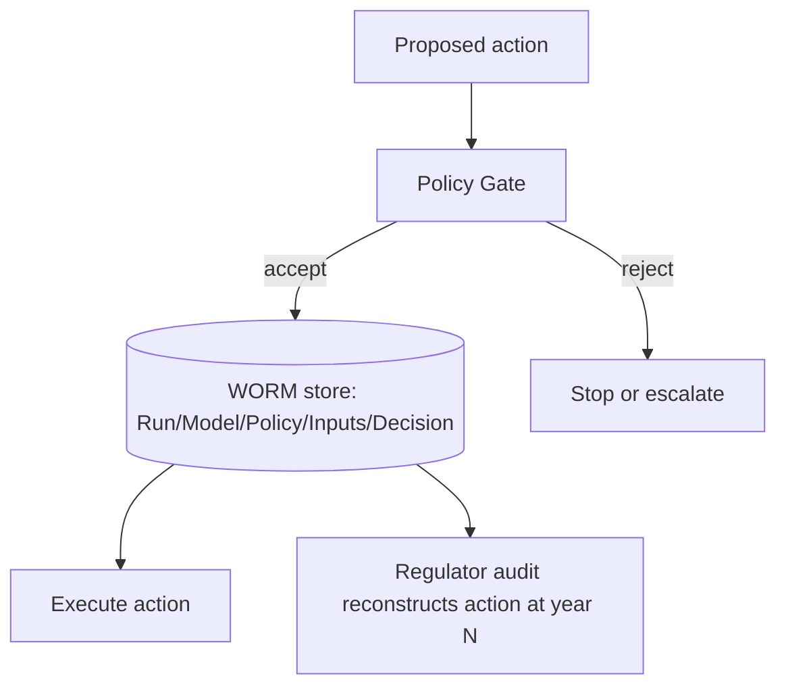

# Policy-Gated Agent Action (KRITIS)

**Also known as:** WORM-Tagged Agent Action, NIS2/EU AI Act Policy Gate

**Category:** Safety & Control  
**Status in practice:** emerging

## Intent

Each agent action passes through a policy gate (NIS2, EU AI Act, BSI rules) and is tagged with Run ID + Model Digest + Policy Hash for WORM-audit reconstruction.

## Context

An agent operates in regulated critical infrastructure (KRITIS): utilities, healthcare, finance, telecom. Regulators require provable per-action policy compliance and incident reconstruction. Free-running agents in such environments are inadmissible.

## Problem

Without per-action policy gating and immutable audit trails, the operator cannot demonstrate to regulators that any specific agent action complied with the applicable policies at the time it executed. After an incident, the operator cannot reconstruct which model version, which policy rules, and which inputs produced the action. Differs from existing policy-as-code-gate by adding the WORM-tagging contract for incident reconstruction.

## Forces

- Agentic flexibility is the value proposition; gating every action adds friction.
- Regulators require reconstruction over time horizons (years) longer than typical agent run logs.
- Model versions and policy rules drift; an audit at year 3 must reflect the state at year 1.

## Therefore

Therefore: every agent action passes a policy gate before execution and is recorded with {Run ID, Model Digest, Policy Hash, Inputs Hash, Decision} in a WORM (Write-Once-Read-Many) store; reconstruction is possible at any point in the retention horizon.

## Solution

Implement a policy-gate service that takes (proposed action, inputs, agent context) and returns {accept/reject, policy hash, rule citations}. Every accepted action carries a WORM-store record: Run ID, Model Digest (which LLM version), Policy Hash (which rule set), Inputs Hash, Decision. The store is append-only with cryptographic chaining (Merkle tree or similar). Pair with policy-as-code-gate, supervisor-plus-gate, decision-log.

## Structure

```
Proposed action + inputs + context --> Policy gate --reject--> Stop or escalate | --accept--> WORM record (Run ID, Model Digest, Policy Hash, Inputs Hash, Decision; hash-chained) --> Execute action; WORM store --> Regulator audit reconstruction
```

## Diagram



## Example scenario

A grid-management agent proposes 'scale generation +50MW on bus 12'. Gate checks against NIS2 + national grid code + operator policy. Rule R-217 requires human confirmation when delta >30MW. Gate returns {accept: false, reason: R-217, requires: human}. WORM record written: {run_id, model: claude-opus-4-7@sha256:..., policy: 2026-Q2-grid@sha256:..., inputs_hash, decision: human-required}. Three years later an auditor reconstructs the exact policy version that governed the decision.

## Consequences

**Benefits**

- Per-action policy compliance demonstrable to regulators.
- Incident reconstruction possible at any retention point.
- Cryptographic chaining detects tampering with the audit trail.

**Liabilities**

- Latency per action — gate check + WORM write.
- Storage cost scales with action volume × retention years.
- Policy gate becomes a critical-path dependency; its failure halts the agent.

## Failure modes

- Gate outage halts work — the policy gate is on the critical path, it goes down, and every agent action stops.
- Incomplete record — the WORM entry omits the model digest or inputs hash, and an incident cannot be reconstructed years later.
- Retention cost — storage grows with every action over the retention period, and teams cut retention below what regulators require.

## What this pattern constrains

No agent action commits without a gate-decision record in the WORM store; the policy gate is on the critical path of every action.

## Applicability

**Use when**

- Agent operates in NIS2/EU AI Act/BSI/sectoral-regulator scope.
- Per-action audit reconstruction required over multi-year horizon.
- Latency budget can accommodate per-action gate + WORM write.

**Do not use when**

- Agent operates outside regulated scope and audit value does not justify cost.
- Action latency budget is sub-100ms.
- No team capacity to maintain policy-as-code rule set.

## Components

- Policy-as-code rule set — versioned, hashable
- Policy Gate service — accept/reject + rule citations
- WORM store — append-only with cryptographic chaining
- Model digest registry — pins which model version produced the action
- Audit reconstruction tool — replays a Run ID against the historical state

## Tools

- Policy-as-code rule set — versioned
- Policy gate service — accept/reject per action
- WORM audit store — append-only with cryptographic chaining

## Evaluation metrics

- Per-action audit completeness — share of actions with WORM record
- Policy violation catch rate — actions blocked by gate
- Audit reconstruction success — historical-action replay accuracy

## Known uses

- **[heise: Agentic AIOps in kritischen Infrastrukturen](https://www.heise.de/hintergrund/Agentic-AIOps-KI-Agenten-in-kritischen-Infrastrukturen-11267508.html)** _available_

## Related patterns

- _specialises_ **Policy-as-Code Gate**
- _complements_ **Supervisor-Plus-Gate**
- _complements_ **Decision Log**
- _complements_ **Provenance Ledger**
- _complements_ **Approval Queue**
- _complements_ **BPMN/DMN Deterministic Shell Around Agent**
- _complements_ **Synchronous Execution-Plan Confirmation**
- _complements_ **Pipeline Triad Pattern**
- _complements_ **Decision Context Maps**
- _complements_ **Context Gap (Security)**
- _complements_ **Progressive Tool Access**
- _complements_ **Delegated Agent Authorization** — The policy gate evaluates the scoped delegated token's authority before the action proceeds.
- _complements_ **Decision Token** — The policy gate decides whether an action may proceed and tags the run for reconstruction; the Decision Token captures the authored justification of the conclusion the agent reached on the data it read.
- _complements_ **Change-Freeze-Aware Action Gate** — Both place a gate on the critical path of every action; KRITIS tags each action for WORM audit, the freeze gate adds the missing time-window authority check.
- _complements_ **Attenuating Delegation Chain** — The gate decides whether an action is permitted by policy; the chain decides whether the caller holds the authority to ask. Facets the chain cannot express belong in the policy engine.

## References

- [Agentic AIOps: KI-Agenten in kritischen Infrastrukturen](https://www.heise.de/hintergrund/Agentic-AIOps-KI-Agenten-in-kritischen-Infrastrukturen-11267508.html) — 2026
