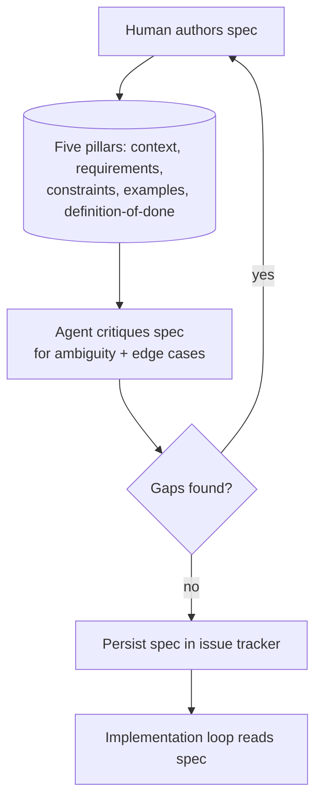

# Pre-Flight Spec Authoring

**Also known as:** Spec-Driven Development (authoring phase), SDD authoring, Pre-Implementation Specification

**Category:** Planning & Control Flow  
**Status in practice:** emerging

## Intent

Before any code is generated, author a multi-pillar spec and have the agent critique it for ambiguity and edge cases, so that the loop executes against a reviewed target rather than a fresh prompt.

## Context

A team is about to put a coding agent to work on a non-trivial change. The team has a shared issue tracker, source control, and at least one capable agent available for both spec critique and implementation. Time spent in front of the first agent run is cheap compared to the cost of cleaning up agent-written code that compiles but is wrong in shape.

## Problem

Agents handed an underspecified prompt produce code that runs but does not match what the team needed: assumptions get baked in silently, edge cases get skipped, and the team discovers the gap during review or in production. Quoting the Norwegian source: agents 'ignorerer instruksjoner, de produserer kode som fungerer men ikke nødvendigvis er vedlikeholdbar' — they ignore instructions and produce code that works but is not necessarily maintainable. The team needs a way to do the thinking up front and to make the agent challenge that thinking before it writes code.

## Forces

- Spec authoring is up-front cost; the team must believe it pays back in less rework.
- The agent that critiques the spec must be allowed to push back rather than rubber-stamp it.
- The spec must live somewhere durable — the issue tracker or repo — so later loop iterations and human reviewers share the same target.

## Therefore

Therefore: write the spec in a fixed multi-pillar template, have the agent read it critically and surface gaps before any code is generated, and persist the result in the issue tracker as the loop's authoritative input.

## Solution

Author the spec along five pillars: context (why this work, what surrounds it), requirements (what must be true), constraints (what must not be done), examples (concrete inputs and outputs or code shapes to mirror), and definition-of-done (the gate the loop must pass). Then run an explicit model-critique step in which the agent reads the spec and lists ambiguities, missing edge cases, internal contradictions, and unstated assumptions; the human resolves each before code generation begins. Store the finished spec in the issue tracker (or an equivalent durable artefact store) so every later iteration and every human reviewer reads the same target. Only then hand the spec to the implementation loop.

## Structure

```
Human authors spec (context, requirements, constraints, examples, definition-of-done) --> Agent critiques for ambiguity and edge cases --gaps--> Human resolves --> re-critique --no gaps--> Persist spec in issue tracker --> Implementation loop reads spec
```

## Diagram



## Example scenario

An engineer picks up an issue to add idempotency keys to a payment endpoint. Rather than prompt the agent directly, they fill in a five-pillar template in the tracker: context (why retries currently double-charge), requirements (header name, storage TTL, response shape on replay), constraints (no schema migration this sprint, must work behind the existing rate limiter), examples (a curl request and the expected replayed response), definition-of-done (a new integration test plus updated API docs). They run a 'critique this spec' pass with the agent, which flags three gaps: behaviour on key collision across tenants, behaviour when the original request is still in flight, and whether the key should be required or optional. The engineer answers each in the spec, then starts the implementation loop. The loop converges in fewer iterations because the agent stops asking the same questions every turn.

## Consequences

**Benefits**

- Fewer agent question-asks during execution because the spec already answers them.
- Spec lives in the tracker as persistent shared memory across humans and agents.
- Defects shift left: ambiguities surface before any code is written.
- Reviewer cost drops because the target is explicit and diffable.

**Liabilities**

- Up-front authoring time is real and visible; teams under deadline pressure skip it.
- A weak critique step (agent rubber-stamps the spec) produces false confidence.
- Spec can over-constrain exploratory work where the right shape is not yet known.
- Tracker-stored specs drift from code unless the loop or a downstream pattern keeps them in sync.

## Failure modes

- Rubber-stamp critique — the agent reads the spec and reports no gaps, and the team starts coding with false confidence.
- Skipped under deadline — the spec step is dropped when time is short, and the loop runs on a bare prompt again.
- Over-specified exploration — a five-pillar spec fixes a shape for work whose right shape is still unknown, and the loop builds the wrong thing precisely.
- Spec drift — the code changes after the spec is stored, and later iterations read a target that no longer matches the code.

## What this pattern constrains

No code-generating step may begin until the spec has been authored along the five pillars, critiqued by the agent, and persisted in the durable artefact store; loop iterations read the spec as their authoritative input rather than the free-form prompt that started the session.

## Applicability

**Use when**

- The change is non-trivial and underspecified prompts are likely to produce wrong-shape code.
- The team has a durable artefact store (issue tracker, repo) that humans and agents both read.
- An agent capable of honest critique is available for the spec-review step.
- Downstream loop iterations will read the spec as their authoritative input.

**Do not use when**

- The work is genuinely exploratory and committing to a spec would prune options too early.
- The change is small enough that authoring the spec costs more than just doing the work.
- No agent or reviewer will challenge the spec, in which case the critique step is theatre.
- There is no durable store to persist the spec across loop iterations and reviewers.

## Components

- Five-pillar spec template — context, requirements, constraints, examples, definition-of-done
- Agent critique step — explicit pass that lists ambiguities, missing edge cases, contradictions, and unstated assumptions
- Human resolver — closes each flagged gap by editing the spec before the next step
- Tracker integration — persists the spec in the issue tracker or repo as the loop's authoritative input
- Hand-off gate — no code generation begins until the spec has cleared the critique pass

## Tools

- Observability — logs, traces, and metrics that surface the pattern in production
- Eval harness — runs that quantify the pattern's frequency or severity over time

## Evaluation metrics

- Spec rework rate after critique — fraction of specs revised because the agent flagged a gap.
- Post-merge defect rate vs. no-spec baseline — defects per change with and without the authoring step.
- Agent question-asks during execution — clarification turns the loop needs after the spec is in place.
- Iterations to convergence on the implementation loop — passes through the loop before definition-of-done is met.
- Spec-to-code drift — incidents where shipped code diverged from the persisted spec without a corresponding spec edit.

## Known uses

- **[GitHub Spec Kit](https://github.com/github/spec-kit)** _available_ — Open-source toolkit for Spec-Driven Development with explicit phases (Constitution, Specify, Plan, Tasks, Implement); the Specify phase corresponds to this pattern's authoring discipline before any code phase begins.
- **[Magnus Rødseth, kode24](https://www.kode24.no/artikkel/de-beste-utviklerne-koder-knapt-lenger/259565)** _available_ — Norwegian practitioner piece naming the five-pillar authoring shape and the AI-critique-of-spec step ('La AI lese spesifikasjonen kritisk') as preconditions to letting the agent write code.
- **[Lars-Ivar Krohn-Hansen, kode24](https://www.kode24.no/artikkel/100-prosent-ki-generert-kode-ja-hvis-du-taler-a-gjore-forarbeidet/252209)** _available_ — Companion Norwegian piece on '100 prosent KI-generert kode' that grounds the same discipline: 'Det meste av jobben skjer før AI skriver sin første kodelinje' (most of the work happens before the AI writes its first line of code).
- **[Consile.dk — Agentic Engineering glossary](https://consile.dk/ai/ordbog/agentic-engineering-agentbaseret-softwareudvikling)** _available_ — Danish-language glossary entry for 'Agentic Engineering / Agentbaseret softwareudvikling' that lists authoring-before-execution as a prerequisite and warns that misinformation propagates through chained processes without it.
- **[Birgitta Böckeler — Thoughtworks SDD writing](https://martinfowler.com/articles/exploring-gen-ai/sdd-3-tools.html)** _available_ — Names three implementation levels (spec-first, spec-anchored, spec-as-source); the spec-first level is the authoring discipline this pattern captures, with the spec written and reviewed before the AI-assisted development workflow begins.
- **[Addy Osmani — 'How to write a good spec for AI agents'](https://addyosmani.com/blog/good-spec/)** _available_ — Published Jan 2026 on addyosmani.com and Feb 2026 on O'Reilly Radar. Lays out the spec sections (commands, testing, project structure, code style, git workflow, boundaries) and the planning-first, self-check-against-spec discipline before code generation.

## Related patterns

- _composes-with_ **Spec-Driven Loop**
- _composes-with_ **Spec-First Agent**
- _complements_ **Goal Decomposition**
- _complements_ **Plan-and-Execute**
- _complements_ **Todo-List-Driven Autonomous Agent**
- _complements_ **Agentic Context Engineering Playbook**
- _complements_ **Strategic Preparation Phase**

## References

- [GitHub Spec Kit](https://github.com/github/spec-kit) — 2026
- [Spec-Driven Development: Hvordan skrive krav som AI-agenter forstår](https://www.kode24.no/artikkel/de-beste-utviklerne-koder-knapt-lenger/259565) — Magnus Rødseth, 2026
- [100 prosent KI-generert kode? Ja, hvis du tåler å gjøre forarbeidet!](https://www.kode24.no/artikkel/100-prosent-ki-generert-kode-ja-hvis-du-taler-a-gjore-forarbeidet/252209) — Lars-Ivar Krohn-Hansen, 2025
- [Agentic Engineering (Agentbaseret softwareudvikling)](https://consile.dk/ai/ordbog/agentic-engineering-agentbaseret-softwareudvikling) — 2026
- [Understanding Spec-Driven Development: Kiro, spec-kit, and Tessl](https://martinfowler.com/articles/exploring-gen-ai/sdd-3-tools.html) — Birgitta Böckeler, 2026
- [How to write a good spec for AI agents](https://addyosmani.com/blog/good-spec/) — Addy Osmani, 2026
