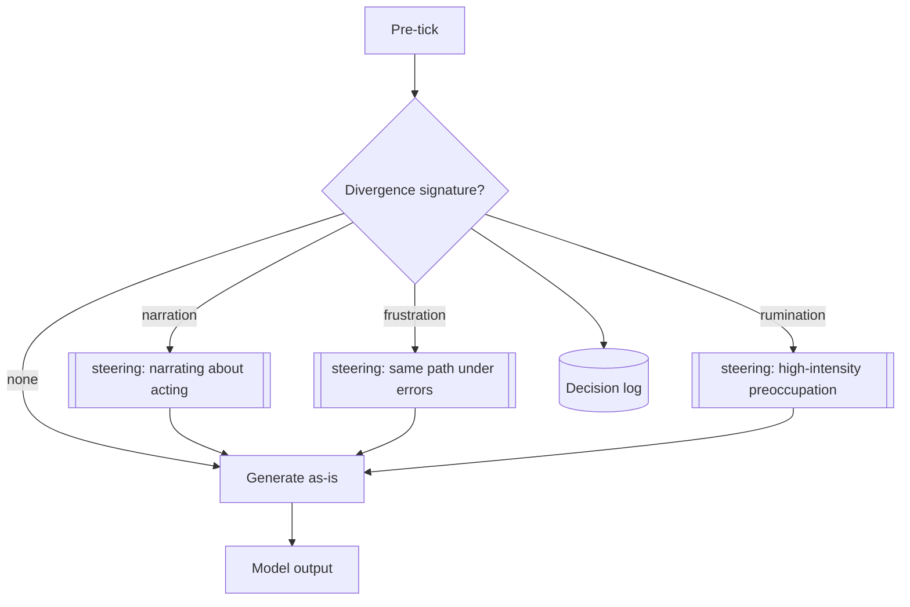

# Pre-Generative Loop Gate

**Also known as:** Divergence Pre-Check, Steering-Hint Injector, Loop-Pattern Detector

**Category:** Cognition & Introspection  
**Status in practice:** experimental

## Intent

Before the next generation fires, detect divergence signatures (narration loops, frustration paths, repetition pressure) and inject a diagnostic steering hint into the prompt rather than veto the call.

## Context

A team is running an agent with frequent ticks where certain failure modes recur often enough to be recognisable from telemetry alone: narrating about acting instead of actually invoking the tool, retrying the same broken path repeatedly after an error, or sinking into rumination on a high-intensity preoccupation without producing new content. These signatures are visible in the recent thoughts, recent tool calls, affect snapshot, and preoccupation list before the next model call fires.

## Problem

Today's post-hoc detectors only catch these failures after the model has already produced the bad output, by which point the tokens are billed and the user has seen them. The agent itself would frequently avoid the failure if it were told the diagnostic before generating, but nothing reads the available pre-call signal and surfaces it. A hard veto on the next call is too aggressive because the same signature sometimes appears in legitimate work, but doing nothing means paying for the bad output every time.

## Forces

- A hard veto blocks legitimate cases that match the heuristic.
- A silent injection makes debugging mysterious if the model behaves differently than expected.
- The hint has to be terse or it overwhelms the prompt.
- False positives must be tolerable; the model can ignore the hint.

## Therefore

Therefore: run a cheap pre-tick check for known divergence signatures (low surprise plus intent phrase, recent error plus no orienting call, high-intensity preoccupation plus low novelty) and append a one-line system-level steering hint to the prompt instead of vetoing the call, so that the model sees the diagnostic before producing tokens.

## Solution

A pre-tick function takes recent thoughts, recent tool calls, the affect snapshot, and the preoccupation list and returns either None or a short steering string of the form `[steering] divergence pattern <id> detected; consider <move>`. The hint is appended to the prompt as a system line and the call proceeds. The decision (hint or no hint, which pattern) is logged so post-hoc review can correlate hint-presence with subsequent behavior. Vetoing remains the job of explicit safety patterns.

## Structure

```
Pre-tick (recent thoughts, tool calls, affect, preoccupations) --> divergence signature? --none--> generate as-is | --narration / frustration / rumination--> append '[steering] divergence pattern <id> detected; consider <move>' --> generate; every decision --> decision log
```

## Diagram



*Pre-tick check classifies divergence signatures and appends a short steering line to the prompt; the model retains authority to ignore.*

## Example scenario

A long-running personal agent keeps falling into a narration loop where it says 'let me check the calendar' but never actually invokes the calendar tool. A post-hoc detector catches it after the model has already produced the empty narration. The team adds a Pre-Generative Loop Gate: each pre-tick check looks for low-surprise plus intent-phrase signatures and appends '[steering] you may be narrating about acting instead of acting; consider invoking the tool directly' to the prompt. The narration rate drops without blocking any legitimate call.

## Consequences

**Benefits**

- Divergence is named before tokens are produced, not after.
- Steering as a hint lets the model retain authority; false positives are recoverable.
- Hint-presence in logs creates an evaluation substrate for the detector itself.

**Liabilities**

- Pattern signatures are heuristic and will misfire.
- Steering hints add tokens to every flagged tick.
- Silent injection complicates debugging if the model adapts to it.

## Failure modes

- Misfiring signature — a heuristic flags a healthy tick as a narration loop, and the steering hint pushes the model away from the right path.
- Hint creep — the gate starts blocking calls or rewriting the prompt, turning a soft steer into an unreviewed veto.
- Opaque adaptation — the model learns to react to the steering line, and without the decision log nobody can explain the change in behaviour.
- Token tax — signatures fire on most ticks, so every call carries extra hint text for little gain.

## What this pattern constrains

Pre-tick hints can only append a short steering line; they cannot block the call, modify tool selection, or rewrite the user prompt — vetoing remains the responsibility of explicit safety patterns.

## Applicability

**Use when**

- Specific divergence signatures are detectable from telemetry pre-call.
- Post-hoc detectors catch the failure too late to avoid the cost.
- The model is responsive to short steering hints in the system context.

**Do not use when**

- The agent's failure modes are not detectable pre-call.
- Tokens for steering hints are not budget-tolerable per tick.
- Audit policy requires the model to receive an unmodified prompt.

## Components

- Pre-Tick Function — runs before the next model call
- Divergence-Signature Set — narration, frustration, rumination patterns
- Steering-Hint Emitter — one-line system-level diagnostic appended to the prompt
- Decision Log — records hint-presence and pattern id for retrospective audit
- Affect Snapshot Reader — feeds intensity into the rumination check

## Tools

- LLM API — receives the appended steering line and retains authority to ignore it
- Structured JSON store — decision log keyed by tick id

## Evaluation metrics

- Hint-fire rate — share of ticks that receive a steering line
- False-positive rate — hint-fired ticks where the subsequent output was actually healthy
- Post-hint behaviour shift — change in the targeted failure rate after the gate is enabled
- Token cost per hinted tick — overhead the diagnostic line adds to the prompt

## Known uses

- **[Sparrot (author's long-running personal agent; single private deployment)](https://marco-nissen.com/sparrot/)** _available_ — A loop-gate inspects context for divergence signatures (repeating phrasing, ping-pong shape, post-compaction drift) BEFORE the next generation and injects steering hints or refuses, rather than waiting for the output to fail downstream. Single-source evidence: one private deployment by the catalog author.

## Related patterns

- _complements_ **Circuit Breaker**
- _complements_ **Degenerate-Output Detection**
- _complements_ **Typed Tool-Loop Failure Detector**
- _complements_ **Fragment Juxtaposition**

## References

- [Toward a Theory of Situation Awareness in Dynamic Systems](https://journals.sagepub.com/doi/10.1518/001872095779049543) — Mica R. Endsley, 1995
- [Skills, Rules, and Knowledge: Signals, Signs, and Symbols, and Other Distinctions in Human Performance Models](https://ieeexplore.ieee.org/document/6313160) — Jens Rasmussen, 1983
