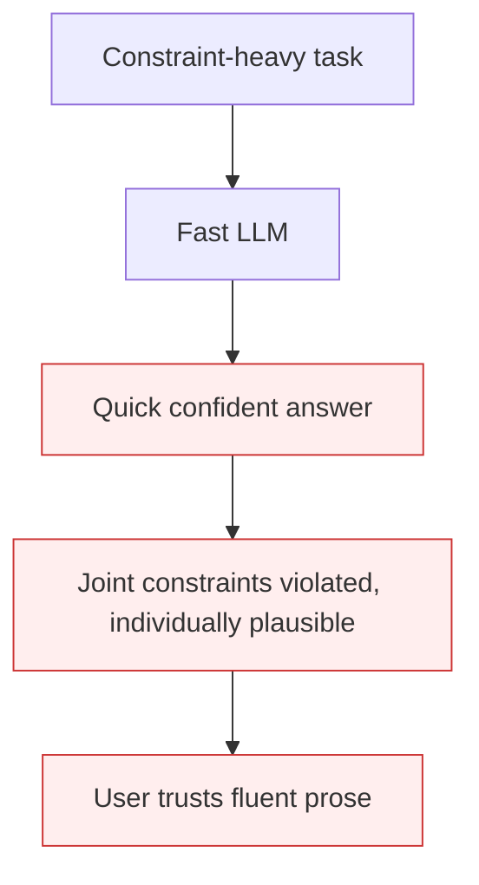

# Premature Closure

**Also known as:** LLM Jump-to-Conclusion, Pre-Constraint-Check Commitment

**Category:** Anti-Patterns  
**Status in practice:** deprecated

## Intent

The LLM commits to a confident answer before processing all constraints, characteristic of constraint-heavy tasks where it fills in plausible answers fast and gets cross-constraint interactions wrong.

## Context

The agent receives a problem with interconnected constraints (crossword, scheduling, multi-objective design). Standard LLM behavior is to begin generating the answer as soon as the prompt is parsed, optimizing for fluent next-token prediction. The constraint web is acknowledged but not held.

## Problem

The model commits early to per-clue / per-step answers that are individually plausible but jointly incoherent. By the time later constraints are processed the commitment is already made. Reviewing the trace shows the model knew the constraints but didn't gate generation on them. Result: confident wrong answers, not 'I don't know' wrong answers.

## Forces

- Next-token prediction architecture biases toward fluency over correctness.
- Fast responses are rewarded by users and benchmarks.
- Slowing down (e.g. LRM) costs latency and money.

## Therefore

Therefore: detect premature-closure-prone tasks and route them to a reasoning-tuned model OR insert a strategic-preparation-phase OR force a generate-and-test workflow; do not let the LLM ship its first fluent answer.

## Solution

Pair with: large-reasoning-model-paradigm (route to LRM), strategic-preparation-phase (force constraint enumeration before generation), generate-and-test-strategy (separate generate from verify). Detect premature-closure-prone tasks by load (constraint-heavy, multi-step, math).

## Structure

```
Anti-pattern: Constraint-heavy task -> model answers part by part as it reads -> early commitments -> confident wrong answer. Corrected: Task -> enumerate all constraints first -> generate -> test against the full list (or route to reasoning model).
```

## Diagram



## Example scenario

A standard LLM is given a 6x6 crossword with intersecting constraints (clues that share letters). Within seconds it fills the grid with plausible answers per individual clue. Five intersections are wrong because the model never held the intersection constraints while choosing per-clue answers. Bornet's crossword: LRM took 2 minutes and got nearly perfect; LLM took seconds and made 5 errors.

## Consequences

**Benefits**

- Short-term: fast single-pass answers look fluent and score well on speed-focused benchmarks.
- Naming it lets a team flag constraint-heavy tasks and add a gate between reading and answering.

**Liabilities**

- Confident wrong answers ship undetected; users trust them because the prose is fluent.
- Errors compound: each premature commit constrains subsequent answers.
- Benchmarks that reward speed reinforce the failure mode.

## Failure modes

- Early lock-in — the model fills in an answer for each clue as it reads, then later constraints cannot change it.
- Jointly incoherent answer — each part looks plausible, but together they break a cross-constraint rule.
- Fluent wrong answer — the output reads with confidence, so users trust it and the error ships.
- Compounding commits — each early choice narrows later choices, so one mistake spreads through the answer.

## What this pattern constrains

No useful constraint; the missing constraint is a structural gate between problem-reading and answer-generation for constraint-heavy tasks.

## Applicability

**Use when**

- Never. Cite when reviewing tasks routed to fast LLMs that should be routed to LRMs.
- Always pair detection with one of the three resolution patterns.
- Surface as a known failure mode in agent design docs.

**Do not use when**

- Any constraint-heavy task routed to a fast LLM without gating.
- Math / multi-step reasoning / scheduling tasks at speed.
- Any production deployment where confident-wrong is worse than slow-right.

## Components

- Constraint-heavy task — input
- Fast LLM — generates without constraint-gating
- Output — confident wrong
- Missing strategic-preparation step

## Tools

- Detection signal — premature-closure incidence on constraint-heavy tasks
- Mitigation pattern infrastructure (LRM / preparation / generate-test)
- Incident-response playbook

## Evaluation metrics

- Premature-closure incident rate per workload class
- Mean-time-to-detection
- Cost per incident (rework, customer-impact)

## Known uses

- **[Bornet et al. — Agentic Artificial Intelligence, Chapter 6 (crossword puzzle experiment with GPT-4o)](https://www.worldscientific.com/worldscibooks/10.1142/14380)** _available_

## Related patterns

- _alternative-to_ **Large Reasoning Model (LRM) Paradigm**
- _alternative-to_ **Strategic Preparation Phase**
- _alternative-to_ **Generate-and-Test Strategy**
- _complements_ **False Confidence Syndrome**
- _complements_ **Context Fragmentation**
- _complements_ **Tool-Output Arithmetic Trust** — Both are confidence-without-checking failures; premature closure skips constraints during answer generation, this skips deterministic computation over already-correct data.
- _complements_ **Deliberation Over Observation** — The opposite failure — committing before the constraints are processed. It needs more deliberation, this one needs less, so the two must stay separately nameable or the wrong remedy gets applied.

## References

- [Agentic Artificial Intelligence — Chapter 6](https://www.worldscientific.com/worldscibooks/10.1142/14380) — 2025
