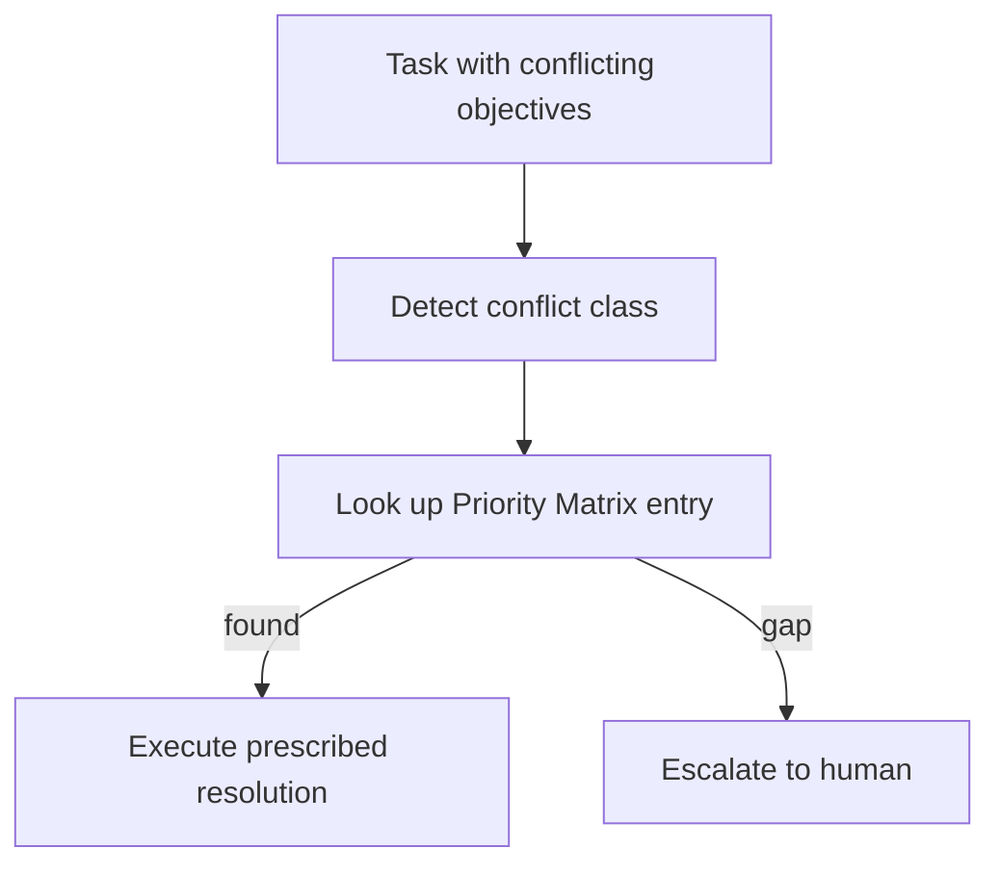

# Priority Matrix (Conflict Resolution)

**Also known as:** Conflict Resolution Lookup Table, Pre-Defined Goal-Priority Matrix

**Category:** Safety & Control  
**Status in practice:** emerging

## Intent

Pre-define how the agent must resolve specific classes of goal conflicts via a human-authored lookup table — transforming the agent from a decision-maker (where it fails on competing objectives) into a decision-implementer.

## Context

An agent is given multi-objective tasks where the objectives can directly conflict (transparency vs security, completeness vs file-size limit, speed vs compliance). The agent demonstrates conflict-competency-gap: it either falls into decision-paralysis or into false-resolution, neither of which is acceptable.

## Problem

Letting the agent reason through goal conflicts on the fly produces unreliable outputs because LLMs lack the contextual judgment to weigh competing objectives. Asking it to 'try harder' does not help — the limitation is architectural. But removing multi-objective tasks entirely throws out the use cases that motivated the agent.

## Forces

- Pre-defining every possible conflict resolution is impossible for open-ended domains.
- Static lookup tables decay as business priorities shift.
- Humans must commit to priority orderings in advance, which is politically difficult.

## Therefore

Therefore: for each class of foreseeable conflict, the team commits in advance to a priority ordering via a Priority Matrix lookup table; at runtime the agent looks up the matching row and implements the pre-decided resolution rather than reasoning about it.

## Solution

Identify the conflict classes the agent will encounter (compliance vs speed, security vs completeness, etc.). For each, build a Priority Matrix: rows are conflict-type entries, columns are the resolution rule. The agent's role becomes: detect the conflict class, look up the matrix entry, execute the prescribed resolution. Cases not in the matrix escalate to human. Pair with conflict-competency-gap awareness, policy-as-code-gate, supervisor-plus-gate, human-in-the-loop.

## Structure

```
Task with conflicting objectives --> Detect conflict class --> Look up Priority Matrix (human-authored) --found--> Execute prescribed resolution | --gap--> Escalate to human
```

## Diagram



## Example scenario

A regulatory document-processing agent at a pharma company faces conflicts: speed (CEO needs in 2 hours), security (24h review required), completeness (legal needs all sections). Priority Matrix entry for 'urgent-CEO-vs-compliance-review': resolution = release a compliance-cleared executive summary in 2 hours, full document after 24h review. Agent looks up, implements. Pre-matrix attempts caused decision-paralysis; post-matrix the agent reliably executes.

## Consequences

**Benefits**

- Multi-objective tasks become tractable without exposing the conflict-competency gap.
- Conflict resolutions are auditable: every decision points to a matrix entry signed by humans.
- Misalignments surface as 'we need a matrix entry for X' rather than as production failures.

**Liabilities**

- Matrix authoring is upfront work and requires stakeholder commitment to priority orderings.
- Matrix gaps escalate to human, potentially flooding queues.
- Static matrices decay; refresh cadence required.

## Failure modes

- Misclassified conflict — the agent maps a conflict to the wrong class and applies a resolution rule meant for a different trade-off.
- Gap flood — many real conflicts are not in the matrix, every one escalates, and the human queue backs up.
- Decayed matrix — priorities change but the table does not, so the agent faithfully applies an ordering the organisation no longer holds.

## What this pattern constrains

The agent may not improvise resolution of conflicts within declared conflict classes; only matrix-prescribed resolutions or human escalations are allowed.

## Applicability

**Use when**

- Multi-objective agent tasks with foreseeable conflict classes.
- Stakeholders willing to commit to priority orderings in advance.
- Audit requires per-decision policy citation.

**Do not use when**

- Conflict space is too open-ended to enumerate.
- Stakeholders unwilling to commit to priorities (political deadlock).
- Single-objective workloads where conflicts don't arise.

## Components

- Conflict-class enumeration
- Priority Matrix (rows = conflict classes, columns = resolution rules)
- Runtime detector — identifies which conflict class fired
- Matrix-lookup executor
- Human-escalation path for matrix gaps

## Tools

- Conflict-class enumeration
- Priority Matrix lookup table
- Runtime detector for matrix-class conflicts

## Evaluation metrics

- Matrix-hit rate vs human-escalation rate
- Per-conflict-class resolution latency
- Matrix-gap discovery frequency

## Known uses

- **[Bornet et al. — Agentic Artificial Intelligence, Chapter 5 (pharmaceutical-company case)](https://www.worldscientific.com/worldscibooks/10.1142/14380)** _available_

## Related patterns

- _alternative-to_ **Conflict Competency Gap** — Priority Matrix is the resolution pattern for the Conflict Competency Gap anti-pattern.
- _alternative-to_ **Decision Paralysis**
- _alternative-to_ **False Resolution**
- _complements_ **Policy-as-Code Gate**
- _complements_ **Human-in-the-Loop**
- _complements_ **Modality-Conflict Arbitration** — The same discipline of a pre-declared table, applied to a different conflict: there the rows are classes of goal conflict, here they are claim types and the winner is a modality.
- _complements_ **Control-Loop-Mapped Agent Chain** — Both pre-commit the resolution instead of reasoning about it at runtime; there the table is authored for foreseeable goal-conflict classes, here the priority structure is an existing selector network derived from hazard analysis.
- _complements_ **Co-Tenant Interference Profiling** — That resolves a conflict already surfaced to a decision-maker; this pattern's contribution is discovering, in outcome space, that a conflict exists between controllers that have no knowledge of each other.
- _complements_ **Actuation-Scope-Registered Control Loops** — Supplies the resolution rule once a conflict class is known; the registry is what turns an unknown overlap into a named conflict class early enough for a rule to be written for it.

## References

- [Agentic Artificial Intelligence — Chapter 5](https://www.worldscientific.com/worldscibooks/10.1142/14380) — 2025
