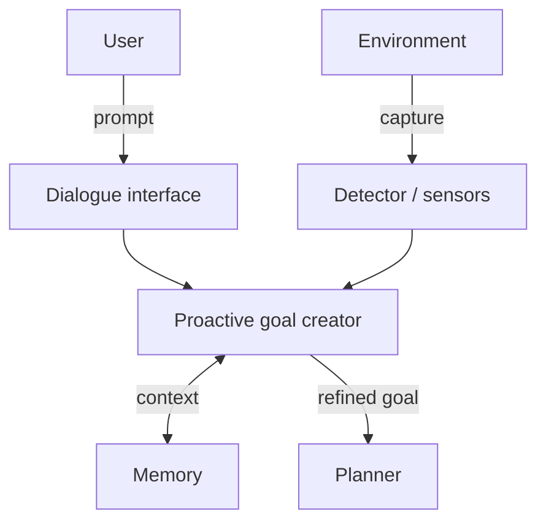

# Proactive Goal Creator

**Also known as:** Multimodal Goal Anticipator, Context-Capturing Goal Creator

**Category:** Planning & Control Flow  
**Status in practice:** emerging

## Intent

Anticipate the user's goal by capturing surrounding multimodal context (gestures, screen state, environment) in addition to what the user types or says.

## Context

A team builds an agent for a setting where the user cannot or will not articulate the full context in text — an accessibility tool used by someone with limited speech, an ambient home assistant, an embodied robot, a screen-aware coding helper. Cameras, microphones, screen capture, or other sensors are available and can supply context the user does not state. The team has the operational and privacy approvals to capture and process that data.

## Problem

If the agent only listens to the user's typed or spoken prompt, it misses the gesture pointing at the object, the screen state the user is looking at, the ambient activity the user assumes is obvious. The user is then forced either to over-articulate (typing what they are already pointing at) or to accept wrong answers. Naively piping raw sensor streams into the planner overwhelms downstream components with multimodal data they cannot use directly. The team needs a component that captures and synthesises the relevant non-verbal context into a structured goal before planning begins.

## Forces

- Underspecification: users may be unable or unwilling to verbalise full context.
- Accessibility: users with motor or speech impairments cannot rely on dialogue alone.
- Overhead: multimodal capture adds cost (sensors, bandwidth, privacy review).

## Therefore

Therefore: pair the dialogue interface with one or more detectors (camera, screen, microphone, environment sensor) and synthesise the captured multimodal signal with the user's prompt into a refined goal, so that the agent can anticipate intent rather than wait for the user to articulate it completely.

## Solution

A proactive goal creator runs alongside the dialogue interface. It activates context-capture devices (cameras for gestures, screen recorders for UI state, microphones for ambient audio, environment sensors), passes the multimodal data through context engineering, and combines it with the user's articulated prompt to produce a refined goal. The component must notify users when context is being captured, with a low false-positive rate, to avoid surprise.

## Structure

```
User → Dialogue interface + Detector (camera/screen/mic) → Proactive goal creator (with Memory and context-engineering) → Refined goal → Planner.
```

## Diagram



*Proactive Goal Creator fuses captured multimodal context with the user's prompt.*

## Example scenario

A user points at an object on their desk and says "can you order another one of these". A proactive goal creator captures the camera frame, recognises the object, combines that with the spoken request, and emits a goal: "reorder the visible model of headphones for the user's default address". The user never had to type a SKU.

## Consequences

**Benefits**

- Interactivity: agent acts on anticipated intent, not only on explicit prompts.
- Goal-seeking: richer context yields more accurate goal extraction.
- Accessibility: users with disabilities can interact via captured context rather than dialogue alone.

**Liabilities**

- Overhead: multimodal capture and continuous processing are expensive.
- Privacy/consent: capture must be disclosed and bounded.
- False positives can interrupt the user when no intent was actually expressed.

## Failure modes

- False trigger — a gesture or screen change is read as intent, and the agent interrupts the user with an unwanted action.
- Undisclosed capture — cameras or screen recording run without clear notice, and users lose trust once they find out.
- Raw-stream overload — sensor data reaches the planner without being synthesised, and planning slows or fails on input it cannot use.
- Capture cost creep — continuous multimodal processing runs all the time, and cost grows with no matching gain in goal quality.

## What this pattern constrains

Multimodal capture must be disclosed to the user; downstream planning may not consume raw sensor streams — only the synthesised goal.

## Applicability

**Use when**

- Embodied / ambient interaction is the primary surface, not chat.
- Accessibility needs make dialogue-only interaction insufficient.
- Context-capture is justified by clear user value and disclosed appropriately.

**Do not use when**

- Sensors / capture infrastructure are unavailable or disallowed (privacy, regulation).
- Articulated prompts already suffice — passive goal creator is simpler.

## Components

- Dialogue interface — receives the user's articulated prompt
- Multimodal detectors — camera, screen capture, microphone, or environment sensors
- Context engineer — synthesises sensor signal into structured features
- Goal creator — fuses captured context with the user's prompt into a refined goal
- Disclosure surface — notifies the user when capture is active

## Tools

- LLM API (often multimodal) — drives goal synthesis from text plus sensor features
- Sensor stack — camera, screen recorder, microphone, or environment sensors
- Memory store — recent conversation and stored preferences
- Privacy and consent ledger — records what was captured and when

## Evaluation metrics

- Intent-anticipation accuracy — fraction of refined goals the user accepts without correction
- False-positive activation rate — interruptions when no intent was actually present
- Multimodal capture cost — bandwidth and compute overhead per refined goal
- Accessibility task completion lift — success rate for users who cannot articulate fully
- Disclosure compliance — fraction of captures with active user notification

## Known uses

- **GestureGPT** _available_ — Cited by Liu et al. (2025) §4.2 — deciphers users' hand-gesture descriptions to comprehend intent.
- **ProAgent** _available_ — Cited by Liu et al. (2025) §4.2 — observes the behaviours of other teammate agents, deduces their intentions, and adjusts the planning accordingly.
- **Programming screencast analysis tool (Zhao et al. 2023b)** _available_ — Extracts coding steps and code snippets from screen capture.
- **[Sparrot](https://marco-nissen.com/sparrot/)** _available_ — Standing drives (coherence, curiosity, self-awareness, progress) become the impulse for what each tick attends to; goals are generated from within rather than dispatched from outside.

## Related patterns

- _alternative-to_ **Passive Goal Creator**
- _complements_ **Input/Output Guardrails**
- _used-by_ **Prompt/Response Optimiser**
- _complements_ **Computer Use**

## References

- [Agent design pattern catalogue: A collection of architectural patterns for foundation model based agents](https://doi.org/10.1016/j.jss.2024.112278) — Yue Liu, Sin Kit Lo, Qinghua Lu, Liming Zhu, Dehai Zhao, Xiwei Xu, Stefan Harrer, Jon Whittle, 2025
