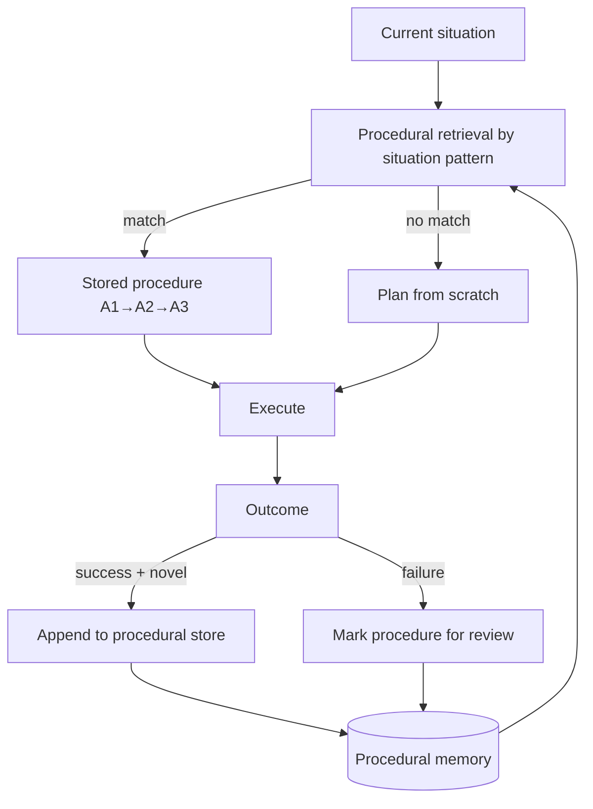

# Procedural Memory

**Also known as:** Skill Memory, How-To Memory, Learned-Procedure Store

**Category:** Memory  
**Status in practice:** emerging

## Intent

Maintain a third agent memory type alongside episodic (past events) and semantic (facts): procedural memory captures *learned how-to* — reusable skills, workflows, and self-rewritten system instructions that map situations directly to actions.

## Context

An agent operates across many sessions and accumulates experience. Some of that experience is best stored as facts (semantic), some as event records (episodic). A third category — how to do something — does not fit either: it's the agent's accumulated playbook, recipes, and shortcuts. Without a dedicated store, this knowledge either lives in a static system prompt (no learning) or gets re-derived from episodic memory each time (slow, wasteful).

## Problem

Episodic memory stores 'on 2026-03-12 I did X'; semantic memory stores 'X is true'. Neither stores 'when situation S arises, the right action sequence is A1, A2, A3'. Without a procedural store, the agent re-derives skills from raw episodes on every invocation, or relies on a frozen system prompt that cannot improve. LangChain's LangMem SDK explicitly names this gap and provides three memory types; the arXiv ProcMEM paper shows learned procedural memory outperforms episodic-only retrieval on reusable-skill tasks.

## Forces

- Episodic memory recalls past events but does not generalise to reusable shortcuts.
- Static system prompts cannot improve from experience.
- Procedural memory must be safely updatable — the agent rewriting its own instructions is itself a risk surface (see rogue-agent-drift).
- Skills must be retrievable by situation, not by keyword — requires structured indexing.

## Therefore

Therefore: maintain a procedural store keyed by situation pattern; allow the agent to read, append, and revise entries; gate updates with provenance and review; retrieve at decision-time by matching current situation against stored patterns.

## Solution

Implement a procedural-memory store as a first-class memory type alongside episodic and semantic. Entries are (situation pattern, action sequence, success record). The agent reads at planning time and appends after successful workflows. Updates are gated — naïvely letting the agent overwrite its own playbook risks rogue-drift, so add provenance and review. Common implementations: LangChain's LangMem 'procedural' channel, Claude Agent Skills (manually authored), ProcMEM-style learned skill libraries.

## Structure

```
Current situation --retrieve by situation pattern--> Procedural store --match--> Stored procedure (A1 -> A2 -> A3) | --no match--> Plan from scratch; --> Execute --> Outcome --success + novel--> gated append | --failure--> mark procedure for review
```

## Diagram



## Example scenario

A software-engineering agent works across hundreds of pull-request reviews. Initially, it re-derives the right review approach (run tests, check coverage, look for security smells) from its general training each time. After adopting procedural memory, the agent stores 'on PRs touching auth code, the right procedure is: 1) load OWASP cheatsheet, 2) check auth-test coverage, 3) flag any new secrets to security review'. On future auth PRs, the procedural retrieval surfaces this playbook, saving derivation cost and producing more consistent reviews. Updates to the procedure require a successful application before they overwrite the prior version.

## Consequences

**Benefits**

- Agent learns reusable skills across sessions without re-deriving from raw episodes.
- Skills compose: complex procedures built from learned sub-procedures.
- Inference cost drops on recurring tasks — retrieved procedures replace re-planning.

**Liabilities**

- Procedural memory updates by the agent itself create rogue-drift risk.
- Retrieval by situation requires structured indexing — keyword search is insufficient.
- Stale procedures persist after the environment changes; needs invalidation discipline.

## Failure modes

- Rogue drift — the agent rewrites its own playbook after a lucky success, and a bad procedure spreads to every later task.
- Stale procedure — the environment changes, but the stored action sequence still matches the situation and is run as if nothing changed.
- Wrong situation match — loose indexing retrieves a procedure for a situation that only looks similar, and the steps fail midway.
- Ungated append — every successful run is saved as a new procedure, and near-duplicates crowd the store.

## What this pattern constrains

Imposes a third memory type with structured situation→action indexing and update governance; constrains the agent to retrieve procedures by situation match rather than by free-text query.

## Applicability

**Use when**

- Agents that operate across many sessions and encounter recurring task shapes.
- Workflows where the cost of re-deriving the right action sequence is high.
- Long-running agents that benefit from accumulated playbooks.

**Do not use when**

- Single-session agents with no recurring task structure.
- Deployments where rogue-drift risk outweighs skill-reuse benefit.
- Settings where situation-pattern indexing infrastructure is unavailable.

## Components

- Procedural store — keyed by situation pattern, stores (situation, action sequence, success record)
- Situation matcher — retrieves stored procedures whose pattern matches the current situation
- Update gate — controls when and how the agent can append or revise procedures
- Provenance tracker — records who/what authored each procedure (manual, learned, imported)

## Tools

- LangMem-style procedural channel — production library implementation
- Skill registry — manually-authored procedures (Anthropic Agent Skills)
- Situation embedding index — vector store keyed by situation features for retrieval
- Procedure success ledger — tracks outcomes so failed procedures get demoted

## Evaluation metrics

- Procedure hit rate — share of decisions where a stored procedure matches the current situation
- Skill-reuse cost saving — inference cost saved by retrieving vs re-planning
- Procedure success rate — fraction of stored procedures that produce successful outcomes when retrieved
- Update-governance violation rate — frequency of unsupervised self-rewrites of the procedural store
- Procedure staleness — share of stored procedures that fail validation against current environment

## Known uses

- **[LangChain LangMem SDK — procedural memory channel (2025)](https://langchain-ai.github.io/langmem/)** _available_
- **[Anthropic Claude Agent Skills — manually-authored procedural surface (2025)](https://www.anthropic.com/engineering/equipping-agents-for-the-real-world-with-agent-skills)** _available_
- **[ProcMEM — learned procedural memory via non-parametric PPO (arXiv 2026)](https://arxiv.org/abs/2602.01869)** _available_
- **[techsy.io Italian memory taxonomy — names procedural memory as one of the seven memory types](https://techsy.io/en/blog/ai-agent-memory-guide)** _available_

## Related patterns

- _complements_ **Episodic Summaries**
- _complements_ **Knowledge Graph Memory**
- _complements_ **Self-Archaeology**
- _complements_ **Dream Consolidation Cycle**
- _conflicts-with_ **Rogue Agent Drift**
- _complements_ **Semantic Memory**
- _complements_ **Episodic Memory**
- _complements_ **Memory-Type Storage Specialization**
- _complements_ **Three Layers of Agentic AI Memory**
- _alternative-to_ **Agent-to-Rule Distillation** — Procedural memory keeps learned how-to inside the agent's memory; distillation externalises the learned path so the model is no longer consulted at all for that case.

## References

- [LangChain — LangMem SDK for Agent Long-Term Memory](https://www.langchain.com/blog/langmem-sdk-launch) — 2025
- [ProcMEM: Learning Reusable Procedural Memory from Experience](https://arxiv.org/pdf/2602.01869) — 2026
- [techsy.io — Memoria degli Agenti IA](https://techsy.io/it/blog/guida-memoria-agenti-ia) — 2026
