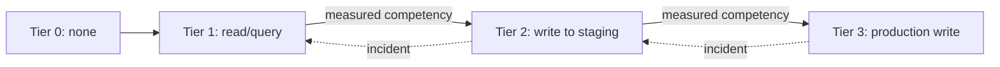

# Progressive Tool Access

**Also known as:** Need-to-Use Tool Access, Graduated Tool Permissions

**Category:** Safety & Control  
**Status in practice:** emerging

## Intent

Grant tool permissions on a need-to-use basis, starting minimum and expanding only as the agent proves competency, mirroring how humans earn system access.

## Context

A new agent goes into production. Default is to provision all its tools at once: full DB access, full email, full file system, full payment. The agent has not yet demonstrated competency on any of them. The tool-access-paradox kicks in: capability and risk both scale with tool count.

## Problem

Front-loaded tool provisioning maximizes blast radius before competency is established. An early agent mistake on a tool it didn't need yet causes a high-cost incident. The standard mitigations (sandbox-isolation, policy-gates) are runtime — they don't address the design choice of which tools to grant in the first place.

## Forces

- Graduated provisioning slows agent's reach to full capability.
- Defining 'proved competency' per tool is engineering work.
- Rolling back provisioning after escalation is operationally awkward.

## Therefore

Therefore: provision tools in stages tied to demonstrated competency — start with read-only or query-only access, escalate to write/mutate only after the agent shows measured competency on the lower tier.

## Solution

Define provisioning tiers per tool: Tier 0 — none; Tier 1 — read/query only; Tier 2 — write to staging/sandbox; Tier 3 — full production write. Move the agent up tiers based on demonstrated metrics (success rate, no incidents, monitored time-in-tier). Track per-tool tier. Pair with tool-loadout, tool-loadout-hotswap, sandbox-isolation, policy-gated-agent-action, three-tier-autonomy-portfolio.

## Structure

```
Tier 0 (none) --> Tier 1 (read / query) --measured competency--> Tier 2 (write to staging) --measured competency--> Tier 3 (production write); incident --> drop one tier; tier tracked per tool
```

## Diagram



## Example scenario

An inventory agent is provisioned Tier 1 on stock-query, Tier 1 on order-DB. After 30 days with zero incidents and 99% query success it earns Tier 2 on order-DB (write to staging). After 60 more days clean it earns Tier 3 on order-DB (production write). Meanwhile a sibling agent has an incident on Tier 1 stock-query (returned wrong data, caused downstream confusion) and is held at Tier 1 until incident root cause is resolved.

## Consequences

**Benefits**

- Blast radius scales with proven competency, not with aspirational design.
- Early mistakes hit lower-tier tools where damage is bounded.
- Tier progression becomes a measurable signal of agent maturity.

**Liabilities**

- Slower time-to-full-productivity for new agents.
- Operational complexity of tier tracking per tool per agent.
- Competency metrics must be defined and trusted — bad metrics promote bad agents.

## Failure modes

- Bad promotion metric — the success rate used for promotion rewards easy tasks, and an agent reaches production write without being competent at it.
- Stale tier record — tier tracking per tool per agent falls out of date, and an agent keeps a tier after an incident should have dropped it.
- Slow ramp — every new agent starts at the bottom, takes long to reach useful tiers, and teams skip the ladder to ship faster.

## What this pattern constrains

No tool is provisioned at a tier the agent has not earned via measured competency; tier downgrade on incident is automatic, not negotiated.

## Applicability

**Use when**

- New agents in production.
- Tools whose blast radius justifies graduated trust.
- Team can define competency metrics per tool.

**Do not use when**

- Single-tier tools (no read-only mode exists).
- Sub-day deployment with no measurement window.
- All tools low-blast-radius enough that front-loading is acceptable.

## Components

- Per-tool tier definitions
- Per-agent tier registry
- Competency metrics per tool
- Tier-progression workflow
- Incident-triggered tier downgrade

## Tools

- Per-tool tier definitions
- Per-agent tier registry
- Competency-metric tracking per tool

## Evaluation metrics

- Per-tool tier-progression cadence
- Incident-triggered tier downgrade frequency
- Tool-incident rate vs single-tier baseline

## Known uses

- **[Bornet et al. — Agentic Artificial Intelligence, Chapter 5 'Progressive Tool Access: A Framework for Safety'](https://www.worldscientific.com/worldscibooks/10.1142/14380)** _available_

## Related patterns

- _complements_ **Tool Loadout**
- _complements_ **Tool Loadout Hot-Swap**
- _complements_ **Sandbox Isolation**
- _complements_ **Policy-Gated Agent Action (KRITIS)**
- _alternative-to_ **Static Role for a Dynamic Agent** — Earning access incrementally from a minimal baseline is the positive model against granting a broad standing role up front.
- _alternative-to_ **Monotonic Privilege Confinement** — Runs the ratchet the other way: permissions start minimal and expand as the agent proves competency over time, which is exactly the movement this pattern refuses to make without approval.

## References

- [Agentic Artificial Intelligence — Chapter 5](https://www.worldscientific.com/worldscibooks/10.1142/14380) — 2025
