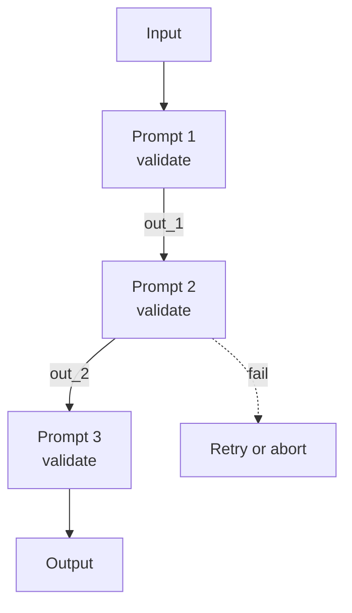

# Prompt Chaining

**Also known as:** Sequential Decomposition, Pipeline of Prompts

**Category:** Routing & Composition  
**Status in practice:** mature

## Intent

Decompose a task into a fixed sequence of LLM calls where each step's output becomes the next step's input.

## Context

A team is building an agent for a task that decomposes cleanly into a fixed sequence of sub-tasks whose order is known before the request arrives — for example turning a meeting transcript into structured action items decomposes into cleaning the transcript, attributing speakers, extracting candidate actions, normalising dates and owners, and emitting validated JSON. Each sub-task has its own definition of done, its own preferred prompt, and its own shape of output. The team controls the orchestration code that runs between LLM calls.

## Problem

If the team tries to do the whole task in a single mega-prompt, the model is asked to juggle several concerns at once and quality suffers across all of them. When the output is wrong, the team cannot tell which sub-task went off the rails because the steps are entangled inside one generation. Retries have to redo the entire task instead of just the failing step, and improvements to one part of the prompt risk regressing another.

## Forces

- Decomposition clarity vs compounded latency.
- Step isolation vs error compounding across the chain.
- Schema rigor between steps vs pipeline flexibility.

## Therefore

Therefore: replace the mega-prompt with a fixed sequence of validated prompts that hand off typed outputs, so that failures localise to a step instead of corrupting the whole task.

## Solution

Define a fixed pipeline of prompts. Each step has its own system prompt, expected output shape, and validation. A failure at step k retries step k or aborts; downstream steps run only on success.

## Structure

```
Input --> Prompt 1 --validate--> out_1 --> Prompt 2 --validate--> out_2 --> ... --> Prompt N --validate--> Output; step k fails validation --> retry step k or abort (later steps do not run)
```

## Diagram



## Example scenario

A team builds a 'turn meeting transcript into a structured action-item list' feature as one mega-prompt. Failures are hard to localise — sometimes the speaker attribution is wrong, sometimes the dates are wrong, sometimes the JSON is malformed. They split it into a prompt-chain: step one cleans the transcript and attributes speakers, step two extracts candidate action items, step three normalises dates and owners, step four validates and emits JSON. Each step has its own validator; a failure at step three retries step three instead of redoing the whole pipeline.

## Consequences

**Benefits**

- Failures localise to a step.
- Each step's prompt can be optimised independently.

**Liabilities**

- Inflexible to inputs that do not match the assumed decomposition.
- Latency = sum of step latencies.

## Failure modes

- Error compounding — step 2 passes validation with a subtly wrong output, and every later step builds on the mistake.
- Decomposition misfit — an input does not fit the assumed sequence of steps, and the fixed chain forces it through steps that make no sense for it.
- Weak step validator — a schema check accepts output that has the right shape but the wrong content, so the handoff gate does not catch the failure.
- Retry loop on one step — a persistent failure at step k burns its retry budget on every request because the abort rule is too lenient.

## What this pattern constrains

Step k cannot bypass step k-1's output schema.

## Applicability

**Use when**

- A task decomposes into a fixed sequence of LLM calls with clear handoffs.
- Each step has its own system prompt, expected output shape, and validation.
- Localised retries at a step are preferable to retrying a mega-prompt.

**Do not use when**

- The decomposition is data-dependent and only knowable at runtime (use orchestrator-workers).
- A single well-structured prompt already solves the task reliably.
- Chain length amplifies latency beyond what users tolerate.

## Components

- Per-step prompt — system prompt, exemplars, and output schema scoped to one sub-task
- Per-step validator — schema or rule check that gates the handoff to the next step
- Chain orchestrator — runs the fixed sequence, propagates typed outputs, owns retries
- Localised retry policy — per-step retry budget and abort rule on persistent failure
- Step-level telemetry — latency, error, and quality metrics tagged per step

## Tools

- Prompt orchestration framework — LangChain, DSPy, LlamaIndex Workflows, or hand-rolled sequence
- Structured-output validator — JSON Schema, Pydantic, or Instructor at each step boundary
- LLM API — possibly different models per step depending on the step's profile

## Evaluation metrics

- Per-step success rate — share of inputs that pass validation at each step
- Per-step retry cost — average retries to clear each step and the token bill that implies
- End-to-end success rate vs mega-prompt baseline — the quality the decomposition is meant to buy
- Localisation rate — share of failures cleanly attributable to a single step on incident review
- Cumulative latency — sum of step latencies vs the mega-prompt single call

## Known uses

- **Anthropic Building Effective Agents (Workflow #1)** _available_

## Related patterns

- _complements_ **Routing**
- _alternative-to_ **Parallelization**
- _specialises_ **Pipes and Filters**
- _specialises_ **Chat Chain**
- _uses_ **Augmented LLM**

## References

- [Anthropic: Building Effective Agents](https://www.anthropic.com/research/building-effective-agents) — 2024
