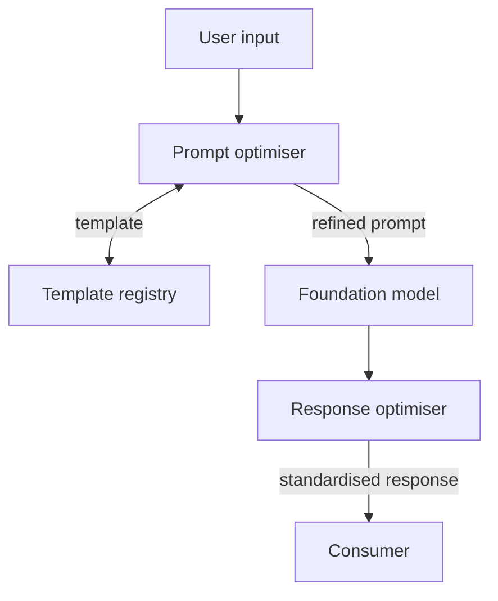

# Prompt/Response Optimiser

**Also known as:** Prompt Template Runtime, Runtime Prompt Refinement, Prompt Standardiser

**Category:** Structure & Data  
**Status in practice:** mature

## Intent

At runtime, transform user inputs and model outputs into standardised, template-aligned prompts and responses against predefined constraints, so the agent and its downstream consumers see consistent shapes.

## Context

A team is running an agent that sits between free-form human input on one side and a chain of downstream consumers on the other — other agents, tool calls, and user-interface components that each expect a particular shape. Users write whatever they want, in whatever phrasing they want, and downstream code expects predictable structure. The team needs a place to standardise both ends without asking either side to change its habits.

## Problem

If user prompts go straight to the model and the model's free-form output goes straight to consumers, two things drift in parallel. The model's behaviour changes with every small wording variation in how users phrase the same intent, and each downstream consumer ends up writing its own ad-hoc parser to extract what it needs from prose, with parsers that disagree on edge cases. Over time the agent's behaviour becomes hard to reproduce and downstream integrations become brittle, because there is no single contract that both the model and the consumers are held to.

## Forces

- Standardisation: consistent shape across prompts and responses helps reliability.
- Goal alignment: optimisation must serve the user's actual goal, not just template compliance.
- Interoperability: other tools/agents need predictable shapes.
- Adaptability: templates must accommodate different domains and constraints.

## Therefore

Therefore: insert a runtime component that refines prompts on the way in and responses on the way out using a registry of templates with constraints, so that what the model sees and what consumers see are standardised against the same contract.

## Solution

A prompt/response optimiser sits between the user-facing surface and the foundation model. On input, it loads a template for the current task (few-shot examples, format constraints, goal restatement) and rewrites the user's prompt to match. On output, it post-processes the model's response into the consumer's expected shape. The template registry can be evolved independently of the agent logic.

## Structure

```
User input → Prompt optimiser (template registry) → Foundation model → Response optimiser → Consumer.
```

## Diagram



*Runtime templates standardise both the model's input and its output.*

## Example scenario

An onboarding agent accepts any free-form question from a new employee. A prompt/response optimiser wraps every user message in a template that restates the company policy context, the employee's department, and the required output format (a JSON object with answer + citation). The model never sees raw user wording without that frame, and the downstream UI always renders a predictable shape.

## Consequences

**Benefits**

- Standardisation across prompts and responses without changing user behaviour.
- Goal alignment: refined prompts re-state the underlying goal explicitly.
- Interoperability: downstream agents/tools consume predictable shapes.
- Adaptability: domain-specific templates without re-training the model.

**Liabilities**

- Underspecification: the optimiser may strip context the user meant to convey.
- Maintenance overhead: templates need to evolve as goals and consumers change.
- Drift if templates aren't versioned alongside the agent.

## Failure modes

- Stripped intent — the rewrite into the template drops a detail the user meant, and the model answers a cleaner but different question.
- Template lag — goals or consumers change while the templates stay the same, so rewritten prompts and shaped responses no longer fit.
- Unversioned registry — templates change without being versioned with the agent, and behaviour shifts with no record of why.
- Bypass path — one consumer reads raw model output instead of the optimised response, and the ad-hoc parsing the pattern removed comes back.

## What this pattern constrains

Both the model and the downstream consumers see only template-conformant shapes; raw user wording does not propagate.

## Applicability

**Use when**

- Multiple downstream consumers depend on the agent's response shape.
- Domain-specific prompt scaffolding must be reused across many requests.
- Templates can be evolved separately from agent logic.

**Do not use when**

- A single inline prompt suffices and no consumer chain exists.
- Templates would over-constrain user expression in ways that hurt goal alignment.

## Components

- Prompt optimiser — rewrites raw user input against the loaded template before it reaches the model
- Response optimiser — post-processes model output into the shape the consumer expects
- Template registry — versioned store of templates, format constraints, and few-shot exemplars per task
- Foundation model — sees only template-conformant input, never raw user wording
- Downstream consumer — agent, tool, or UI that depends on the standardised response shape

## Tools

- Prompt-template runtime (LangChain PromptTemplate, Bedrock Prompt Management, Dialogflow Generators) — loads and applies templates at request time
- Template versioning system — tracks template changes alongside agent code so behaviour is reproducible
- Output post-processor (regex, JSON parser, schema validator) — coerces model output into the consumer's shape

## Evaluation metrics

- Template-conformance rate on inputs — fraction of optimised prompts that match the declared template structure
- Response-shape conformance rate — fraction of post-processed outputs the consumer accepts without further parsing
- Goal-alignment regression — sample-audited rate at which template rewriting strips context the user meant to convey
- Inter-template behaviour drift — variance in agent behaviour across template versions for the same intent
- Consumer-side parser complexity — lines of ad-hoc parsing each consumer still needs; should trend to zero

## Known uses

- **[LangChain prompt templates](https://api.python.langchain.com/en/latest/prompts/langchain_core.prompts.prompt.PromptTemplate.html)** _available_ — Practitioners author and reuse prompt templates as a runtime construct.
- **[Amazon Bedrock prompt management](https://docs.aws.amazon.com/bedrock/latest/userguide/prompt-management.html)** _available_ — Bedrock Prompt management lets users create reusable prompt templates with variables, alternative variants, and versioning.
- **[Google Dialogflow](https://cloud.google.com/dialogflow)** _available_ — Generators allow users to specify agent behaviours and responses at runtime.

## Related patterns

- _complements_ **Prompt Versioning**
- _complements_ **Dynamic Scaffolding**
- _composes-with_ **Structured Output**
- _alternative-to_ **DSPy Signatures**
- _uses_ **Passive Goal Creator**
- _uses_ **Proactive Goal Creator**

## References

- [Agent design pattern catalogue: A collection of architectural patterns for foundation model based agents](https://doi.org/10.1016/j.jss.2024.112278) — Yue Liu, Sin Kit Lo, Qinghua Lu, Liming Zhu, Dehai Zhao, Xiwei Xu, Stefan Harrer, Jon Whittle, 2025
