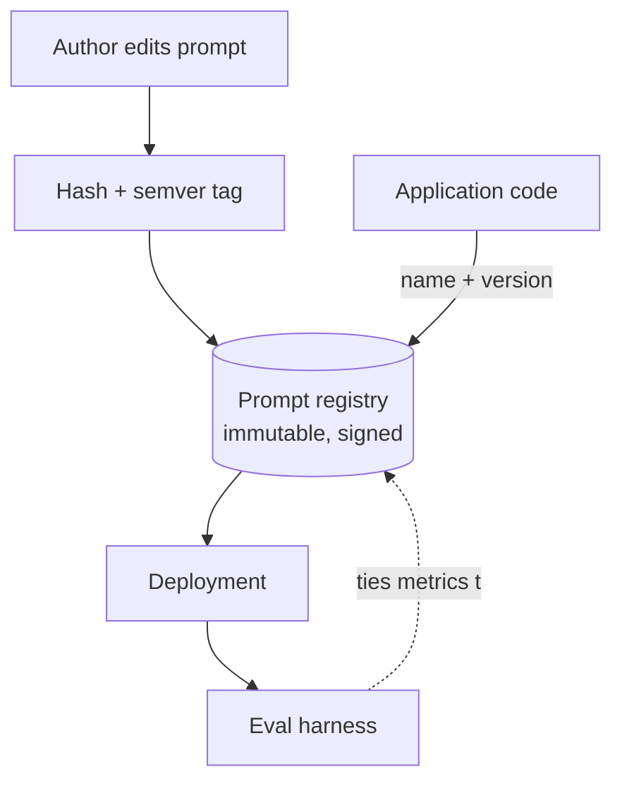

# Prompt Versioning

**Also known as:** Prompt-as-Artifact, Prompt Registry, Versioned Prompts

**Category:** Governance & Observability  
**Status in practice:** mature

## Intent

Treat prompts as immutable, hashed, semver'd artefacts in a registry; deploy and roll back like code.

## Context

A team runs an agent where the system prompt and task prompts are major levers on quality. Multiple engineers edit those prompts, sometimes inline in code, sometimes through a prompt-management tool. The team needs to know exactly which prompt text was live at any given time, to be able to roll back a bad prompt cleanly, and to tie evaluation results to the specific prompt being scored.

## Problem

When prompts live as plain strings inside the application code, a wording change becomes a code change: rolling back the prompt requires reverting a deployment, comparing two prompt versions side by side requires diffing branches, and there is no clean way to say which prompt produced last week's outputs. Evaluation runs cannot be tied back to specific prompt text once that text has been edited in place. The team is forced to choose between treating every prompt edit as a full code release or losing the ability to audit and revert prompts precisely.

## Forces

- Registry adds infrastructure.
- Prompt versioning must integrate with eval harness.
- Signed prompts vs editable prompts.

## Therefore

Therefore: store prompts as immutable, hashed, semver-tagged artefacts in a registry that code references by name and version, so that deploys, rollbacks, and eval results all pin to a specific prompt the same way they pin to specific code.

## Solution

Prompts live in a registry as immutable, hashed, version-tagged artefacts. Code references prompts by name + version (semver). Deployments pin specific versions; rollback by version. Eval harness ties metric outcomes to prompt versions. Optionally signed for provenance.

## Structure

```
Author edits prompt --> Hash + semver tag --> Prompt registry (immutable, optionally signed) <--name + pinned version-- Application code --> Deployment --> Eval harness --metrics tied to version--> Prompt registry; rollback = repin previous version
```

## Diagram



## Example scenario

A team rolls a small wording change into a prompt at 14:00 and by 16:00 the agent's behaviour has shifted in ways nobody predicted. There is no clean rollback short of redeploying the entire service from a prior commit. They adopt prompt-versioning: prompts live in a registry as immutable, hashed, semver-tagged artefacts; code references them by name plus version; deployments pin a specific version; rollback is a one-line config change. Eval-harness metrics tie to prompt versions. The next bad-prompt incident is reverted in under a minute.

## Consequences

**Benefits**

- Prompt rollback without redeploy.
- Eval results map to specific prompts.

**Liabilities**

- Registry infrastructure.
- Version-pinning means prompts stop tracking model upgrades automatically.

## Failure modes

- Inline prompt bypass — a developer adds a quick inline prompt string for a new feature, and its outputs cannot be tied to any registry version.
- Stale pin after model upgrade — the model is upgraded while the prompt stays pinned to a version tuned for the old model, and quality drops with no prompt change on record.
- Mutable tag — a version tag is overwritten instead of a new version being created, and two deployments with the same version run different text.
- Unbound eval results — eval runs are stored without the prompt version, so a score change cannot be linked to the prompt that caused it.

## What this pattern constrains

Production calls reference pinned prompt versions only; ad-hoc inline prompts are forbidden.

## Applicability

**Use when**

- Prompts are edited often and audit, rollback, or A/B comparison is required.
- Eval outcomes need to be tied to specific prompt versions.
- A registry can hold immutable, hashed, semver-tagged artefacts.

**Do not use when**

- Prompts are stable and rarely changed.
- No registry exists and the operational cost outweighs current churn.
- Inline prompts already work and there is no audit obligation.

## Components

- Prompt Author Workflow — edits flow into the registry rather than into application strings
- Hash and Semver Tagger — produces an immutable identity for each prompt version
- Prompt Registry — immutable, optionally signed store of versioned prompt artefacts
- Application Reference — code references prompts by name plus pinned version, not inline text
- Eval-Harness Binding — ties metric outcomes back to specific prompt versions

## Tools

- LangSmith Prompts — hosted prompt registry with versioned artefacts
- PromptLayer — versioned prompt store with deployment pinning
- Humanloop — managed prompt registry tied to evals
- Helicone Prompts / Vellum — alternative prompt-as-artefact registries

## Evaluation metrics

- Pinned-reference rate — share of production calls that resolve to a registry version vs inline string
- Mean time to roll back a bad prompt — minutes from detection to a pinned older version
- Eval-to-prompt linkage rate — share of eval results that resolve to a specific prompt version
- Inline-prompt-leak count — production calls using ad-hoc inline prompts (target zero)
- Prompt-version churn — edits per prompt per week, surfaces unstable areas

## Known uses

- **LangSmith Prompts** _available_
- **PromptLayer** _available_
- **Humanloop** _available_
- **Vellum** _available_
- **Helicone Prompts** _available_

## Related patterns

- _composes-with_ **Lineage Tracking**
- _uses_ **Eval as Contract**
- _complements_ **Shadow Canary**
- _complements_ **Prompt/Response Optimiser**
- _complements_ **Agentic Context Engineering Playbook**
- _generalises_ **Own Your Prompts (12-Factor Agents)**
- _complements_ **Prompt Variant Evaluation**

## References

- [LangSmith Prompts](https://docs.smith.langchain.com/prompt_engineering/concepts)
- [PromptLayer](https://docs.promptlayer.com)
- [Humanloop](https://humanloop.com)
