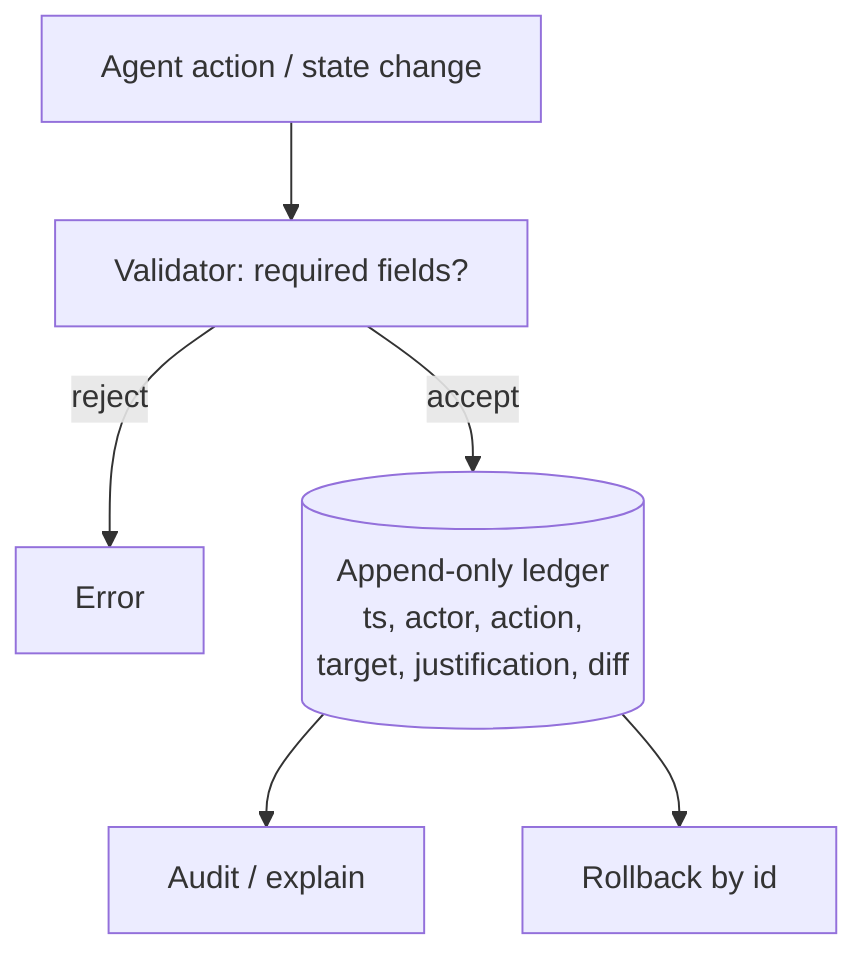

# Provenance Ledger

**Also known as:** Audit Trail, Action Log

**Category:** Governance & Observability  
**Status in practice:** mature

## Intent

Log every agent decision and state change with enough metadata to explain or reverse it later.

## Context

A team runs an agent that takes consequential actions in the real world: approving or rejecting insurance claims, modifying production records, sending money. Sometimes weeks or months later, a regulator, a customer, or an internal auditor asks why the agent did what it did on a specific date. Answering that question requires both the action and the chain of reasoning, retrieved evidence, and model version that surrounded it.

## Problem

Without an immutable, append-only record of every decision and state change tied to a justification, agent behaviour becomes inscrutable after the fact. Rolling back a specific bad action is impossible because there is no event identifier to reverse, and patterns of failure across time are invisible because the trail is not queryable. The team is forced to choose between trusting that nothing will ever be questioned or attempting to reconstruct months-old behaviour from logs that were never designed for audit.

## Forces

- Auditability vs storage cost of every event.
- Schema rigidity vs evolvability over the agent's lifetime.
- PII in events: redaction at write time vs read time.

## Therefore

Therefore: append every agent decision and state change to an immutable log with timestamp, actor, action, target, justification link, and diff hash, and reject events that lack those fields, so that any change can be explained or reversed after the fact.

## Solution

Append events to an immutable log with: timestamp, actor, action, target, justification (link to thought or decision), diff hash. Enable rollback by id. Reject events that lack the required fields.

## Structure

```
Agent action / state change --> Event recorder --> Required-fields validator (ts, actor, action, target, justification link, diff hash) --reject--> Error / --accept--> Append-only ledger --> Audit / explain + Rollback resolver (by event id)
```

## Diagram



## Example scenario

A regulator asks an insurance-claims agent why it rejected a specific claim three months ago. The team can show the final decision but not the chain of reasoning, the retrieved policy clauses, or which model version answered — the audit trail is partial. They add a provenance-ledger: every decision and state change appends an immutable event with timestamp, actor, action, target, justification link, and diff hash. Rollback by event id becomes trivial; the next regulator question is answered with a full reconstruction.

## Consequences

**Benefits**

- Audit and rollback become tractable.
- Pattern of failures becomes visible across time.

**Liabilities**

- Log volume can dominate other storage.
- Justification fields require the agent to write them; lazy agents skip.

## Failure modes

- Empty justification — the agent fills the justification field with a generic placeholder that passes the validator but explains nothing.
- Ledger crowding — every minor state change is logged in full, and the ledger outgrows the rest of storage until retention cuts are forced.
- Rollback without diff — an event is recorded with a hash but the diff it points to is gone, so the action cannot be reversed by id.
- Side-channel writes — some state changes go through a path that never reaches the recorder, and the ledger shows a gap at the moment that matters.

## What this pattern constrains

Self-edits and other recorded actions are rejected if they lack a valid justification reference.

## Applicability

**Use when**

- Agent decisions and state changes must be explainable or reversible after the fact.
- An immutable, append-only log can be operated and queried.
- Each event can carry timestamp, actor, action, target, and justification fields.

**Do not use when**

- The agent has no consequential state changes worth logging.
- Storage and review cost of immutable logs are unjustified by risk.
- No queryable store is available to make the ledger useful.

## Components

- Event Recorder — emits a record for every decision and state change
- Required-Fields Validator — rejects events lacking timestamp, actor, action, target, justification, or diff hash
- Append-Only Ledger Store — immutable storage preserving order and integrity
- Justification Link — pointer from each event to the decision-log or thought entry that produced it
- Rollback Resolver — uses event id and diff hash to reverse a specific past action

## Tools

- Langfuse traces — captures action events with justification links
- OpenTelemetry GenAI semantic conventions — standardised span schema for agent actions
- Datadog LLM Observability — managed ingestion and query for action events
- Append-only store (object lock, WORM, EventStore) — guarantees immutability

## Evaluation metrics

- Justification-link coverage — share of action events with a resolvable justification reference
- Rollback success rate by event id — share of attempted reverses that completed cleanly
- Validator-rejection rate — events refused because they missed required fields
- Audit-answer turnaround — time to produce a full reconstruction for a regulator or customer query
- Ledger storage growth — bytes per day, signals when retention policy needs revisiting

## Known uses

- **Langfuse traces** _available_
- **OpenTelemetry GenAI semantic conventions** _available_
- **Datadog LLM Observability** _available_
- **[Sparrot](https://marco-nissen.com/sparrot/)** _available_ — An append-only ledger records every write and self-edit so the agent's behaviour is auditable from the ledger alone.

## Related patterns

- _composes-with_ **Append-Only Thought Stream**
- _specialises_ **Decision Log**
- _used-by_ **Compensating Action**
- _complements_ **Lineage Tracking**
- _alternative-to_ **Black-Box Opaqueness**
- _used-by_ **Sandbox Escape Monitoring**
- _complements_ **Memo-As-Source Confusion**
- _used-by_ **Emotional State Persistence**
- _complements_ **World-Model Separation**
- _complements_ **Durable Workflow Snapshot**
- _alternative-to_ **Errors Swept Under the Rug**
- _complements_ **Rigor Relocation**
- _complements_ **Hidden State Coupling**
- _complements_ **Policy-Gated Agent Action (KRITIS)**
- _composes-with_ **Deontic Token Delegation** — Records each deontic-token transfer so the delegation chain is auditable.
- _alternative-to_ **Agent Confession as Forensics** — An independent pre-captured action trail replaces interrogating the agent for forensics.
- _complements_ **Decision Token** — A provenance ledger is an append-only audit trail of all decisions and state changes; the token is the per-action justification record a ledger entry can reference rather than reconstruct.
- _used-by_ **Determinism-Tiered Replay Gate** — The tier harness consumes the logged inputs, decisions, and metadata the ledger captures, since it cannot re-run cases or compare conclusions without them.
- _complements_ **Attenuating Delegation Chain** — The append-only chain plus the signed receipt for each executed action is what the ledger records, so authorization evidence and audit evidence stay the same object.
- _used-by_ **Cumulative Disclosure Accounting** — The disclosure ledger is a provenance record read at decision time, not only after the fact.

## References

- [OpenTelemetry GenAI semantic conventions](https://opentelemetry.io/docs/specs/semconv/gen-ai/) — 2024
