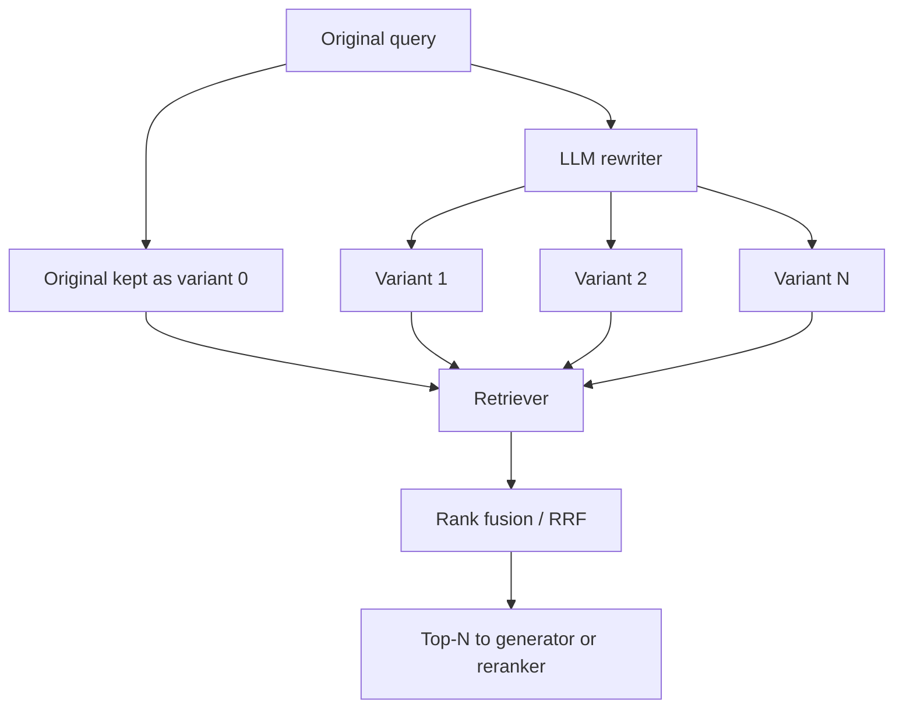

# Query Rewriting

**Also known as:** Multi-Query Retrieval, Query Expansion, Query Reformulation, RAG-Fusion (query side)

**Category:** Retrieval & RAG  
**Status in practice:** mature

## Intent

Use an LLM to generate several alternative formulations of the user's query, retrieve documents for each, and rank-fuse the results so recall does not depend on one phrasing.

## Context

A team runs retrieval over a corpus where the user's natural phrasing is only one of many ways to express the same information need. The corpus chunks may use different vocabulary, abbreviations, or framing for the same concept, and an embedding-based lookup against a single query vector lands in only one neighbourhood of the embedding space. Users themselves under-specify, ask compound questions, or use idioms the corpus does not echo.

## Problem

A single query embedding samples only one point in the semantic space and retrieves only the chunks closest to that point. Relevant chunks expressed in different vocabulary, at a different specificity level, or framed as a different sub-question are missed entirely, and no downstream reranker can rescue a chunk that was never retrieved. The user's first phrasing is a noisy estimator of intent, and recall is bottlenecked by how well that one phrasing aligns with how the answer chunks were written.

## Forces

- More query variants improve recall but multiply retrieval cost linearly.
- Variants generated by the LLM may drift off-topic and inject noise into the result set.
- Fusion strategy (union, RRF, weighted) decides whether rare-but-relevant chunks survive deduplication.
- Latency budget bounds how many parallel retrievals the system can afford per request.

## Therefore

Therefore: have the LLM rewrite the query into several variants, retrieve for each in parallel, and fuse the rankings so the answer set reflects the intent rather than the surface phrasing.

## Solution

At query time, prompt an LLM to produce N reformulations of the user's query (typically 3–5) covering paraphrase, decomposition into sub-questions, and specificity shifts. Retrieve top-k chunks for each variant in parallel. Fuse the result lists with Reciprocal Rank Fusion or a deduplicated union, then pass the fused top-N forward to the generator or to a downstream reranker. The original query is included as one of the variants so the system never does worse than a single-query baseline.

## Structure

```
Original query --> LLM rewriter --> Variants 1..N + original as variant 0 --> Retriever runs once per variant (in parallel) --> Rank fusion (RRF or deduplicated union) --> Top-N --> Generator or reranker
```

## Diagram



*Query Rewriting expands the user query into N variants, retrieves for each in parallel, and rank-fuses the results.*

## Example scenario

A documentation assistant gets the query 'why is my deploy slow?' A single embedding lookup retrieves a handful of chunks about deploy speed in general. The rewriter produces variants — 'deployment latency causes', 'slow CI pipeline diagnosis', 'docker image build time bottlenecks', 'kubernetes rollout delay reasons' — and runs retrieval for each in parallel. The fused result set now contains chunks about image-build caching and rollout strategy that the original query embedding sat too far from. Reciprocal Rank Fusion across the five rankings surfaces the chunks that appear in multiple lists.

## Consequences

**Benefits**

- Recall lift on queries whose first phrasing is under-specified or vocabulary-mismatched against the corpus.
- Decomposes compound questions into retrievable sub-questions without changing the generator.
- Composable: stacks in front of any existing retriever (dense, sparse, or hybrid) and in front of any reranker.

**Liabilities**

- Retrieval cost and latency multiply by the number of variants.
- LLM-generated variants can drift off-topic and inject distractors into the result set.
- Fusion tuning (RRF constant, weight, union policy) is empirical and corpus-specific.
- An extra LLM call sits on the request path before any retrieval can start.

## Failure modes

- Drifting variant — one rewrite shifts the topic, its results enter the fused list, and distractors push relevant chunks down.
- Lost original — the original query is not kept as a variant, and the system does worse than plain retrieval on queries that were already well phrased.
- Fusion drops the rare hit — a relevant chunk found by only one variant ranks too low after fusion and is cut from the top-N.
- Latency multiplier — the rewrite call plus N parallel retrievals push a simple lookup past the request's time budget.

## What this pattern constrains

The retriever cannot be driven by the user's original query alone; the result set is the rank-fusion across all generated variants plus the original.

## Applicability

**Use when**

- Users under-specify or phrase queries in vocabulary that does not echo the corpus.
- Queries are compound and naturally decompose into sub-questions answered by different chunks.
- Single-query retrieval shows recall@k below the level a reranker could rescue.
- Latency budget can absorb one LLM call plus N parallel retrievals.

**Do not use when**

- Queries are short and exact (codes, identifiers, exact-match lookups) where variants would only add noise.
- Sub-100ms p95 retrieval is required and the extra LLM call blows the budget.
- Corpus is small enough that a single embedding lookup already saturates recall.

## Components

- Query rewriter — LLM call that emits N variants of the user query in a structured format
- Parallel retriever — runs the underlying retriever (dense, sparse, or hybrid) once per variant
- Rank fusion stage — Reciprocal Rank Fusion or deduplicated union merges the N ranked lists into one
- Top-N selector — emits the fused top-N to the generator or to a downstream reranker

## Tools

- LLM rewriter — small fast model is sufficient (e.g. Haiku-class); the rewriter does not need the strongest model
- Retriever — any existing retriever (vector index, BM25, or hybrid) reused unchanged per variant
- Fusion library — RRF implementation or vector-store SDK that exposes hybrid/multi-query helpers

## Evaluation metrics

- Recall@k against single-query baseline — quantifies the lift from variant expansion
- Per-variant contribution — fraction of fused top-N chunks unique to each variant, to detect dead variants
- Distractor rate — fraction of retrieved chunks that the generator does not cite, to detect off-topic drift
- p95 retrieval latency — overhead of the rewriter LLM call plus N parallel retrievers
- Cost per query — extra LLM call plus N retrievals against the single-query baseline

## Known uses

- **[LangChain MultiQueryRetriever](https://python.langchain.com/api_reference/langchain/retrievers/langchain.retrievers.multi_query.MultiQueryRetriever.html)** _available_
- **[RAG-Fusion (Raudaschl, 2024)](https://github.com/Raudaschl/rag-fusion)** _available_
- **[Most production RAG pipelines using LangChain or LlamaIndex retrievers](https://www.langchain.com/blog/query-transformations)** _available_

## Related patterns

- _specialises_ **Naive RAG**
- _composes-with_ **Hybrid Search**
- _composes-with_ **Cross-Encoder Reranking**
- _alternative-to_ **HyDE**
- _composes-with_ **Modular RAG**
- _composes-with_ **Hierarchical Retrieval**

## References

- [RAG-Fusion: a New Take on Retrieval-Augmented Generation](https://arxiv.org/abs/2402.03367) — Raudaschl, 2024
- [LangChain — MultiQueryRetriever](https://python.langchain.com/docs/how_to/MultiQueryRetriever/)
- [Martin Fowler — Emerging Patterns in Building GenAI Products](https://martinfowler.com/articles/gen-ai-patterns/) — Bryce Mecum, Birgitta Boeckeler, Martin Fowler, Ryder Dale Walton, 2025
- [Reciprocal Rank Fusion outperforms Condorcet and individual Rank Learning Methods](https://dl.acm.org/doi/10.1145/1571941.1572114) — Cormack, Clarke, Buettcher, 2009
