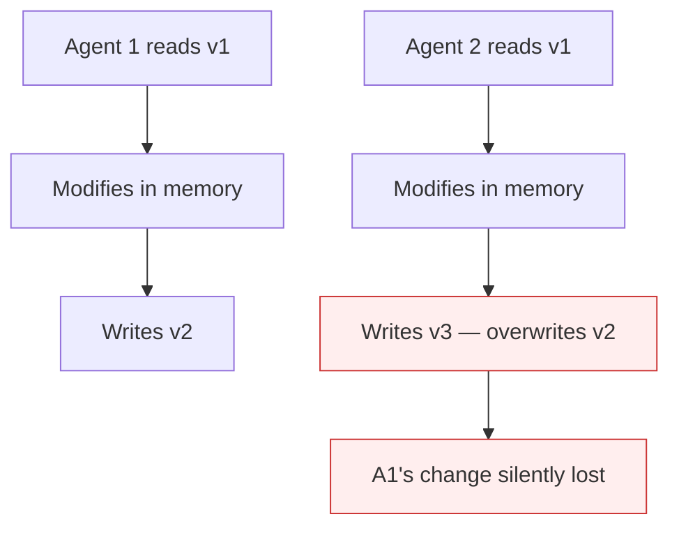

# Race Conditions on Shared Tool Resources

**Also known as:** Unlocked Read-Modify-Write, Concurrent Agent Resource Contention

**Category:** Anti-Patterns  
**Status in practice:** deprecated

## Intent

Anti-pattern: let concurrent agents perform read-modify-write on shared external resources without locking, producing silent data corruption.

## Context

Multiple agent instances (parallel sub-agents, fan-out workers, swarm members) operate on the same external resource — a row in a database, a file in object storage, a row in a spreadsheet, a calendar entry. Each agent reads, modifies in memory, then writes back.

## Problem

When two agents read the same baseline, modify independently, and write back, the last writer wins and the first writer's change is lost. Without explicit locking (compare-and-swap, optimistic concurrency control, lease), corruption is silent — both writes 'succeed' from the agent's perspective. The corruption surfaces hours or days later as missing fields or wrong totals.

## Forces

- Parallelization patterns naturally encourage concurrent writes for speed.
- Backing stores without native CAS (spreadsheets, simple files, some APIs) make locking awkward.
- Agents do not naturally serialize because they have no shared view of in-flight work.

## Therefore

Therefore: every concurrent write to a shared resource must use compare-and-swap, optimistic concurrency tokens, or a coordinated lock; without one of these, parallel writes must be funnelled to a single serialization point.

## Solution

Use the backing store's CAS or ETag mechanisms. Where unavailable, route writes through a dedicated single-writer agent (consumer of an event queue). For non-mutating reads, allow parallelism freely. Pair with quorum-on-mutation when the resource is high-stakes (financial, identity). Detect lost-writes via background reconciliation jobs and alert on divergence.

## Structure

```
Anti-pattern: Agent A read -> Agent B read -> A write -> B write (last writer wins) -> silent lost update. Corrected: Agent read -> modify -> CAS / ETag write (retry on conflict) or single-writer queue -> reconciliation job alerts on divergence.
```

## Diagram



## Example scenario

A fan-out of 5 sub-agents each appends a row to a shared CSV report. They all read the file, append in-memory, and write back. Two of the appends land at the same time; the second overwrites the first. The report has 4 rows instead of 5 with no error. Discovered three weeks later when a quarterly reconciliation found revenue gaps.

## Consequences

**Benefits**

- Short-term: letting agents write in parallel without locks is simple and fast, and each write appears to succeed.
- Naming it lets a team require concurrency control on every shared write an agent makes.

**Liabilities**

- Silent lost-write corruption discovered hours or days after the incident.
- Reconciliation requires expensive background scans, often manual.
- Apparent success at the agent layer masks data integrity violations.

## Failure modes

- Lost update — two agents read the same record, each edits it, and the second write erases the first.
- False success — both writes report success, so neither agent nor log shows a problem.
- Late discovery — wrong totals or missing fields appear hours or days after the conflict.
- Manual reconciliation — fixing the damage needs costly scans across the shared resource.

## What this pattern constrains

No useful constraint; the missing constraint is explicit concurrency control on every write to a shared resource.

## Applicability

**Use when**

- Never. Cite when reviewing parallel-write agent designs.
- Use CAS/ETag/lease on every concurrent write.
- Funnel through a single-writer agent when backing store has no CAS.

**Do not use when**

- Any agent fan-out that writes to a shared external resource without CAS.
- Any swarm pattern with concurrent mutations and no coordination.
- Any agent system where lost writes would damage data integrity.

## Components

- Concurrent agents — each performs read-modify-write independently
- Shared resource — has no CAS/ETag protection
- Missing concurrency token — would detect overlapping modifications
- Missing reconciliation job — would surface lost writes after the fact

## Tools

- Detection signal — monitors or audits that surface this anti-pattern in the wild
- Mitigation pattern infrastructure — the positive pattern that resolves this anti-pattern
- Incident-response playbook — what to do when the anti-pattern fires

## Evaluation metrics

- Incident rate — occurrences per period
- Mean time to detection — how long the anti-pattern runs unobserved
- Cost / damage per incident — measurable impact of each occurrence

## Known uses

- **[Production agentic workflow 2026 failure taxonomy (digitalapplied.com)](https://www.digitalapplied.com/blog/agentic-workflow-anti-patterns-orchestration-mistakes-2026)** _available_

## Related patterns

- _complements_ **Quorum on Mutation**
- _complements_ **Missing Idempotency on Agent Calls**
- _complements_ **Hidden State Coupling**
- _alternative-to_ **Parallelization**
- _complements_ **Compensating Action**
- _complements_ **Co-Tenant Interference Profiling** — That anti-pattern is direct read-modify-write contention on the same resource; the difficulty here is that no shared field is written at all and the coupling runs through the physical medium.
- _complements_ **Actuation-Scope-Registered Control Loops** — That anti-pattern is a runtime lost write between concurrent actors on one resource, fixed by compare-and-swap or a single writer. This pattern is the design-time question of which perpetual loops may write the resource at all, answered before any of them starts.

## References

- [Agentic Workflow Anti-Patterns: Orchestration Mistakes (2026)](https://www.digitalapplied.com/blog/agentic-workflow-anti-patterns-orchestration-mistakes-2026) — 2026
