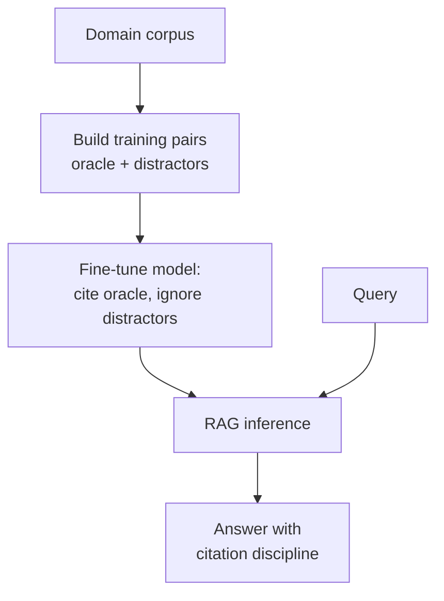

# RAFT

**Also known as:** Retrieval-Augmented Fine-Tuning, Distractor-Robust RAG

**Category:** Retrieval & RAG  
**Status in practice:** emerging

## Intent

Train the model to ignore irrelevant retrieved documents (distractors) in a domain-specific RAG setting.

## Context

A team is using retrieval-augmented generation in a specific domain and has observed that retrieval almost always returns a mix of documents. Some of the retrieved chunks are genuinely relevant to the user's query; others are topically similar distractors that share keywords or themes but do not actually answer the question. An off-the-shelf retrieval-augmented model attends to all of these chunks and is over-confident on the distractors that look plausible at a glance.

## Problem

Generic models trained on broadly relevant retrievals have not been taught to be sceptical of plausible-looking distractors in their context. When the retrieval mixes one relevant document with two or three convincing distractors, the model's answer drifts towards the loudest irrelevant source, often quoting it directly back at the user. The team needs the model to learn, during fine-tuning, how to ignore distractors in its context window and rely only on the truly relevant documents when those exist — and the team needs to do this with a training procedure that simulates the real retrieval mix rather than assuming clean inputs.

## Forces

- Training data construction (oracle docs + distractors) is its own pipeline.
- Domain shift between training and serving distractors.
- Trade-off between generalisation and domain specialisation.

## Therefore

Therefore: train the model on examples containing both oracle and distractor documents, so that it learns to cite oracles and ignore distractors at serving time.

## Solution

Construct training examples where some documents are oracle and others are distractors. Train the model to cite oracle documents and ignore distractors. Couples chain-of-thought with citation discipline.

## Structure

```
Training: Domain corpus --> Training-data builder (query + oracle docs + sampled distractors) --> Fine-tune generator (chain-of-thought, cite oracle, ignore distractors). Inference: Query --> Retriever (mixed relevant and distractor docs) --> Fine-tuned model --> Answer with citations --> Citation checker (evaluation)
```

## Diagram



## Example scenario

A clinical-coding RAG assistant keeps citing topically-similar but wrong ICD chapters when the retriever pulls in adjacent conditions. The team builds a RAFT-style training set where each prompt has the oracle code reference plus three convincing distractors, and the gold answer cites only the oracle. After fine-tuning, the model learns to ignore distractors even when they dominate the retrieved context. Production accuracy on the long-tail comorbidity codes climbs without changing the retriever.

## Consequences

**Benefits**

- Robustness to distractor documents in domain RAG.
- Citation discipline improves.

**Liabilities**

- Training data effort.
- Domain-specific; transfer between domains is partial.

## Failure modes

- Unrealistic distractors — the training distractors are easier to spot than real retrieval noise, and the fine-tuned model still follows convincing distractors in production.
- Domain shift — the retriever or corpus changes after training, the distractor mix looks different, and the learned scepticism no longer applies.
- Over-scepticism — the model learns to doubt context too much and ignores the relevant document when it is the only one retrieved.
- Citation form without substance — the model learns to emit citations to oracle-looking passages while the answer still draws on a distractor.

## What this pattern constrains

Cited claims must come from documents marked oracle in training; distractor citations are penalised.

## Applicability

**Use when**

- Domain-specific RAG models drift to topically similar distractors.
- Training data with oracle and distractor documents can be constructed at scale.
- Citation discipline matters and outputs must be traceable to oracle sources.

**Do not use when**

- Generic RAG quality already meets the domain bar.
- No training pipeline exists to fine-tune on oracle-versus-distractor signals.
- Inference-time retrieval is already filtered enough to make distractors rare.

## Components

- Training-data builder — assembles each example as one query plus oracle documents plus plausible distractors
- Distractor sampler — selects topically similar but non-supporting documents from the domain corpus
- Fine-tuning loop — trains the generator to cite oracle docs and ignore distractors, often with CoT rationales
- Inference-time retriever — supplies the mixed oracle-and-distractor context the fine-tuned model now handles
- Citation checker — verifies that emitted citations land on oracle-style passages at evaluation time

## Tools

- Fine-tuning infrastructure — supervised fine-tuning or LoRA pipeline for the domain generator
- Domain corpus and labelled oracle sets — source of training examples
- Retriever for inference — same vector or BM25 backend the production RAG uses

## Evaluation metrics

- Accuracy on the held-out domain set with distractors present — the core RAFT result vs an off-the-shelf RAG baseline
- Distractor-citation rate — share of answers whose citations point at distractor rather than oracle documents
- Oracle-citation precision — fraction of cited spans that actually come from oracle passages
- Cross-domain transfer accuracy — how the fine-tuned model holds up when distractor structure shifts
- Training-data construction cost per example — capex driver of the pattern

## Known uses

- **RAFT paper experiments** _available_

## Related patterns

- _specialises_ **Naive RAG**
- _alternative-to_ **Contextual Retrieval**

## References

- [RAFT: Adapting Language Model to Domain Specific RAG](https://arxiv.org/abs/2403.10131) — Zhang, Patil, Jain, Shen, Zaharia, Stoica, Gonzalez, 2024
