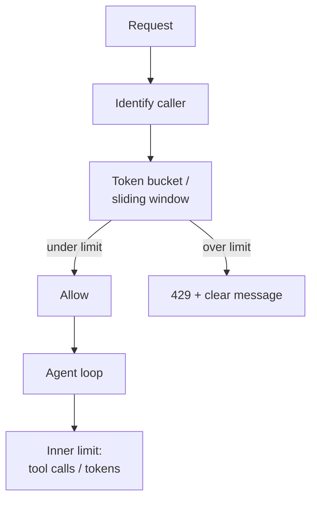

# Rate Limiting

**Also known as:** Throttling, Quota Enforcement

**Category:** Safety & Control  
**Status in practice:** mature

## Intent

Cap the number of requests, tokens, or tool calls per user (or session) within a time window.

## Context

A team runs a multi-tenant agent product where many users share the same backend resources — token budgets with model providers, tool API quotas, compute capacity. Any one of those users can, accidentally or maliciously, send much more traffic than the operator priced for: a runaway script, a compromised account, or simply a single power user opening hundreds of concurrent sessions.

## Problem

Without per-identity limits, a single caller can drain the month's token budget in a few hours, hit downstream provider rate limits and starve every other user, or simply run up an unbounded bill the operator did not authorise. Imposing one global cap is too blunt — it punishes everyone for one bad actor — and trusting users to behave reasonably has never worked at scale. The team is forced to choose between generous limits that hurt cost and tight limits that hurt legitimate users.

## Forces

- Generous limits hurt cost; tight limits hurt UX.
- Per-tier limits add complexity.
- Distributed counters need coordination.

## Therefore

Therefore: enforce per-identity token-bucket counters at multiple horizons in both the gateway and the agent loop, so that no single caller can starve the system or run up an unbounded bill.

## Solution

Define limits per identity at multiple horizons (per minute, per hour, per day). Use token-bucket or sliding-window counters. Apply at API gateway and at agent loop level. Surface limit hits to the user clearly.

## Structure

```
Request --> Identify caller --> Token bucket / sliding window (per minute, hour, day) --over limit--> 429 + clear message | --under limit--> Agent loop --> Inner limit on tool calls and tokens
```

## Diagram



## Example scenario

A coding assistant ships a free tier and within a week one signed-up account opens 400 concurrent agent loops, draining the month's token budget in two hours. The team adds per-identity token-bucket counters at three horizons (per minute, per hour, per day) at the API gateway and inside the agent loop itself. Over-budget callers get a clear 429 naming which window tripped and when it resets. Cost stops being a single hostile user away from blowing up.

## Consequences

**Benefits**

- Cost predictability.
- Abuse becomes detectable as limit hits.

**Liabilities**

- Legitimate burst usage is throttled.
- Tier definitions ossify.

## Failure modes

- Throttled burst — a legitimate user with a short spike of real work hits the per-minute limit and is blocked mid-task.
- Ossified tiers — limits set at launch never change, and they no longer match how people use the product.
- Outer-only limit — the gateway caps requests, but one request starts an agent loop that makes unbounded tool calls inside it.

## What this pattern constrains

Requests beyond the limit are rejected or queued; no code path may bypass the limiter.

## Applicability

**Use when**

- A single user or compromised account could otherwise bankrupt the product or starve others.
- Limits per identity can be enforced at API gateway and inside the agent loop.
- Limit hits can be surfaced to users in a clear, actionable way.

**Do not use when**

- The deployment is a closed internal tool with trusted volume.
- Existing infrastructure already rate-limits effectively at the boundary.
- False rate-limit denials would block more legitimate work than they protect.

## Components

- Identity resolver — extracts the caller id used to key per-tenant counters
- Token-bucket counter — per-identity bucket refilled at the configured rate
- Multi-horizon limit table — per-minute, per-hour, per-day caps applied in parallel
- Gateway enforcer — outer limiter at the API boundary
- Inner loop enforcer — secondary limit on tool calls and tokens inside the agent loop

## Tools

- Distributed counter store — Redis or equivalent backing the buckets across instances
- Sliding-window timer — reference clock for window resets and bucket refills

## Evaluation metrics

- 429 response rate by tenant — distribution of limit hits across the user base
- Token-budget burn-rate per tenant — early warning of runaway accounts
- False-limit denials — legitimate burst traffic blocked by an over-tight cap
- Gateway-vs-loop-limit hit ratio — which layer fired and how often

## Known uses

- **Most production agent APIs** _available_
- **[Sparrot](https://marco-nissen.com/sparrot/)** _available_ — A sliding-window token cap is enforced per minute per provider so a chatty stretch cannot exhaust the budget for a calmer one.

## Related patterns

- _complements_ **Circuit Breaker**
- _complements_ **Cost Gating**
- _complements_ **Event-Driven Agent**
- _complements_ **Kill Switch**
- _complements_ **Infrastructure Burst Bottleneck (Agent Scale-Out)**
- _complements_ **Naive Retry Without Backoff**
- _used-by_ **Agent Middleware Chain**
- _used-by_ **Business + LLM Microservice Split**
- _complements_ **Crawler Dispatcher**
- _alternative-to_ **Velocity-and-Magnitude Governor** — Rate limiting caps requests, tokens, or calls per window; the governor caps committed financial magnitude per window instead — same throttle shape, a different governed quantity (dollars-per-second, not calls-per-second).
- _alternative-to_ **Cumulative Disclosure Accounting** — Both are session-scoped counters, but a rate limiter counts requests in a time window and says nothing about what those requests revealed.
- _complements_ **History-Dependent Admissibility** — Rate limits count requests per window; this counts what the requests meant to each other, so a slow, polite, in-quota sequence is still refused.

## References

- [Rate limits](https://docs.claude.com/en/api/rate-limits) — 2025
