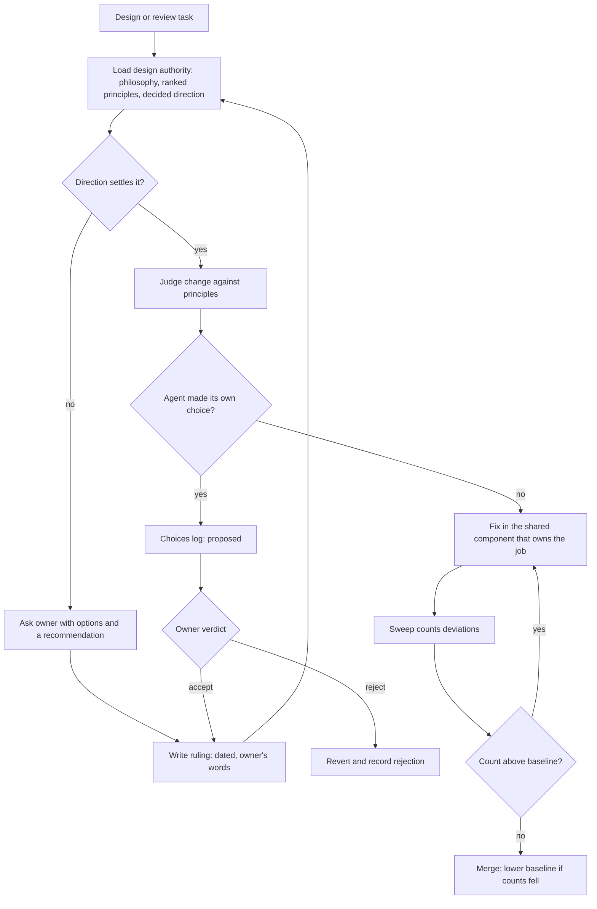

# Ratified Design Philosophy

**Also known as:** Owner-Ratified Design Authority, Self-Learning Design Review Skill, Living Design Direction

**Category:** Governance & Observability  
**Status in practice:** emerging

## Intent

Give a design or review agent one living design authority that holds the owner's ranked principles and their reasons, learns from every correction, and changes only through the owner's ratification.

## Context

Coding agents now build and change most of the user interface of a product with many themes, platforms, window sizes and display modes. Each change is local: the agent sees one screen, styles it until it looks right, and moves on. The product owner has a clear sense of what the product should feel like, but only part of that sense can be written as checkable rules, and the rest lives in reasons, priorities and taste that come out one correction at a time.

## Problem

Rules alone are applied to the letter and miss the intent. An agent told to use no hardcoded colours will still give one screen its own card, its own spacing and its own selected state, because nothing told it that two looks for one meaning is a defect. Left to its own taste, the model regresses to an average, safe look and narrows a deliberately wide range of styles toward a tasteful middle. Each local fix adds code instead of retiring it, so agent-written interface code grows while consistency falls. Letting the agent rewrite its own guidance fixes the staleness but not the drift, because its unreviewed choices quietly become the direction.

## Forces

- Checkable rules can be enforced mechanically but cover only the measurable part of a design direction; principles cover intent but need judgement to apply.
- An agent that learns from every correction stays current, while one that learns without review drifts away from the owner's taste.
- Fixing the screen in front of the agent is fast and local; fixing the shared component retires many deviations at once but touches every screen.
- Asking the owner when the direction is unsettled costs a round trip; guessing costs a silent choice that later has to be found and reverted.
- A large existing body of deviations cannot be fixed at once, yet new deviations must stop now.

## Therefore

Therefore: keep one design authority that states the philosophy as ranked principles with reasons, records the owner's rulings in their words, logs the agent's own choices as proposed until ratified, routes every fix to the shared component that owns the job, and backs the measurable part with a sweep whose baseline may only fall.

## Solution

Write the design direction as a single document the agent loads for any design work, not only for reviews. It opens with the philosophy: why the product exists and a short ordered list of principles, each with its reason, so a conflict between two good options is settled by rank rather than by taste. A section of decided direction holds the owner's rulings, each dated and quoting the owner's own words, and the agent applies them without asking again. Where neither the principles nor the rulings answer a question, the agent asks the owner with options and a recommendation before rating anything a defect. Every choice the agent makes on its own goes into a choices log as proposed, and the owner either accepts it, which moves its rule into the decided direction, or rejects it, which reverts it. The document learns on every use within a narrow, owner-granted scope: a correction becomes a dated rule, a mistake that cost a round becomes a check in the protocol, and a superseded rule is rewritten or deleted so two rules never disagree. Each finding names the rule it breaks and the one shared component where the fix belongs, so a fix improves every screen and removes local code instead of adding it. A static sweep counts the textual deviations, such as colour literals and local touchables, and a test fails any count that rises above a committed baseline; a batch that removes deviations lowers the baseline in the same commit.

## Structure

```
Owner -> rulings (dated, quoted) + ratify/reject proposed choices -> Design authority (philosophy, ranked principles, decided direction, choices log, hard gates) -> Agent (design and review work; asks when unsettled; logs own choices; routes fixes to shared components) -> Sweep + ratchet baseline (blocks new measurable deviations)
```

## Diagram



*The agent works from ranked principles, asks when the direction is unsettled, logs its own choices for ratification, fixes at the shared component, and a ratchet blocks new measurable deviations.*

## Example scenario

A coding agent is asked to restyle the settings screen of a hobby app. Its design guide tells it that one meaning gets one look, so instead of giving the screen its own green selected chip it fixes the shared chip, which changes twenty other screens too. It is unsure whether a new badge counts as a status or a label, so it asks the owner, who answers that status colours never colour words. The agent writes that answer into the guide with the date and the owner's words, and the design check now fails any new coloured status text.

## Consequences

**Benefits**

- The agent can resolve cases no rule anticipated by reasoning from ranked principles and their reasons.
- Fixes land in shared components, so interface code shrinks and every screen improves together.
- The direction stays current because each correction is written back the same session, and stays the owner's because nothing the agent decides becomes direction without ratification.
- The ratchet stops new measurable deviations immediately while the existing backlog is paid down in batches.

**Liabilities**

- The owner must keep answering questions and ratifying proposed choices; an unattended choices log becomes a second, unofficial direction.
- The document grows with every lesson and needs pruning to stay readable in the agent's context.
- The sweep sees only textual deviations; rhythm, contrast and tone still need rendering and judgement, and a zero count does not prove compliance.
- Routing fixes to shared components makes each change wider and riskier than a local patch.

## Failure modes

- Rule accretion: lessons are appended but superseded rules are never deleted, so the agent meets two rules that disagree.
- Silent choice: the agent decides an unsettled question without logging it, and its taste becomes the direction unreviewed.
- Letter over intent: the agent satisfies every sweep rule while breaking a principle the sweep cannot measure.
- Baseline gaming: a deviation is moved out of the sweep's reach (a skipped path, a renamed pattern) instead of fixed.
- Owner bottleneck: questions and proposed choices pile up faster than the owner answers them.

## What this pattern constrains

The agent must not treat its own design choices as direction until the owner ratifies them, must not fix a deviation locally when a shared component owns the job, and cannot raise any sweep count above the committed baseline.

## Applicability

**Use when**

- Agents write or change most of a product's interface and the owner has a design direction that is only partly written down.
- The product spans many themes, platforms or display modes, so local fixes multiply into inconsistent variants.
- A shared component layer exists or can exist, so a fix has one place to land.
- The owner is available to answer questions and ratify proposed choices on a regular basis.

**Do not use when**

- The interface is small or short-lived enough that a fixed style guide and a linter cover it.
- No one holds design authority, so there is nobody to ratify choices and the log would never close.
- The design system is owned by a separate team whose rules the agent may only consume, not extend.

## Components

- Philosophy — why the product exists and an ordered list of principles with their reasons, used to settle conflicts
- Decided direction — the owner's rulings, each dated and quoting the owner, applied without asking again
- Choices log — every choice the agent made itself, marked proposed until the owner accepts or rejects it
- Learning protocol — the scoped rule for writing corrections, mistakes and superseded rules back into the authority each session
- Shared component layer — the one place each design job is implemented and every fix lands
- Deviation sweep — a static scan that counts measurable deviations such as colour literals and local controls
- Ratchet baseline — committed counts that a test forbids from rising and that fall with each cleanup batch

## Tools

- Agent skill or guidance file — carries the design authority into every design session
- Static sweep script — counts textual deviations per rule and file
- Test runner with a ratchet test — fails any sweep count above the baseline
- Lint bulk suppressions (for example ESLint) — a baseline of existing violations while new ones are enforced
- Screenshot rendering across the support matrix — checks what the sweep cannot measure

## Evaluation metrics

- Sweep totals over time — whether measurable deviations fall batch by batch
- Lines of interface code per shipped screen — whether fixes retire code instead of adding it
- Repeat corrections — how often the owner corrects the same thing twice, a sign a lesson was not written back
- Open proposed choices and their age — whether ratification keeps up with the agent
- Contradicting rules found in the authority — whether superseded rules are being deleted

## Known uses

- **Design-review agent skill in a production consumer app** _available_ — Coding-agent skill in a private multi-platform app repository: a philosophy section with seven ranked principles, a decided-direction section of dated owner quotes, a choices log of proposed/accepted/rejected agent choices, a standing instruction to learn on every use within the skill's own files, findings that name the shared component for each fix, and a sweep script with a ratchet test against a committed baseline.

## Related patterns

- _complements_ **Agentic Golden Path** — The golden path supplies machine-readable standards and drift checks; this pattern adds the ranked philosophy behind them and the owner-ratified loop through which they change.
- _complements_ **Context-Driven Architecture Drift** — Names the drift that results when conventions are tacit; this pattern is a remedy for the interface layer.
- _alternative-to_ **Agentic Context Engineering Playbook** — The playbook evolves autonomously through a reflector and curator; here every agent-made choice waits for the owner's verdict.
- _alternative-to_ **Constitutional Charter** — A charter is fixed and unmodifiable by the agent; this authority is living and changes through ratification.
- _alternative-to_ **Frozen Rubric Reflection** — A frozen rubric stops the reviewer inventing criteria by never changing; this pattern lets criteria change but only through the owner.
- _uses_ **Agent-to-Rule Distillation** — The measurable part of the direction is distilled into sweep rules and a ratchet; the rest stays principle and judgement.
- _uses_ **Disambiguation** — The agent asks the owner, with options and a recommendation, whenever the direction does not settle a question.
- _complements_ **Set-and-Forget System Prompt** — The anti-pattern this avoids: the direction is rewritten on every use instead of left to go stale.

## References

- [Inverse Constitutional AI: Compressing Preferences into Principles](https://arxiv.org/abs/2406.06560) — Arduin Findeis, Timo Kaufmann, Eyke Hüllermeier, Samuel Albanie, Robert Mullins, 2025
- [UICrit: Enhancing Automated Design Evaluation with a UICritique Dataset](https://arxiv.org/abs/2407.08850) — Peitong Duan, Chin-yi Chen, Gang Li, Bjoern Hartmann, Yang Li, 2024
- [Generative AI enhances individual creativity but reduces the collective diversity of novel content](https://pmc.ncbi.nlm.nih.gov/articles/PMC11244532/) — Anil R. Doshi, Oliver P. Hauser, 2024
- [Speed at the Cost of Quality: How Cursor AI Increases Short-Term Velocity and Long-Term Complexity in Open-Source Projects](https://arxiv.org/abs/2511.04427) — Hao He, Courtney Miller, Shyam Agarwal, Christian Kästner, Bogdan Vasilescu, 2026
- [ESLint: Bulk Suppressions](https://eslint.org/docs/latest/use/suppressions) — 2025
