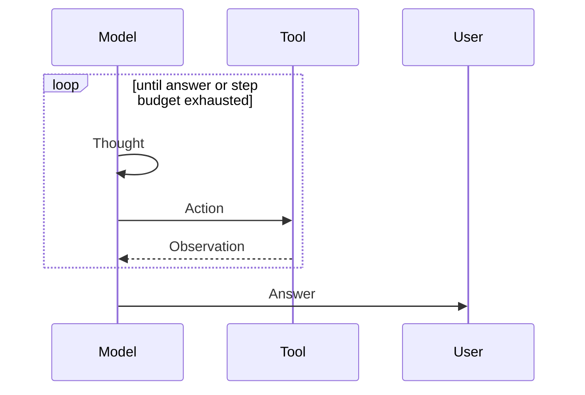

# ReAct

**Also known as:** Reason+Act, Think-Act-Observe Loop

**Category:** Planning & Control Flow  
**Status in practice:** mature

## Intent

Interleave a single thought, a single tool call, and a single observation per step so the agent reasons over fresh evidence.

## Context

A team builds an agent for a task that cannot be answered from the model's parametric knowledge alone — it has to look something up, query a database, search the web, or take an action against a real system. The next step often depends on what the previous tool call returned, so the agent cannot plan all the calls up front. Tool calls cost latency and money and may have side effects, so each one needs to be deliberate.

## Problem

Pure chain-of-thought reasoning produces fluent, confident answers that hallucinate the facts a tool would have returned. Pure tool-blasting — calling several tools speculatively per turn — wastes calls on the wrong things, returns more results than the model can use, and gives the agent no chance to think between calls. Without a structured interleave of reasoning and action, the agent either guesses or thrashes, and the loop has no clean place to put a step budget or a termination check.

## Forces

- Tool calls are expensive (latency, cost, side effects).
- Observations change the right next step.
- The loop must terminate.

## Therefore

Therefore: interleave one Thought, one Action, and one Observation per step inside a bounded loop, so that the agent reasons over fresh tool evidence instead of either hallucinating from pure thinking or blasting tools blind.

## Solution

On each step the agent emits Thought (private reasoning), Action (one tool call), Observation (the tool's result). Repeat until the agent decides to answer. A step budget bounds the loop.

## Structure

```
[Thought_i, Action_i, Observation_i] for i in 1..N, then Answer.
```

## Diagram



*ReAct alternates Thought, Action, Observation until the model decides it has an answer or a budget halts the loop.*

## Example scenario

A travel-planning chatbot is asked, 'Find me a flight from Oslo to Tokyo next Tuesday under €800.' It thinks: 'I should check flights.' It calls a flight-search tool. The result shows three options. It thinks again: 'The cheapest is on a Tuesday morning — that fits.' Each step it sees what the previous tool call returned, then decides what to do next.

## Consequences

**Benefits**

- Lowest-overhead path for simple lookups and single-field updates.
- Easy to inspect and debug step by step.

**Liabilities**

- Sequential by nature; long traces are slow and expensive.
- No global plan; the agent can wander.

## Failure modes

- Wandering trace — with no global plan, the agent follows one interesting observation after another and drifts away from the question.
- Budget exhaustion — the step budget runs out mid-investigation, and the agent stops with no answer or answers early to fit.
- Slow long traces — every step waits on the last, so a task with many lookups takes far longer and costs far more than its parts.
- Ignored observation — the thought step restates the prior belief instead of reading the tool result, and the agent repeats the same call.

## What this pattern constrains

Each step the model may call exactly one tool; reasoning between calls is not actuated.

## Applicability

**Use when**

- The next action depends on what was learned from the previous action.
- The agent needs tool access during a multi-step task.
- Outputs from tools are short and inspectable so the model can react to them.

**Do not use when**

- The full plan is known up front; Plan-and-Execute commits earlier.
- Latency is critical; each iteration adds a model round-trip.
- Tool results are large; they will dominate the context window.

## Components

- Thought slot — private reasoning emitted by the model per step
- Action slot — exactly one tool call per step
- Observation slot — the tool's result fed back to the model
- Step-budget guard — bounds the loop so it terminates
- Termination check — model decides when to emit the final answer

## Tools

- LLM API — invoked once per Thought-Action step
- Tool catalogue — the actions available per step (search, code exec, retrieval, etc.)
- Step-budget counter — enforces the loop bound

## Evaluation metrics

- Steps to answer — average loop length on representative tasks
- Tool-call necessity rate — fraction of actions that genuinely advanced the answer
- Step-budget exhaustion rate — runs that hit the bound without answering
- Hallucinated-fact rate — answers asserting facts no observation supplied
- Per-step round-trip latency — wall-clock cost of one Thought-Action-Observation cycle

## Known uses

- **Bobbin (Stash2Go)** _available_ — observe node + route_after_observe edge in LangGraph.
- **[LangChain AgentExecutor (default)](https://python.langchain.com/docs/how_to/agent_executor/)** _available_
- **[Claude Code](https://docs.claude.com/en/docs/claude-code/overview)** _available_
- **[Cursor](https://cursor.com/)** _available_
- **GitHub Copilot agent** _available_
- **[Devin](https://docs.devin.ai/get-started/devin-intro)** _available_

## Related patterns

- _alternative-to_ **Plan-and-Execute**
- _uses_ **Tool Use**
- _used-by_ **Agentic RAG**
- _alternative-to_ **Planner-Executor-Observer**
- _used-by_ **Language Agent Tree Search**
- _used-by_ **Computer Use**
- _specialises_ **Self-Ask**
- _composes-with_ **Code Execution**
- _generalises_ **Code-as-Action Agent**
- _generalises_ **Augmented LLM**
- _specialises_ **Rumination Agent**
- _complements_ **Incremental Model Querying**
- _alternative-to_ **Agentic Behavior Tree**
- _used-by_ **Managed Agent Runtime**
- _composes-with_ **Attentive Reasoning Queries** — An ARQ blueprint can structure the reasoning step inside a ReAct loop.
- _complements_ **Deliberation Over Observation** — The failure happens inside a working reason-and-act loop with native function calling; adopting the loop does not resolve it, because the model still chooses to extend the chain rather than emit the call.

## References

- [ReAct: Synergizing Reasoning and Acting in Language Models](https://arxiv.org/abs/2210.03629) — Yao, Zhao, Yu, Du, Shafran, Narasimhan, Cao, 2022
- [Building Effective Agents](https://www.anthropic.com/research/building-effective-agents) — Anthropic, 2024
